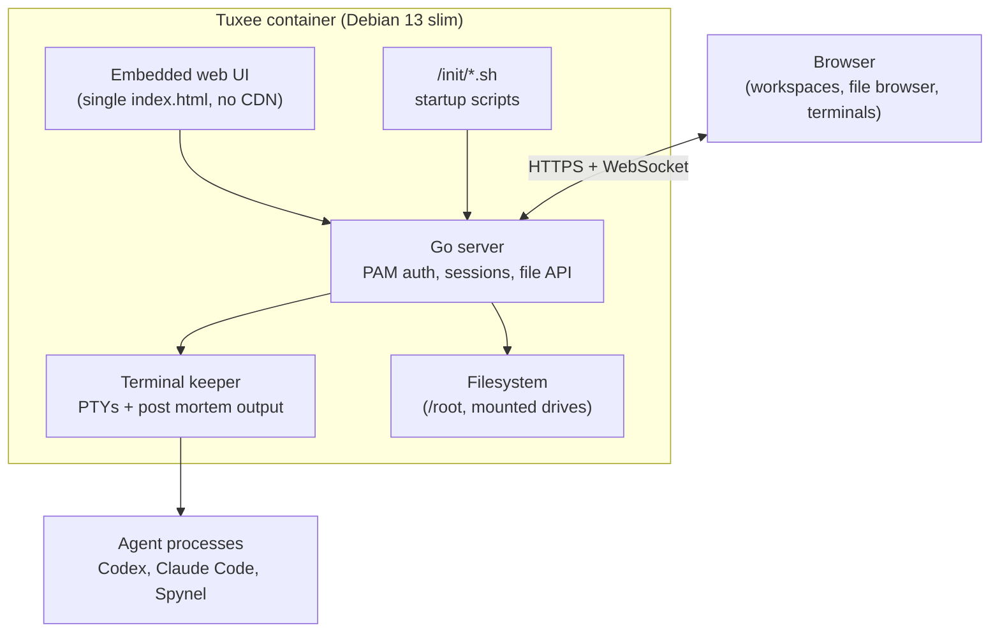

import Card from '@site/src/components/Card/Card';
import CardGroup from '@site/src/components/Card/CardGroup';
import Steps from '@site/src/components/Steps/Steps';
import Step from '@site/src/components/Steps/Step';
import Tabs from '@theme/Tabs';
import TabItem from '@theme/TabItem';
import Accordion from '@site/src/components/Accordion/Accordion';
import AccordionGroup from '@site/src/components/Accordion/AccordionGroup';

# Tuxee - Linux Container for AI Agents

:::info
Tuxee is a tiny Debian 13 (Trixie) slim container with a web interface for **files** and **persistent terminals**. A single Go executable serves the UI, authenticates against real Linux accounts through PAM, and keeps your shells alive when you close the tab. The project advertises roughly **60 MB image**, **about 1 second startup** and **10 to 20 MB of RAM** when idle. It is built by the Agent Zero team and is MIT licensed.
:::

Most agent tooling assumes an interactive terminal you keep open. Tuxee flips that: the terminal lives on the server, and the browser is only a viewer. Close the laptop, reconnect from a phone, or let a coding agent keep working overnight - the shell, its PTY and its child processes are unaffected.

## Why Tuxee for agents

- **Terminals survive disconnects** - logout, reload, workspace switch or a lost connection does not kill the shell or the agent running inside it. This is the same property `tmux` gives you, but with files and a UI on top.
- **Real Linux, not a sandbox abstraction** - a Debian userland with `apt`, `git`, `python3` and everything else. Install Codex, Claude Code, OpenCode or Spynel the normal way.
- **File browser built for handing over context** - drag a file from your desktop into a terminal and Tuxee uploads it to `~/uploads` and types the quoted path. No `scp`, no base64 pasting.
- **Zero configuration** - one `docker run`, no config file, no reverse proxy required for local use.
- **Isolation from your host** - the container holds the agent's credentials, repos and mess, and you throw it away when done.

:::tip
Tuxee is the environment, not the agent. Pair it with [Spynel](https://github.com/agent0ai/spynel) for one chat that orchestrates many coding harnesses, or run coding agents directly in its terminals.
:::

## Architecture



The container persists three volumes:

| Container path | Data |
| --- | --- |
| `/var/lib/tuxee` | Server state, TLS certificates, instance ID |
| `/root` | User files, settings, saved workspace layouts |
| `/init` | Startup scripts run on each container start |

## Quick Start

<Tabs>
  <TabItem value="docker" label="Docker" default>

```sh
docker run -p 80:80 -p 443:443 -e ROOT_PASSWORD='your-password' agent0ai/tuxee
```

Open `https://localhost/` and sign in as `root`. If you omit `ROOT_PASSWORD`, the entrypoint generates a random 32-character password and prints it **once** in the container logs. Change it immediately with `passwd` in a Tuxee terminal.

  </TabItem>
  <TabItem value="compose" label="Compose">

```bash
ROOT_PASSWORD='your-password' docker compose up -d
docker compose logs -f tuxee
```

The supplied Compose file pulls the published `amd64`/`arm64` image, publishes 80 and 443, and keeps the three volumes above as named volumes. Separate Compose projects get separate volumes.

  </TabItem>
  <TabItem value="native" label="Native Linux">

```bash
curl -fsSL https://tuxee.agent-zero.ai/install.sh | sudo sh
sudo tuxee service install --hosts admin.example.com
sudo tuxee service start
```

Native mode manages the **host's real accounts** instead of container accounts, which makes it a drop-in replacement for SSH plus a file manager. Requires glibc 2.36+ with PAM and NSS; Alpine/musl and 32-bit systems are unsupported.

  </TabItem>
</Tabs>

<Steps>
  <Step title="Choose a password source">
    Prefer `ROOT_PASSWORD_FILE` with a bind-mounted file or a Compose secret over the plain `ROOT_PASSWORD` environment variable, which stays visible in container metadata. Do not set both.
  </Step>
  <Step title="Pick your ports">
    Internal listeners default to 80 and 443 and can be moved with `TUXEE_HTTP_PORT` / `TUXEE_HTTPS_PORT` (setting one to `0` disables that protocol). Only the Docker port mapping needs to change for host-side ports, for example `-p 8080:80 -p 8443:443`.
  </Step>
  <Step title="Decide on TLS">
    Automatic certificates use TLS-ALPN-01 and need public TCP 443 to reach Tuxee. Until issuance succeeds you get a locally generated certificate, so expect a browser warning. Behind Traefik, Caddy or another TLS-terminating proxy, forward the domain and WebSockets to **container port 80** and let the proxy own certificates.
  </Step>
  <Step title="Mount your work">
    Add a bind mount for the repos or data the agent should see. Skip mounting your whole home directory - the agent runs with the permissions you give it.
  </Step>
</Steps>

## UI Usage

The UI is a small window manager in the browser: a top bar with workspace tabs and resource widgets, and below it a 4x2 grid of panels.

### Login and workspaces

- Sign in with a real Linux username and password. PAM handles authentication and account policy; Tuxee never stores passwords. Container mode manages the container's accounts only.
- Each **workspace** is a tab holding up to eight components on a fixed 4x2 grid (2x4 in portrait). Twelve workspaces per user.
- Tabs can be renamed, reordered by dragging, and closed. Closing a workspace terminates its terminals.
- New workspaces open with a sensible default: two file browsers and one terminal on wide screens, one of each on mobile.

### Panels: file browsers and terminals

Only two component types exist, and that is the point.

- **File browser** - editable path bar, breadcrumbs-free navigation, keyboard-driven selection (`Up`/`Down`, `Right` to enter, `F2` rename, `Delete` to trash), multi-select, properties with recursive size calculation, copy/cut/paste, ZIP download with streaming progress, and archive compress/extract via the installed tools.
- **Terminal** - a real PTY under your Linux UID, GID and supplementary groups. `Ctrl+C` interrupts, `Ctrl+Shift+C` copies, and selecting text uses the browser's normal copy path. Touch devices scroll output by dragging.
- **Layouts** - drag panels anywhere on the header, resize from edges or corner grips, and drop onto grid highlights to snap, split or swap. Invalid drops return to the original spot.
- **Auto layouts** - the reflow button cycles Balanced, Terminals, Files and your saved Custom layout, and the icon rotates to show the current mode. Manual edits reset the cycle.
- **Mobile** - the grid becomes a borderless tab bar with component icons; add and rearrange controls sit at the right edge.

### Moving files in and out

Drag files from your desktop onto a file browser to upload into the current folder, or onto a terminal to drop them in `~/uploads` and insert shell-quoted paths without pressing Enter. Folder structure and empty folders are preserved, collisions get numbered suffixes, and existing data is never overwritten. Pasting a screenshot into a terminal uses the clipboard upload path.

Downloads stream back the other way: single files directly, folders and multi-selections as a ZIP compressed on the fly with a cancel button.

### Editing and viewing

Double-clicking a file opens the bundled CodeMirror 6 editor (syntax highlighting by extension, search and replace, line wrap, 1 MiB pages for large files) or a native viewer for images, PDF, audio and video. Saves validate the original page hash before replacing the file atomically, so a stale tab cannot silently overwrite newer content.

### Retained terminals

This is the feature that matters for agent work.

- Terminals keep running with no idle timeout. Logout, reload and browser crashes do not end them.
- **Retained terminals** lists live sessions outside your workspaces plus dead terminals that were not explicitly closed. Use **Connect** for a live one, **View** for its last output.
- When a shell exits, the panel shows the transcript with **Post mortem** and **Restart**. Output is stored as plain text under `~/.local/state/tuxee/terminals/`, so ordinary tools can read it.
- Retention for explicitly closed terminals defaults to 168 hours and is configurable in Settings.

### Settings worth knowing

| Setting | Effect |
| --- | --- |
| Default directory | Starting folder for new terminals and file browsers (default `~`) |
| Shell command | Command for new terminals, for example `zsh` or `/bin/bash --login` |
| Terminal background | Applies to open and detached terminals without restarting them |
| Keep closed terminals history | Hours before a closed terminal's transcript is discarded |
| Resource widgets | CPU, RAM, disk and network in the header, plus a process monitor with kill |

The user menu also exposes **Restart Tuxee** and an update check. A runtime restart preserves terminals and running agents but signs everyone out; restarting the container or the host ends them.

## Running agents inside Tuxee

<AccordionGroup>
  <Accordion title="Coding agents in a terminal" icon="lucide:terminal">
    Install the harness you use and run it in a terminal panel. Because the PTY is owned by the server, the agent keeps going when you close the laptop. Come back later, reconnect and read the output, or leave it in a retained terminal and poll it from a phone.

    ```bash
    # inside a Tuxee terminal
    npm install -g @anthropic-ai/claude-code   # or codex, opencode, etc.
    cd /root/work && claude
    ```
  </Accordion>
  <Accordion title="Long-running services via /init" icon="lucide:play">
    Every container start runs each `/init/*.sh` script in parallel, as root, with no ordering guarantee. Use it to launch a sidecar, a bot or a persistent agent daemon. Scripts are not restarted automatically, so wrap anything critical in a loop. Restarting Tuxee does not rerun them; restarting the container does. Native installs ignore this folder.
  </Accordion>
  <Accordion title="Spynel and Agent Zero" icon="lucide:network">
    Tuxee comes from the same team as [Agent Zero](https://github.com/agent0ai/agent-zero) and [Spynel](https://github.com/agent0ai/spynel). Spynel is a terminal orchestrator with no model of its own: it drives Claude Code, Codex and other harnesses, keeping tasks in Markdown and coordinating many agents from one chat. Running it inside Tuxee gives that chat a persistent home with a browser front end.

    Agent Zero itself bundles a full Linux desktop and works in its own container; Tuxee is the lighter option when you only need files and terminals.
  </Accordion>
  <Accordion title="GUI applications (optional)" icon="lucide:app-window">
    Launching a GUI program such as `xterm` from a terminal can render its window in the browser over a local VNC proxy, with no extra port, browser extension or privileged container. This requires the GUI-capable build (`tuxee-Xvnc`); the display starts on first use and is reclaimed a couple of seconds after the last window closes.
  </Accordion>
</AccordionGroup>

## Caveats

:::warning
The upstream docs still describe Tuxee as a **built, locally validated prototype, not a production release**, and call the root server "a privileged management surface" that needs a security review before public deployment. Treat it accordingly.
:::

- **Never expose plain HTTP.** Credentials and terminal traffic are unencrypted on port 80. Use the built-in HTTPS listener or a TLS-terminating proxy on the same private network.
- **Root is root.** The container image has no `sudo` and runs as `root`, so anything that reaches the terminal owns the container. Do not mount host paths you would not give the agent, and do not mount the Docker socket casually.
- **Recreating the container resets accounts.** Password changes survive restarts, but a recreated container initializes a fresh account database from `ROOT_PASSWORD` or a new random password.
- **Container restart ends terminals.** Tuxee restarts and updates preserve guardian-backed terminals; a container or host restart does not.
- **PAM authentication only.** Login sessions use PAM and account policy, but PAM session modules and systemd-logind integration are not implemented.
- **Not an agent sandbox.** Tuxee isolates the agent from your host, not from you or from itself. It has no per-agent quotas or permission model beyond normal Linux users.

## Tuxee vs the alternatives

| | Tuxee | SSH + tmux | ttyd / wetty | Plain Docker exec |
| --- | --- | --- | --- | --- |
| Persistent terminals | Yes, server-side | Yes | Depends on tmux | No |
| File manager UI | Yes | No | No | No |
| Browser access | Built in | Needs client | Yes | No |
| Auth | PAM, real accounts | SSH keys | Usually a token | Docker socket |
| Setup | One `docker run` | Server config | Reverse proxy, service | Manual |
| Footprint | ~60 MB image | Minimal | Small | Image dependent |

## Resources

<CardGroup cols={2}>
  <Card title="GitHub Repository" href="https://github.com/agent0ai/tuxee" icon="mdi:github">
    Source, issue tracker and the full guide.
  </Card>
  <Card title="Docker Hub" href="https://hub.docker.com/r/agent0ai/tuxee" icon="mdi:docker">
    Published amd64 and arm64 images.
  </Card>
  <Card title="User Guide" href="https://github.com/agent0ai/tuxee/blob/main/docs/guide.md" icon="mdi:book-open-variant">
    Every UI behavior, port setting and storage detail.
  </Card>
  <Card title="Spynel" href="https://github.com/agent0ai/spynel" icon="mdi:robot">
    The orchestration layer meant to run inside Tuxee.
  </Card>
</CardGroup>

## References

- **Video walkthrough** - [Tuxee - the most convenient Linux for servers and agents](https://youtu.be/RdexB39ISjg)
- **GitHub repository** - [agent0ai/tuxee](https://github.com/agent0ai/tuxee)
- **User and developer guide** - [docs/guide.md](https://github.com/agent0ai/tuxee/blob/main/docs/guide.md)
- **Installation** - [docs/install.md](https://github.com/agent0ai/tuxee/blob/main/docs/install.md)
- **Docker image** - [agent0ai/tuxee on Docker Hub](https://hub.docker.com/r/agent0ai/tuxee)
- **Agent Zero** - [agent0ai/agent-zero](https://github.com/agent0ai/agent-zero)
- **Spynel** - [agent0ai/spynel](https://github.com/agent0ai/spynel)
- **Announcement** - [Agent Zero on X](https://x.com/agent0ai/status/2114721217798361525)
