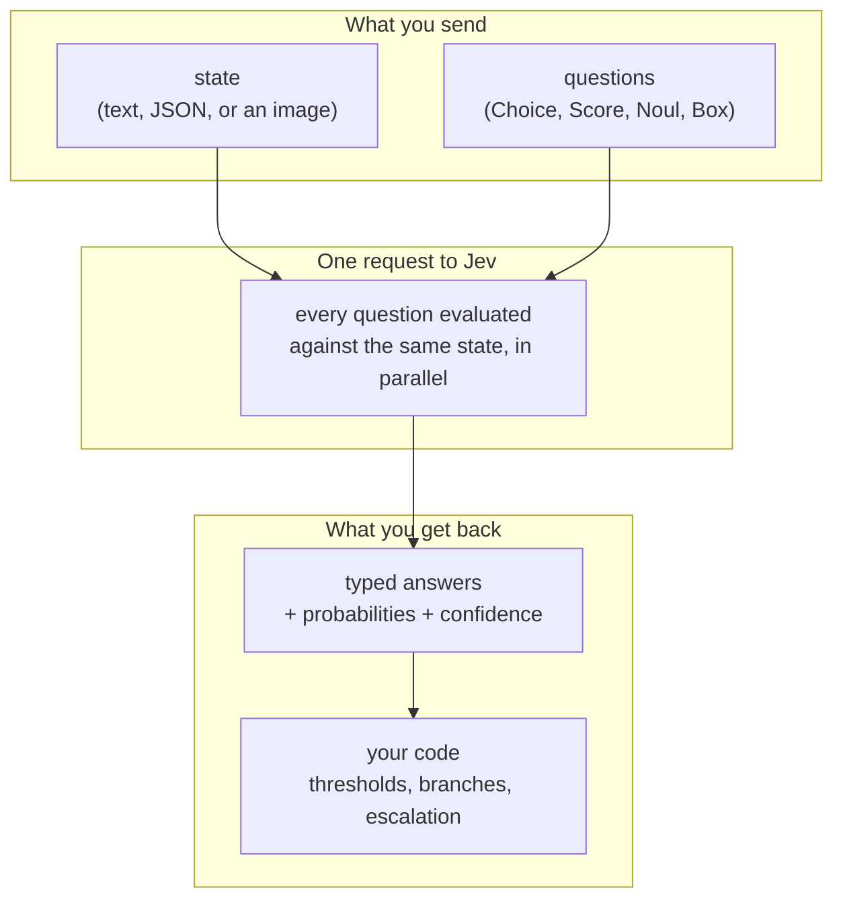

import Steps from '@site/src/components/Steps/Steps';
import Step from '@site/src/components/Steps/Step';
import Accordion from '@site/src/components/Accordion/Accordion';
import AccordionGroup from '@site/src/components/Accordion/AccordionGroup';

# Jev Decision Model

**Jev** is the flagship model from **TypeSafe AI** and the first of a class the company calls **System One models**. It does not chat, write prose, or generate code. You send it a **state** (a message, a ticket, a JSON record, a document, an image) and a set of **typed questions**, and it returns a decision for each one: an option from a list you defined, a position on a scale you defined, or a probability that a statement is true.

The point is the shape of the answer, not the wording of it. A chat model asked "is this ticket urgent?" writes a sentence and you parse it. Jev returns `0.94` for the statement "this ticket is urgent", plus an estimate of how sure it is. That is a value a normal `if` statement can use, and it is the reason people are using it as the decision layer inside agents and back-office workflows rather than as a replacement for their LLM.

:::tip
This article covers what Jev is, what it is for, and when to reach for it. For a point-by-point comparison with the open decision model THX-02, see [THX-02 vs Jev](../comparatives/thx-02-vs-jev.md).
:::

## What you get back

Every request produces one answer per question. There are four question types, and they are the whole vocabulary:

| Question type | What you ask | What comes back |
|---|---|---|
| **Choice** | Pick one option out of a list you define, up to 255 options | `choice`, a probability for every option, `confidence` |
| **Score** | Place the state on an ordered rubric, from 2 to 10 levels | `score`, which can land between levels, a probability per level, `confidence` |
| **Noul** | Is this statement true? | `noul`, a number from 0 to 1 |
| **Box** | Where is this thing in the image? | `box` with `top`, `bottom`, `left`, `right` as fractions of the image, `confidence` |

`Box` needs Jev 1.14 or newer. The other three work on every current model.

The name **Noul** is TypeSafe's own; it plays the role of a yes/no classifier. A Noul answer has no separate `confidence` field because the probability already carries the uncertainty: values near 0.5 mean the model is genuinely unsure, and the docs suggest treating 0.7 and above as yes, 0.3 and below as no, and giving the band between them its own outcome in code.

## A different shape from an LLM

TypeSafe trains Jev with **Reinforcement Learning for Calibrated Decisions (RLCD)**, an objective that rewards honest probabilities instead of text people like to read. That single choice is where the rest of the differences come from:

- **The answer space is closed.** Define three categories and Jev will return one of those three. It cannot invent a fourth, so there is no JSON repair step and no mystery label to handle at 3 a.m.
- **The answer carries its own uncertainty.** Probabilities are trained to match outcomes across many predictions, so a threshold on `confidence` is a stated risk tolerance rather than a guess.
- **Questions are independent.** Every question in a request is answered against the same state, in parallel and in isolation. Adding a fifth question barely changes the latency, and no question quietly becomes context for another.
- **There is no prose to parse.** Nothing upstream has to decide whether the model answered the question or told a story about the question.

That is also why TypeSafe's own docs are blunt that Jev is not an agent. It does not choose its next action, hold a conversation, or write code. Code owns the workflow and calls the model where a judgement is needed.

## How one request works



A request is one `POST /v1/systemone` call, or one call through the Python or JavaScript SDK. It fits two context limits: 64k tokens per request and 32k tokens per question. A `TypeSafe-Danger-Zone-Long-Context: true` header raises both to 262k tokens, off by default because it is slower and less accurate.

There is no separate limit on the number of questions, only on the context they fit into. That is what makes the batching pattern work: ask everything you might need about the same state in one call, then let code decide which answers matter on this path.

## What it costs and how fast

| | Jev 1.14 | Jev 1.13 |
|---|---|---|
| Model ID | `jev-1.14.0` | `jev-1.13.0` |
| Price | $42 per billion input tokens, $0.042 per million | same |
| Output tokens | Free | Free |
| Context | 64k per request, 32k per question | same |
| Input | Text, images | Text, images |
| Question types | Choice, Score, Noul, Box | Choice, Score, Noul |

`jev-latest` points at 1.14. TypeSafe reports end-to-end response times of 70 to 500 ms and describes most calls as about 100 ms, which is the number that decides whether you can put a decision in a request path or a user interface.

:::info
The homepage figure of **193.6x faster and 444.6x cheaper** comes from TypeSafe's own workflow evaluations, where the reference answer is the average of two frontier LLMs working through the same decision graph. The company says to expect these to be on the higher end of real-world gains, so treat them as a ceiling and not as your saving.
:::

The claim that actually holds up under scrutiny is simpler. Most of the steps inside an agent are not writing tasks. They are routing, classifying, checking, and scoring, where the answer was always one of two or three values. Replacing a full generation call with a 100 ms typed decision on each of those steps is where the money and the latency go.

## What it is good for

The documentation organises the same four primitives into a long list of shapes. The recurring ones:

- **Routing.** Which model, tool, queue, or team should handle this? The `choice` plus its probabilities is directly a router, and the confidence tells you when to escalate instead.
- **Triage at volume.** Department, urgency, refund request, and churn risk in a single request over the same message, with each answer independently thresholded.
- **Guardrails for other models.** Screen prompts, completions, tool calls, citations, and reasoning traces for jailbreaks, hallucinations, policy violations, or dangerous commands, at a fraction of the cost of the call being checked.
- **Verification.** Check whether a quoted passage supports a claim, whether an answer follows from the paragraphs it was given, or whether a tool call actually matches the user's request.
- **Ranking and retrieval.** Score a shortlist against a plain-language query, or pick which retrieved passages are worth sending to the answering model.
- **Real-time decisions.** TypeSafe's own demos include a browser agent picking its next click and a bot deciding once per game tick. Anything that has to keep up with a UI or a game loop is the natural home for a model this fast.

And a pattern practitioners keep reinventing: put the reasoning model in charge of the hard thinking and let Jev pick between the options the harness prepared. The harness owns the menu, Jev picks from it, the harness checks the pick. That keeps the expensive model doing what it is good at and takes the cheap decisions off its bill.

## When to use it

A community write-up reduces the "should this be a Jev decision?" question to three checks. They are not official, but they line up with what the docs say, and they are a good filter:

<AccordionGroup>
  <Accordion title="1. Can you write down every valid answer in advance?" icon="mdi:format-list-bulleted">
    If the set of acceptable outputs is closed (three teams, five risk levels, yes or no), Jev fits. If the output is open-ended, it is a writing task and you want a generative model.
  </Accordion>

  <Accordion title="2. Would a fast human glance settle it?" icon="mdi:eye-outline">
    Jev is a gut-check model. If judging the situation correctly needs real reasoning or several dependent steps, a classifier-shaped call is the wrong shape, however cheap it is.
  </Accordion>

  <Accordion title="3. Does it happen often enough to matter?" icon="mdi:counter">
    A decision you make five times a week does not need a 200x speedup. A decision you make five thousand times a day does, and that is where the price difference starts paying for the engineering.
  </Accordion>
</AccordionGroup>

Three yeses and the decision is a real candidate. One no and the honest move is to leave it where it is.

Two more practical signals, both from the docs:

- **The judgement is semantic.** Reading intent, relevance, tone, severity, or policy fit out of messy text. That is what the model is trained for.
- **The decision should be debuggable.** Because the options are yours and the probabilities are explicit, you can log the candidates, the pick, the threshold, and the outcome. That is much easier to audit than a paragraph of reasoning.

## When not to use it

These are the documented failure modes, not opinions:

- **Writing anything.** Summaries, replies, reports, code, explanations. Jev is not trained to generate text. Chaining choices to fake a sentence works badly and slowly.
- **Arithmetic, counting, and dates.** Jev is not a calculator and does not count reliably. It also reads dates as text rather than ordered quantities, so "which of these is earlier" is unreliable. Extract with the model, compute in code.
- **Multi-step reasoning in one call.** A question about a property of a property costs accuracy. If a decision depends on another decision, that is two requests, not one clever prompt.
- **Open-ended extraction.** When the answer space is unbounded, generate candidates with a regex or an LLM and let Jev pick the right one.
- **Per-customer fine-tuning.** Jev is not fine-tuned or LoRA-adapted on customer data, and the same weights serve every account. You shape behaviour through the request, not through training.
- **Local or air-gapped deployment.** Jev is a hosted API only. If the data cannot leave your network, this is not the model for you.
- **Decisions that need adversarial robustness out of the box.** State is treated as data, not as hostile input, and text written to steer the model can move the answer. Test edge cases before you widen the blast radius.
- **Replacing your coding agent's model.** Jev does not stream text, call tools, or edit files. It is not a drop-in swap for the LLM behind your coding agent; it is a decision layer you call from code.

## Getting started

<Steps>
  <Step title="Get a key">
    Create an API key in the TypeSafe console and put it in an environment variable, so the SDK picks it up.
    ```bash
    export TYPESAFE_API_KEY="your-api-key"
    ```
  </Step>
  <Step title="Install the SDK">
    Python needs 3.10 or newer. The JavaScript SDK needs Node 20 or newer.
    ```bash
    pip install typesafe-sdk
    # or
    npm install @typesafe-ai/sdk
    ```
  </Step>
  <Step title="Ask a few questions at once">
    ```python
    from typesafe_sdk import Choice, Noul, Score, TypeSafeClient

    ticket = "Our API has returned 500 errors for 20 minutes and we cannot process orders."

    with TypeSafeClient(model="jev-latest") as client:
        response = client.system_one(
            state=ticket,
            questions={
                "team": Choice(
                    instructions="Which team should handle this?",
                    criteria={
                        "billing": "Payment and subscription issues",
                        "technical": "Bugs and integration problems",
                        "sales": "Pricing and new accounts",
                    },
                ),
                "urgent": Noul(instructions="Does this need attention right now?"),
                "frustration": Score(
                    instructions="How frustrated is the customer?",
                    criteria=["calm", "annoyed", "angry"],
                ),
            },
        )

    print(response.answers["team"].choice)
    print(response.answers["urgent"].noul)
    ```
  </Step>
  <Step title="Put the thresholds in code">
    ```python
    team = response.answers["team"]

    if team.confidence < 0.6:
        send_to_human_review(ticket)
    elif response.answers["urgent"].noul > 0.7:
        page_on_call(team.choice)
    else:
        queue(team.choice, ticket)
    ```
  </Step>
</Steps>

The Playground in the console runs the same thing in the browser: paste a state, add questions, read the answers, without writing code. It is the fastest way to find out whether your question is really one question.

## The honest limits

- **Confidence is not correctness.** A high `confidence` means the probability distribution is concentrated, not that the pick is right. It can be confidently wrong, and there is no error message for that. Every source on this page says it in one form or another, and it is the one thing to design around.
- **Calibration is a group property.** Probabilities of 0.8 should be right about 80% of the time across many predictions. That says nothing about any single answer, and it was measured on the training distribution, not on yours. Label a few hundred of your own examples before trusting a threshold.
- **Overlapping categories break it quietly.** Three options that secretly describe the same case will still produce a confident pick, every time. When that happens the fix is rewriting the categories, not the prompt.
- **It reads literally.** Jev answers the question you wrote, not the one you meant. The explanation you find yourself giving after a wrong answer is the missing half of the instruction.
- **Option order can matter.** The model leans toward the first option in some cases. Reorder the options and check that the answer holds.
- **Large irrelevant state costs accuracy.** Unrelated material in the state is a distractor. Filter first, or use a Noul to screen for relevance.
- **Aliases move.** `jev-latest` follows the newest release, so answers can change without a code change. Log the `model` field from each response, and pin a version ID once you have tuned thresholds against it.
- **The product is young.** Jev launched in September 2026. Box answers and images are still marked as work in progress, and the vendor's own failure-mode page says several of its edges will be fixed in later versions.

## References

- [TypeSafe AI homepage](https://typesafe.ai/)
- [Documentation introduction](https://docs.typesafe.ai/introduction)
- [Models and pricing](https://docs.typesafe.ai/models)
- [Confidence](https://docs.typesafe.ai/confidence)
- [Model jaggedness](https://docs.typesafe.ai/model-jaggedness) - the documented failure modes
- [Example use cases](https://docs.typesafe.ai/concepts/use-case-map)
- [How to build with TypeSafe](https://docs.typesafe.ai/concepts/how-to-build-with-system-one)
- [Quick start](https://docs.typesafe.ai/introduction/quickstart)
- [Introducing System One Models and Jev](https://typesafe.ai/blog/introducing-system-one-models-and-jev) - the launch post and its caveats
- [Jev Engineering: The Model That Refuses to Talk](https://x.com/rvaniaaaa/status/2101709732314558639) - practitioner overview and the three-question test
- [How to Build an Agentic Harness using Jev](https://x.com/Av1dlive/status/2102802621664985241) - Jev as a decision layer inside a coding harness
- [THX-02 vs Jev](../comparatives/thx-02-vs-jev.md) - the comparison with the open alternative
