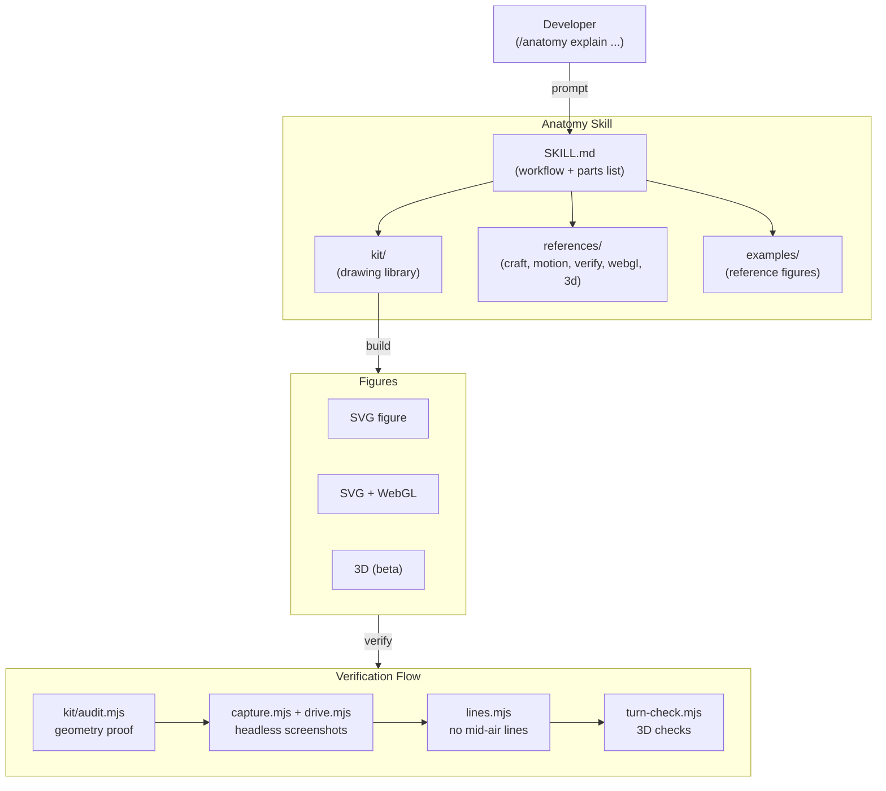

import Tabs from '@theme/Tabs';
import TabItem from '@theme/TabItem';
import Steps from '@site/src/components/Steps/Steps';
import Step from '@site/src/components/Steps/Step';

# Anatomy

Anatomy is a Claude skill that explains an idea by **building it as a real, working object**. Instead of returning a paragraph or a static diagram, it crafts interactive isometric figures made of many small, precise parts - drawn in SVG, WebGL and true 3D - that you can rotate, inspect and explore. It also runs in OpenCode and Codex through the open Agent Skills standard.

The idea is that some concepts are understood best by watching them move. A token bucket fills and drains. A CDN cache hits and misses. A Raptor engine lights a shader-driven flame. Anatomy turns a prompt into a card with a live readout, eased motion and correctly shaded parts, so the explanation is something you operate rather than read.

:::info
Anatomy is MIT licensed, (c) 2026 Ryan (@wheresryan22), and has gathered roughly **5.5k stars** and 395 forks on GitHub.
:::

## Key Features & Advantages

- **Interactive, not illustrated**: Figures respond to input with a live readout and eased motion, so you can step through the states of a system.
- **Crafted geometry**: Many small precise parts are composed by hand - not a generic icon or stock diagram.
- **Three rendering tiers**: Pure SVG for the core, SVG + WebGL for fire/water/light, and true 3D (beta) for parts that turn.
- **Portable output**: Ships as a standalone HTML file, a lone `.svg` with embedded styles, or React/Next.js components.
- **Zero dependencies**: The kit uses only Node.js built-in modules - no `npm install` required (React output aside).
- **Agent agnostic**: Runs in Claude Code, OpenCode and Codex, and follows the open Agent Skills standard.

## Three Kinds of Figures

| Kind | What it draws | Used for | Examples |
| --- | --- | --- | --- |
| **SVG** (core) | Solid isometric parts with four-tone shading, painted back to front inside a card with a live readout and eased motion | The default figure: honest, self-contained geometry | dial-indicator, desk-computer, arcade-cabinet, test-rig |
| **SVG + WebGL** | A shader in a canvas sandwiched between a back and a front SVG, sharing the same isometric camera | Fire, exhaust, water, caustics, lamp light, glow, steam | raptor-engine, ripple-tank |
| **3D** (beta) | Parts that turn in true 3D | A dial or turntable that spins, fingers that flex, a piece that breaks off and falls | turning-dial |

The SVG core still works without any WebGL: when the shader cannot run, the layered SVG continues to read correctly on its own.

:::warning
**3D mode is beta.** It has been proven on its own example and one test figure, but not yet on a production figure. A small 3D figure runs at 60fps; a 380-part stress figure reaches about 20fps at 1440px and 13-15fps on a throttled phone profile. A full 3D orbit audit over 30 parts can take 15-20 minutes.
:::

## Installation & Setup

Pick the agent you use. The `skills` CLI installs Anatomy into that agent's global skills directory.

<Tabs groupId="agent">
  <TabItem value="claude" label="Claude Code" default>
    ```bash
    npx skills add wheresryan22/anatomy -g -a claude-code
    ```

    Installs to `~/.claude/skills/anatomy`.
  </TabItem>
  <TabItem value="opencode" label="OpenCode">
    ```bash
    npx skills add wheresryan22/anatomy -g -a opencode
    ```

    Installs to `~/.config/opencode/skills/anatomy`.
  </TabItem>
  <TabItem value="codex" label="Codex">
    ```bash
    npx skills add wheresryan22/anatomy -g -a codex
    ```

    Installs to `~/.agents/skills/anatomy`.
  </TabItem>
</Tabs>

You can also clone the repository or download the ZIP and drop the skill folder into the matching directory manually.

<Steps>
  <Step title="Install the skill">
    Run the `skills add` command for your agent from the tabs above, or clone the repo:
    ```bash
    git clone https://github.com/wheresryan22/anatomy
    ```
  </Step>
  <Step title="Confirm Node.js">
    Anatomy targets **Node.js 20.10+** and uses built-in modules only. Check your version:
    ```bash
    node --version
    ```
  </Step>
  <Step title="Point Chrome at the checker">
    The verification scripts drive headless Chrome. If Chrome is not on your `PATH`, set `CHROME_PATH`:
    ```bash
    export CHROME_PATH="/Applications/Google Chrome.app/Contents/MacOS/Google Chrome"
    ```
  </Step>
  <Step title="Generate a figure">
    Ask your agent for an interactive explainer and let it build the object.
  </Step>
</Steps>

## Usage

Type the skill command with the idea you want explained. The word `interactive` asks for something you can operate rather than a static drawing.

```text
/anatomy explain how a token bucket rate limiter works, interactive
```

In Codex you invoke it with `$anatomy`. The skill also loads on its own when you ask for an isometric illustration or an interactive explainer without naming it.

Good prompts name the object and the numbers that must be true:

- **Token bucket rate limiter** - fill and drain with a live readout.
- **CDN edge cache** - cache hit vs miss, TTL 60s.
- **Kubernetes** - an interactive cluster diagram.
- **Bunsen burner** - a WebGL flame.
- **Heat-exchanger espresso machine** - pipes, steam and temperature flow.
- **Database connection pooling** - output as a React component.

:::tip
**Three habits for the best figures:**
1. **Name the idea, not the drawing** - give real numbers so the figure is honest about its sizes.
2. **Or name the object and what should move** - describe the machine and the motion you want to see.
3. **Say where it will live** - standalone HTML, a lone SVG, or a React/Next.js component, and whether it is light or dark.
:::

## How It Works

Anatomy's `SKILL.md` defines a fixed workflow: **collect true numbers first, invent the object, write a parts list, plan the world, build the geometry once with the kit, paint back to front, frame it, make it live, then verify like a critic.** The `kit/` directory is the drawing library, `references/` holds the long-form guides, and `scripts/` runs the automated checks.



The `kit/` library holds the isometric camera, the solids and parts in `iso-kit`, `lathe.mjs` for round parts, `tube.mjs` for pipes and cables, `gl.mjs` for WebGL, the `turn*.mjs` 3D helpers, and the React components. Everything is dependency-free except React for React output.

Verification is treated as a first-class step. `kit/audit.mjs` proves the geometry: nothing passes through anything, ends sit on their mounts, and the depth order is correct. `scripts/capture.mjs` and `drive.mjs` take screenshots, close-ups and contact sheets in headless Chrome. `scripts/lines.mjs` fails any line that ends in mid-air, and `scripts/turn-check.mjs` checks the 3D output.

## Requirements

- **Agent**: Claude Code, OpenCode, or Codex.
- **Node.js 20.10+** - built-in modules only, no `npm install`.
- **Chrome or Chromium** - required for the checks; set `CHROME_PATH` if it is not on your `PATH`.
- **React 18+** - only when you request React/Next.js output.

:::warning
**Codex sandbox caveat.** The skill starts headless Chrome for its checks, which the Codex sandbox may block. Either approve the command so it runs outside the sandbox, or set `approval_policy = "on-request"` with `sandbox_mode = "workspace-write"` and `network_access = true`. You can also run the check manually outside the agent.
:::

## Limits

- **Not a chart library.** There are no axes, series or data plots. Numbers appear as live readouts and as true sizes and counts, not as graphs.
- **Draws machines, not people.** Instruments, tools and furniture are in scope; characters and exact maps are not.
- **Slow on purpose.** A Raptor build takes a few minutes; a full 3D orbit audit can run 15-20 minutes for 30 parts.
- **Shaders need WebGL.** The canvas effects require a WebGL-capable runtime; the SVG layers still read without it.
- **Reduced motion goes still.** Under a reduced-motion preference every figure stops animating.

:::tip
Use `interactive` in the prompt only when you actually want motion. For a static figure, omit it - the skill will still shade and layer the parts correctly.
:::

## References

- [GitHub Repository](https://github.com/wheresryan22/anatomy)
- [Project Site](https://skills.wheresryan.sh/anatomy)
- [Community Showcase - Opus 5.5 + /anatomy skill](https://x.com/0xMovez/status/2109334686488990093)
- [Community Showcase - Spanish walkthrough](https://x.com/midudev/status/2109631140571054251)
- [Agent Skills Standard](https://agentskills.io)
