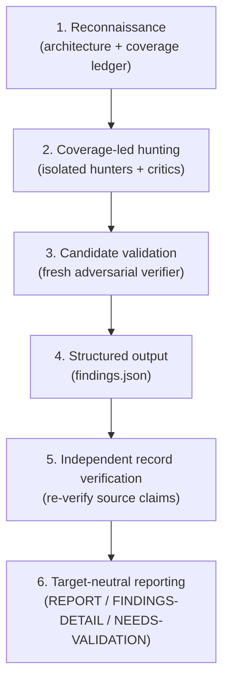

import Steps from '@site/src/components/Steps/Steps';
import Step from '@site/src/components/Steps/Step';

# Cloudflare Security Audit Skill

The [Cloudflare Security Audit Skill](https://github.com/cloudflare/security-audit-skill) turns a coding agent into a **security auditor**. Instead of a single pass with a hopeful summary, it orchestrates a pipeline of isolated agents through six phases that map a codebase, hunt for boundary failures, and independently verify every claim before it reaches a report.

The skill is the seed of Cloudflare's [vulnerability discovery harness](https://blog.cloudflare.com/build-your-own-vulnerability-harness), open-sourced under the MIT license. It surfaced publicly on X when [@midudev](https://x.com/midudev/status/2100208810308575437) highlighted it on Sep 16, 2026.

## The Six Phases



### 1. Reconnaissance

The parent agent maps the target's architecture, trust boundaries, input surfaces, and any prior evidence. It also computes deterministic coverage so later phases know which units still need attention. Output lands in two machine-readable artifacts: `architecture.md` and `coverage-ledger.json`.

### 2. Coverage-led Hunting

Hunters are assigned from the units listed in the ledger, never ad hoc. Each isolated hunter explores one assigned unit and records the checks it performed. Coverage critics then review the checks to surface gaps and feed missing units back into the ledger.

### 3. Candidate Validation

Every unique candidate is routed to a **fresh verifier that tries to disprove it**. The agent that discovered a candidate never gets to validate its own work, which keeps confirmation from becoming a rubber stamp.

### 4. Structured Output

Validated results are written to `findings.json` as `confirmed`, `needs_validation`, or `rejected` records. The file is validated against `report-schema.json` before it is accepted.

### 5. Independent Record Verification

Fresh agents re-verify the final source claims behind each confirmed record. When a record was materially replaced during validation, it gets yet another independent verifier before it can count as confirmed.

### 6. Target-Neutral Reporting

The final reports - `REPORT.md`, `FINDINGS-DETAIL.md`, and `NEEDS-VALIDATION.md` - are derived from the verified records plus the coverage ledger. Because reporting is target-neutral, the same records work for any codebase the skill runs against.

The parent agent runs `validate-coverage-ledger.cjs` after the ledger is created and after every update, and runs `validate-findings.cjs` during Phase 4 and after every Phase 5 replacement.

## Verdict Types

| Verdict | Meaning |
| :--- | :--- |
| `confirmed` | Complete source trace plus a bounded, observed result. |
| `needs_validation` | An exact unresolved fact, with no severity assigned. |
| `rejected` | A candidate that was actively disproved. |

## Design Principles

- **Confirm only established boundary failures.** A source-grounded blocked lead stays as `needs_validation`, carrying its exact unresolved fact rather than a guess.
- **Adversarial validation.** The agent that checks a finding is never the agent that found it.
- **Severity requires impact.** Severity is likelihood multiplied by impact, not deviation from a checklist.
- **Defense-in-depth gaps are not vulnerabilities.** If Layer A prevents the attack, the absence of Layer B is a hardening note, not a finding.
- **Multiple runs improve coverage.** A single run found roughly half of the vulnerabilities that repeated runs found in total. Runs are additive and use prior ledgers and findings to target the remaining gaps.

## Installation & Usage

<Steps>
  <Step title="Install the skill">
    ```bash
    npx skills add https://github.com/cloudflare/security-audit-skill --skill security-audit
    ```

    Add `--global` to install at the user level instead of the current project.
  </Step>
  <Step title="Start the agent in the target codebase">
    Open your coding agent with the repository you want audited as the working directory.
  </Step>
  <Step title="Ask for the audit">
    ```text
    security audit this codebase
    find security vulnerabilities in ./src
    do a security review, output to ~/audits/my-project
    ```
  </Step>
  <Step title="Review the output">
    Findings land under the output directory, by default `~/security-audit-skill/<repo-name>/run-<N>`.
  </Step>
</Steps>

The skill activates on security audit, find vulnerabilities, or pen-test requests. It supports a full audit mode as well as a lighter guidance mode for advice without a full run.

## Requirements

- A coding agent with a model that supports tool use and parallel sub-agents.
- Node.js for the zero-dependency validators.
- An OS-enforced sandbox. Without it, agents lose disabled external networking, a sanitized allowlisted environment, resource limits, and write access restricted to assigned scratch paths - and unverified leads stay `needs_validation`.

## Files Overview

| File | Purpose |
| :--- | :--- |
| `SKILL.md` | Top-level entry point and phase orchestration. |
| `RECONNAISSANCE.md` | Phase 1 guidance for architecture mapping and coverage. |
| `HUNTING.md` | Phase 2 guidance for coverage-led hunting and critics. |
| `VALIDATION-AND-REPORTING.md` | Phases 3-6 guidance for validation and reporting. |
| `report-schema.json` | Schema that every `findings.json` record must satisfy. |
| `validate-findings.cjs` | Zero-dependency validator for findings records. |
| `validate-coverage-ledger.cjs` | Zero-dependency validator for the coverage ledger. |

Additional hunt-class reference files give hunters class-specific checklists: `ATTACK-CLASSES.md`, `MEMORY-SAFETY-AND-BINARY.md`, `AI-AND-LLM.md`, `WEB-PROTOCOL-AND-AUTH.md`, `CLIENT-SIDE.md`, `SUPPLY-CHAIN-AND-RELEASE.md`, `CLOUD-AND-DEPLOYMENT.md`, `PROTOCOLS-RPC-AND-MESSAGING.md`, `RESOURCE-EXHAUSTION-AND-AVAILABILITY.md`, `DATA-ISOLATION-AND-LIFECYCLE.md`, and `DESKTOP-MOBILE-AND-LOCAL-IPC.md`.

## References

- [GitHub Repository](https://github.com/cloudflare/security-audit-skill)
- [Build your own vulnerability harness - Cloudflare Blog](https://blog.cloudflare.com/build-your-own-vulnerability-harness)
- [midudev announcement on X](https://x.com/midudev/status/2100208810308575437)
- [Skills.sh](https://skills.sh)
