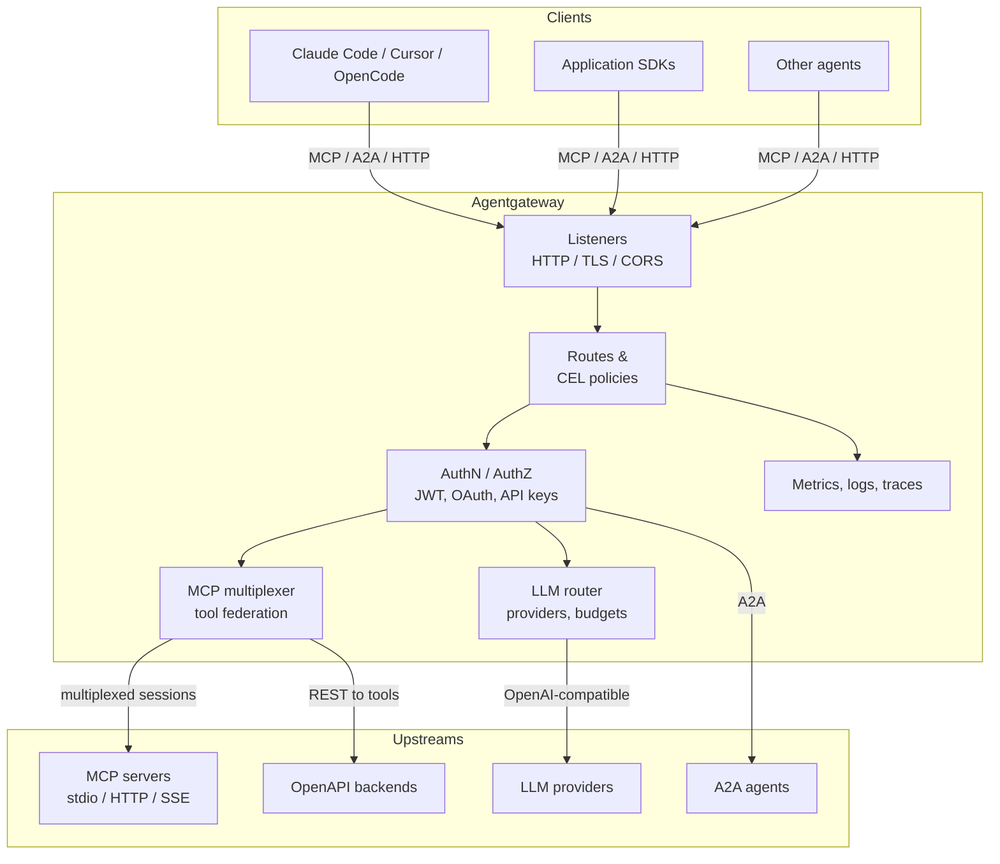

import Tabs from '@theme/Tabs';
import TabItem from '@theme/TabItem';
import Card from '@site/src/components/Card/Card';
import CardGroup from '@site/src/components/Card/CardGroup';
import Steps from '@site/src/components/Steps/Steps';
import Step from '@site/src/components/Steps/Step';

# Agentgateway: Agentic Proxy for AI Agents and MCP Servers

Every MCP server you add to a coding agent is a new credential, a new endpoint, and a new thing to audit. Wire up five servers per developer across a team and you get five times the blast radius with no central place to revoke a token or see who called what. **Agentgateway** is an open source (Apache-2.0) proxy that sits between agents and everything they call: MCP tool servers, A2A agents, and LLM providers.

It started as a Solo.io project, was donated to the Linux Foundation in 2025, and joined the Agentic AI Foundation in 2026. It is written in Rust, speaks plain HTTP and gRPC as well as MCP and A2A, and runs either as a single binary (`agentgateway`) or as a Kubernetes control plane built on Gateway API. In other words, it is a normal API gateway that also understands stateful agent protocols.

:::info
Agentgateway is the reference implementation of the "MCP gateway" idea that Uber described in its own internal platform. The difference is scope: Uber built for hundreds of teams and an internal IDL registry, agentgateway builds for anyone who wants one governed endpoint in front of their MCP servers.
:::

## Why MCP Needs a Gateway at All

MCP is a stateful, bidirectional JSON-RPC protocol, not REST. A client opens a session, keeps it open, and the server can push messages back. A single `tools/list` call may fan out to several upstream servers and must return one coherent answer that is filtered to what *that* session is allowed to see.

That breaks the assumptions of traditional proxies, which expect short-lived requests with no session affinity. It also creates the problems a gateway exists to solve:

- **Credential sprawl**: each agent holds raw tokens for every tool it can reach.
- **No per-tool authorization**: an agent allowed to read tickets is also allowed to delete them.
- **No audit trail**: you cannot answer "which agent called which tool, with whose identity".
- **Context bloat**: every connected server injects its full tool list into the model context.

## Architecture

Agentgateway is a data plane with policies attached at listener, route, backend, or MCP-target level. The same process can front non-agentic HTTP, LLM traffic, MCP targets, and A2A agents.



### Two deployment modes

| | Standalone | Kubernetes |
| --- | --- | --- |
| Runs on | Binary, Docker, or a single Helm Deployment | Cluster with control plane and CRDs |
| Config | YAML file, editable in the UI | Gateway API and agentgateway CRs |
| Fits | Solo developers, small teams, non-Kubernetes infra | GitOps teams with shared cluster infrastructure |

## Key Features

### MCP gateway: multiplexing and federation

Point several MCP servers at one backend and they are exposed as a single virtual MCP server. Tool names are prefixed with their target name (`time_get_current_time`) only when a backend has more than one target, so collisions are impossible by default and clients keep working unchanged.

Targets can be `stdio` subprocesses, streamable HTTP, SSE, or OpenAPI endpoints. Each target also accepts a CEL `condition`, so a server participates in a session only when a header or JWT claim says so. That is how you build per-tenant tool surfaces without running a gateway per tenant.

### Security

- **Inbound**: JWT validation against JWKS, OAuth 2.0 for MCP, API keys, basic auth, OIDC for the UI, external authorization (OPA) and CEL-based `allow`/`deny` rules.
- **Per-tool authorization**: `mcpAuthorization` policies filter `tools/list` so a client never sees a tool it cannot call. This is a direct defense against tool-poisoning attacks.
- **Outbound**: static keys, passthrough, signed JWTs, cloud provider credentials (AWS SigV4, GCP, Azure), and RFC 8693 / RFC 7523 token exchange so the gateway holds the credential instead of the agent.
- **Rate limits**: local token buckets plus distributed rate limiting through an external service.

### Observability

Metrics, structured access logs, and distributed traces export over OTLP, with GenAI and MCP span attributes included. Prometheus, Grafana, Jaeger, Honeycomb, Datadog, Langfuse, LangSmith, and Braintrust are documented sinks. The built-in UI adds a tool playground, a request inspector, and (with SQLite or PostgreSQL) log analytics and cost dashboards.

### LLM and A2A in the same proxy

The LLM side routes OpenAI, Anthropic, Gemini, Bedrock, Vertex, Ollama, and 40-odd other providers behind one OpenAI-compatible API, with virtual keys, per-key budgets, failover, and guardrails (regex, OpenAI moderation, Bedrock Guardrails, Model Armor). The A2A side exposes agent skills and handles agent-to-agent task handoff. One gateway, one policy language, one trace.

## Quickstart

<Steps>
  <Step title="Install the binary">
    ```bash
    curl -sL https://agentgateway.dev/install | bash
    ```

    Docker and Helm installs are also supported. The binary bootstraps a config at `~/.config/agentgateway/config.yaml` if you run it without one.
  </Step>
  <Step title="Start a test MCP server">
    ```bash
    PORT=3005 npx -y @modelcontextprotocol/server-everything streamableHttp
    ```
  </Step>
  <Step title="Configure the gateway">
    <Tabs groupId="agentgateway-setup">
      <TabItem value="file" label="Config file" default>
        ```yaml
        # yaml-language-server: $schema=https://agentgateway.dev/schema/config
        gateways:
          default:
            port: 4000
        mcp:
          targets:
          - name: everything
            mcp:
              host: http://localhost:3005/mcp
        ui: {}
        ```

        ```bash
        agentgateway -f config.yaml
        ```
      </TabItem>
      <TabItem value="ui" label="UI">
        Run `agentgateway`, open `http://localhost:4000/ui`, enable MCP in the welcome wizard, then add the server under **MCP > Servers** with the Streamable HTTP transport and URL `http://localhost:3005/mcp`.
      </TabItem>
    </Tabs>
  </Step>
  <Step title="Call a tool">
    In the UI, open **MCP > Tool Playground**, initialize a session, and call `echo`. With curl, first `initialize` to obtain the `mcp-session-id` header, send `notifications/initialized`, then post `tools/list` or `tools/call` to `http://localhost:4000/mcp` with `Accept: application/json, text/event-stream`.
  </Step>
  <Step title="Point your agent at it">
    Register `http://localhost:4000/mcp` as the only MCP server in Claude Code, Cursor, or OpenCode. The agent now sees the federated tool list, and every call passes through auth, rate limits, and tracing.
  </Step>
</Steps>

:::tip
Write the config file with the `# yaml-language-server` schema line. Editors then validate and autocomplete the whole policy surface, which is far faster than reading the reference docs.
:::

## Agentgateway vs. Uber's MCP Gateway

Uber's [design write-up](https://www.uber.com/us/en/blog/designing-mcp-gateway/) describes an internal platform serving 800+ MCP servers and 5,000+ tools. It is the best public description of what a large MCP gateway must do, but it is not a drop-in product.

| Concern | Agentgateway | Uber MCP Gateway |
| --- | --- | --- |
| Shape | Open source binary or Kubernetes control plane | Internal microservice at Uber |
| Discovery | You declare targets, or use the catalog and OpenAPI integration | AutoCrawler scans IDL registries, generates tools with an LLM, registers them disabled by default |
| Data plane | Rust proxy, policies at listener/route/backend/target level | Proxy translating MCP to HTTP, gRPC, and TChannel through Muttley |
| Governance | CEL policies, per-tool authorization, OAuth/JWT | Access Control System with owner-approved, versioned config diffs |
| Context control | Tool filtering per session, virtual MCP servers | Omni MCP progressive discovery, response projection, Code Mode (`aifx`) |

The design lesson is the same in both: **translation belongs in the gateway, not in every service**. Uber avoids asking teams to write MCP servers by deriving tools from existing IDLs. Agentgateway gets partway there with OpenAPI-to-MCP, but it has no Thrift/TChannel crawler and no equivalent of response projection or `aifx`-style code mode. If you are inside an organization with thousands of IDL-defined services, Uber's architecture is the blueprint, not agentgateway's config file.

What agentgateway gives you that the blog does not ship: a working binary, a UI, and an OSS license.

## Agentgateway vs. Flowlines

[Flowlines](https://flowlines.ai/) looks adjacent but solves a different problem. It is a **SaaS analytics and distribution layer** for a public or commercial MCP server: a "use with Claude/ChatGPT" button, marketplace listing guides, session replay, use-case clustering, and alerts on buying intent. It instruments your server with OpenTelemetry and shows who used it and why.

Agentgateway never tells you that a user at a prospect asked about SSO pricing. It tells you that the call was authorized, rate limited, traced, and routed. The overlap is observability only:

- Use **Flowlines** when the MCP server is your product and you need adoption and business signals.
- Use **agentgateway** when the MCP servers are infrastructure and you need control, tenancy, and compliance.
- Use **both** if you sell an MCP server: agentgateway in front for auth and rate limits, Flowlines instrumentation behind it for product analytics. They are not substitutes, and Flowlines does not replace a gateway.

## When to Use It

<CardGroup cols={2}>
  <Card title="Several MCP servers, one endpoint" icon="mdi:call-merge">
    You are past two or three servers per agent and tool lists are colliding or eating context. Multiplexing collapses them into one virtual server with predictable naming.
  </Card>
  <Card title="Credentials you do not want in agents" icon="mdi:key-variant">
    Token exchange and static backend keys keep provider credentials out of client configs and let you rotate them in one place.
  </Card>
  <Card title="Per-tool authorization" icon="mdi:shield-account">
    Different teams, tenants, or environments need different tool surfaces. CEL policies and target conditions express that without cloning servers.
  </Card>
  <Card title="One trace across LLM and tools" icon="mdi:chart-timeline-variant">
    You need to answer "which agent spent what, calling which tool, for which user" and OTLP into your existing stack is the answer.
  </Card>
</CardGroup>

Use it also when MCP and A2A traffic has to share infrastructure with ordinary HTTP services, since the same proxy and the same policy language cover both.

## When Not to Use It

- **One MCP server, one developer.** A local stdio server in your agent config is simpler. Adding a proxy adds a process, a port, and a config file for zero governance gain.
- **You only need usage analytics on a server you host.** That is Flowlines' job. Agentgateway gives you traces, not product insight, and you would be operating a proxy to get dashboards you could get from instrumentation.
- **You expect automatic discovery of a huge internal API estate.** Agentgateway does not crawl IDL registries or auto-generate tools with an LLM. Budget that work separately; Uber's AutoCrawler has no OSS equivalent here.
- **You need a managed SaaS with an SLA.** The OSS project is self-hosted. Solo Enterprise for agentgateway exists, but do not assume the community binary comes with support.
- **Your team will not own a gateway.** A proxy that nobody rotates keys in, upgrades, or monitors is worse than no proxy: it becomes a single point of failure with a stale policy set.

:::warning
Pin a version and read release notes before upgrading. The project is on a fast release cadence, MCP spec revisions (including the stateless 2026 revision) are actively being adopted, and config keys have changed across minor versions.
:::

## Operational Notes

- **Statefulness is the cost.** The gateway tracks long-lived MCP sessions. In Kubernetes, plan for session affinity or accept that clients restart sessions when a pod is replaced.
- **`prefixMode` is a contract.** Default `conditional` behavior changes tool names when you add a second target. Set `always` or `never` deliberately, and check clients that hardcode tool names (MCP Apps especially).
- **Conditions must be stable per session.** In stateful mode, a request whose target conditions differ from initialization returns `404 session not found`, and the client must start over. Do not put volatile values like timestamps into conditions.
- **The UI is an admin plane.** If it is exposed, put OIDC in front of it. An unauthenticated config editor on a public port is a remote code execution path via `stdio` targets.

## References

- [Official Documentation](https://agentgateway.dev/docs/standalone/latest/documentation/about/introduction)
- [GitHub Repository](https://github.com/agentgateway/agentgateway)
- [Standalone Quickstart](https://agentgateway.dev/docs/standalone/latest/documentation/quickstart/mcp)
- [Kubernetes Documentation](https://agentgateway.dev/docs/kubernetes/latest)
- [Virtual MCP (multiplexing)](https://agentgateway.dev/docs/standalone/latest/integrations/mcp/servers/virtual)
- [Designing MCP Gateway at Uber](https://www.uber.com/us/en/blog/designing-mcp-gateway/)
- [Flowlines MCP Observability](https://flowlines.ai/)
