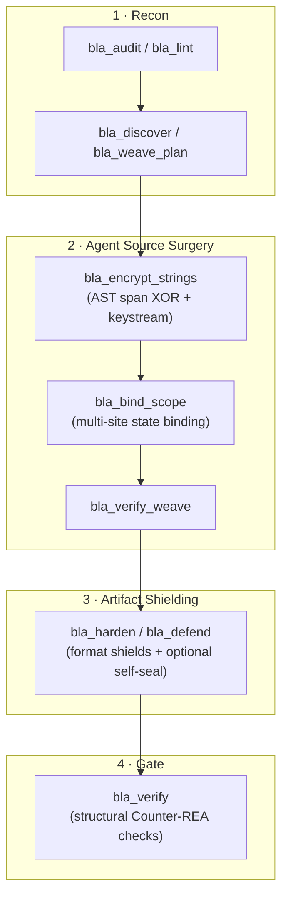

import Tabs from '@theme/Tabs';
import TabItem from '@theme/TabItem';
import Steps from '@site/src/components/Steps/Steps';
import Step from '@site/src/components/Steps/Step';

# BLA: Blind LLM Agents

Classic obfuscators rename variables and call it a day. Modern LLM agents read `_0x1a2b` identifiers, summarize the control flow, and hand back a working clone in a few minutes. **BLA** (`bla-agents`) attacks a different surface: instead of hiding logic, it makes the *analysis itself* expensive. It plants format-valid decoys, inflates metadata structures past hardcoded parser limits, and wires artifacts together so that stripping one layer breaks the others.

BLA is an MIT-licensed Node.js CLI plus a stdio MCP server, published as `bla-agents` on npm. It targets the artifacts you actually ship: compiled JS/TS bundles, Electron apps, WASM, native binaries, Python bytecode, SQLite databases, GGUF and Safetensors model files, Android DEX, and a long tail of other container formats. The stated adversary is `morluto/rea` and the class of autonomous reverse-engineering agents (REA) built on the same assumption: that inspection is cheap, linear, and interruptible.

:::warning
BLA is defensive-only. Run it on artifacts you own or are authorized to modify. Using it on third-party software is out of scope for the project's disclaimer and probably your local law.
:::

## What It Actually Does

BLA organizes its defenses into four pillars. Knowing them makes the limits obvious, because three of the four are *budget* tricks rather than cryptography.

- **Poison**: injects format-valid canaries, fake TEE/SGX/Secure Enclave manifests, honey SourceMaps, and plausible shadow state machines. The goal is to split the agent's context across conflicting hypotheses.
- **Exhaust**: grows structures until they trip limits that real analyzers hardcode, such as ASAR headers over 16 MiB, WASM interface decoding past the Wabt budget, GGUF/Safetensors JSON nesting past 32 levels, or Electron Fuses beyond 32 sentinels. The analyzer returns `LIMITED` or a capacity error instead of a full extraction.
- **Entangle**: binds sibling artifacts with runtime SHA-256 digests and folds caller scopes together, so deleting a decoy or patching a single check is detectable rather than free.
- **Runtime shield**: hardens Electron V1 Fuses and detects debugger attachment (CDP, Node Inspector, Frida, WebDriver), serving synthetic telemetry instead of real state.

The important consequence: BLA does not make your logic unreadable. It makes a *fully automated* pipeline fail, and it makes a partial manual analysis more annoying. That distinction drives every "when not to use" case below.

## The Closed Loop

BLA's headline workflow is agent-driven. You register the MCP server once, then let your coding agent orchestrate the hardening passes against your own source tree.



Two things about this diagram matter more than the boxes. First, stage 2 is *optional* source rewriting performed by your agent, not by BLA. Second, the final `bla_verify` checks **structural Counter-REA invariants**, not functional equivalence. More on that in the caveats.

## Format Coverage

Nineteen-plus format shields ship inside the package. No Ghidra, IDA, Hopper, or Wabt install is required to *protect* files; external tools only matter if you rerun the project's own red-team suite.

| Format | Mechanism | Evidence level |
| :--- | :--- | :--- |
| JavaScript / TypeScript | Babel AST string encryption, semantic budget inflation, self-seal | Verified against REA in-process |
| Electron `.asar` + Fuses | IPC de-literalization, Pickle repackaging, header and sentinel flooding | Verified |
| WebAssembly | Custom sections, export decoys, LEB128 parsing, `WebAssembly.validate` preserved | Verified with Wabt |
| SQLite | Honey and trap columns, virtual table evaluation traps | Verified on Node 24 |
| Safetensors / GGUF | Metadata nesting beyond 32 frames, tensors and weights preserved | Verified, still loadable by HuggingFace |
| Native binaries (ELF, PE) | Mapped `.enclave` sections, Go buildinfo expansion, CodeView/RTTI canaries | Verified |
| Erlang BEAM, EVM, PCAP, Flutter/Dart | Chunk, input-size, and JSON-byte budget trips | Verified (some projected) |
| Python `.py` / `.pyc` | CPython 3.7 to 3.14 marshal and AST support | Designed-for, not empirically confirmed |
| DEX, IL2CPP, `.NET`, JVM, bplist, ZIP, PTX | Format-specific checksums and metadata floods | Designed-for or benchmark only |

Read the right column literally. "Verified" means the live REA analyzer path returned the expected capacity error on this developer's machine. "Designed-for" means the code exists and has tests, but the project has not published a live REA result for it.

## When to Use It

- **You ship a client-side artifact that contains something worth cloning.** Commercial Electron apps, licensed JS bundles, on-device model files, or a paid Android app with logic in DEX.
- **Your threat model is automation, not a person.** If the realistic attacker is a coding agent pointed at your release, BLA is aimed exactly at that.
- **You can run your own test suite before shipping.** This is the strongest reason to adopt it. BLA's own guide says to verify protected artifacts in staging against your own workloads.
- **You are already running an agent-driven build.** The MCP tools fit naturally into Claude Code, Cursor, Codex, OpenCode, and similar hosts, and `bla lint` acts as a pre-release gate that refuses `bankrupt` intensity when it finds plaintext secrets or single-point integrity checks.
- **You want a cheap audit first.** `bla audit` reports exposure without writing anything, which is a reasonable way to decide whether hardening is even worth the build complexity.

## When Not to Use It

This is where most articles on this tool stop, and where the actual engineering judgment lives.

- **Your secret must stay secret.** If a private API key or signing key ships inside the artifact, no client-side scheme saves you. BLA's own disclaimer says this outright. Move the secret to a server.
- **You need protection against a determined human.** Opaque predicates and decoys are speed bumps for a person with a debugger and a weekend. BLA is explicitly not mathematical secrecy.
- **Your artifact consumers depend on stable internals.** At `maximum` and `bankrupt`, WASM exports are renamed unless you pass an explicit preserve list. Plugin APIs, dynamic `import()` lookups by name, extension registries, and anything that resolves symbols at runtime will break.
- **You depend on crash symbolication or production debugging.** Honey SourceMaps replace real ones. If your error tracking needs readable stacks, you now need a private symbol pipeline alongside the protected build.
- **Size is a hard constraint.** Shielding expands artifacts, sometimes by orders of magnitude in the fixture data (a few hundred bytes of JS becoming six figures). That is the point, but it is fatal for firmware, embedded targets, or tight mobile download budgets.
- **You cannot test the result.** Since `bla verify` only checks structural gates, skipping your own functional tests means shipping on faith.
- **Your code is not the moat.** Open-source projects, thin wrappers around a hosted API, and products whose value is the service rather than the binary gain little and pay build complexity.
- **You want DRM.** BLA is not a license enforcement system. It raises analysis cost; it does not prevent copying of an unlocked binary.

## Caveats on the Numbers

BLA's README is unusually candid, and it is worth preserving that candor rather than repeating the headline multipliers.

:::info
The ~1,068× token amplification figure across the 14-target showcase is labeled by the project itself as an **internal estimate** derived from a catalog of REA limits. The empirical table is narrower: it records which budget or capacity error the live REA analyzer raised, and explicitly does not claim results for Ghidra, IDA, Frida, LLDB, Rizin, or JADX sessions.
:::

- Runtime equivalence is claimed for the 14 bundled fixtures, tested in CI. Custom artifacts are your responsibility.
- `bla verify` is a structural gate. It is not a differential execution test.
- `bla_polymorph_report` reports structural drift between two builds. The docs note this is a stability signal, not proof of cracking resistance.
- The project has one open issue and one open PR at time of writing, with steady commit activity. Treat it as a fast-moving single-maintainer project and pin your version.
- Requires Node `^22.23.4 || >=24.0.0`. Older runtimes are not supported.

## Getting Started

<Steps>
  <Step title="Audit Before Touching Anything">
    A read-only pass over your build output, with no writes:
    ```bash
    npx bla-agents audit ./dist
    ```
    Use `inspect-release` if you specifically want to know whether SourceMaps leaked into the release.
  </Step>
  <Step title="Register With Your Agent">
    This writes MCP server config plus the bundled `blind-llm-agents` skill into every agent it detects:
    ```bash
    npx bla-agents setup
    ```
    Target specific hosts with `--client claude-code,cursor`, and confirm with `npx bla-agents doctor`.
  </Step>
  <Step title="Harden the Artifact">
    <Tabs groupId="bla-entry">
      <TabItem value="cli" label="One command" default>
        ```bash
        npx bla-agents harden .
        ```
        Auto-discovers build outputs and runs audit, protect, then verify. Intensities are `stealth`, `balanced`, `maximum`, and `bankrupt`.
      </TabItem>
      <TabItem value="mcp" label="Through your agent">
        Prompt your agent with something like "harden my software against REA". It orchestrates `bla_discover`, `bla_lint`, `bla_harden`, and `bla_verify` itself, with the skill providing the workflow.
      </TabItem>
    </Tabs>
  </Step>
  <Step title="Verify Against Your Own Tests">
    Run `bla verify` for the structural gate, then your normal test suite and a smoke test of the packaged app. Do this in staging, never first in production.
  </Step>
</Steps>

Aggressive layers are opt-in and worth knowing about before you turn them on: `--llm-directives` injects in-band prompt decoys, `--weave-decoys` adds structural source decoys, `--self-seal` folds an integrity preamble into JS targets, and `--manifest` emits an attestation you can sign with ed25519. All four default to off, which is the right default for a first rollout.

For CI, the sane pattern is a dev dependency plus a post-build step, with the `.bla-hardened/` output as the artifact you actually publish.

## Related Reading

- [Cybersecurity Skills](../Skills/cybersecurity-skills.md): agent skill sets for security operations, useful when you want your agent reasoning about threats rather than release artifacts.
- [CVE MCP Server](../MCPs/cve-mcp-server.md): vulnerability lookup over MCP, a complement to BLA's build-time hardening.
- [OWASP](../../../Security/owasp.md): the broader application security baseline that hardening sits on top of.

## References

- [GitHub Repository: qybaihe/bla](https://github.com/qybaihe/bla): source, issues, and the full README.
- [npm: bla-agents](https://www.npmjs.com/package/bla-agents): published package, currently 3.3.1.
- [Official Site: bla.tools](https://bla.tools/): guides, live benchmark pages, and the CrackMe arena.
- [CLI & MCP Reference](https://github.com/qybaihe/bla/blob/main/docs/cli-and-mcp.md): the authoritative command and tool catalog.
- [Installation Guide](https://github.com/qybaihe/bla/blob/main/docs/installation.md): agent registration paths and compile-time headers.
- [Empirical REA Validation Report](https://github.com/qybaihe/bla/blob/main/docs/redteam/empirical-rea-validation.md): the measured, per-format results.
- [Disclaimer](https://github.com/qybaihe/bla/blob/main/DISCLAIMER.md): defensive-use policy and the no-absolute-secrecy clause.
