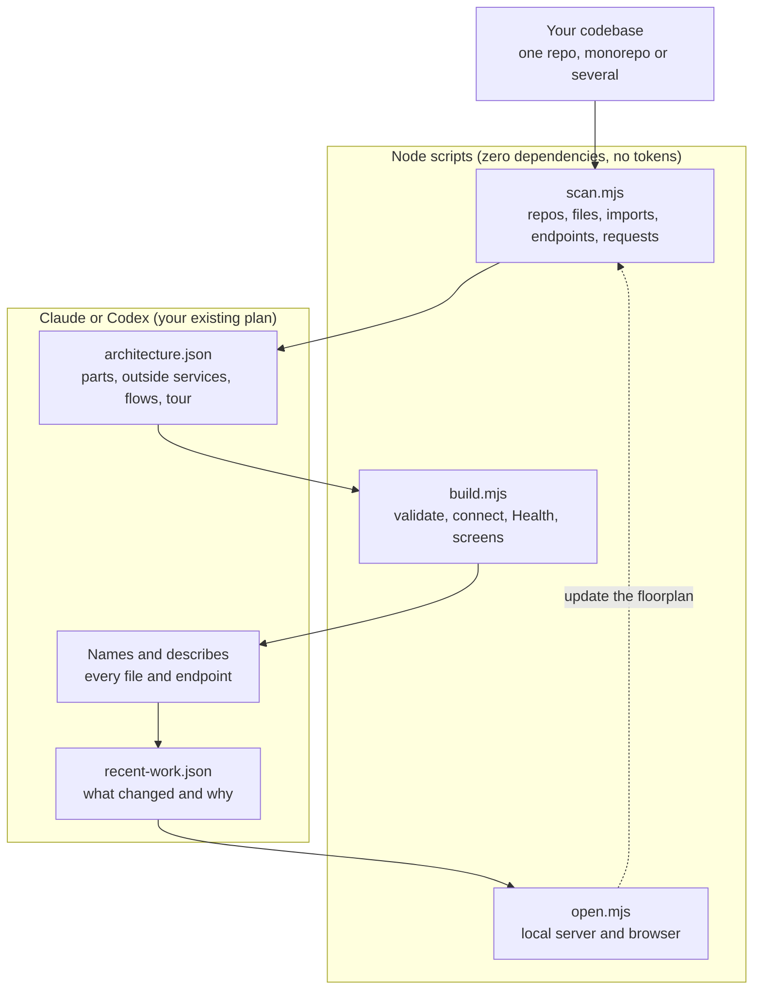

import Tabs from '@theme/Tabs';
import TabItem from '@theme/TabItem';
import Card from '@site/src/components/Card/Card';
import CardGroup from '@site/src/components/Card/CardGroup';
import Steps from '@site/src/components/Steps/Steps';
import Step from '@site/src/components/Steps/Step';
import Accordion from '@site/src/components/Accordion/Accordion';
import AccordionGroup from '@site/src/components/Accordion/AccordionGroup';

# Floorplan

Floorplan is a plugin for Claude Code and Codex that reads your codebase and draws an interactive map of it. Every part, file and web request gets a plain-English name, and every connection between them is shown. You end up with a zoomable board you can browse, search, and ask questions about, instead of a hairball diagram you need to decode.

It is aimed at a specific kind of developer: someone who built an app, mostly with AI help, and can ship features but cannot answer "what happens when someone checks out?" or "what breaks if I change this?". The map answers those questions in your own words, and a Health panel flags the security mistakes that AI-built apps tend to repeat.

## Summary

- A skill-and-scripts pipeline runs inside your existing agent session. Plain Node scripts do the mechanical work (scanning, parsing, matching requests to endpoints, layout). Claude or Codex does the part only a reader of the code can do: naming the parts of your app and explaining what each file does.
- The output is a `floorplan/` folder containing `graph.json` and a self-contained `index.html`. A tiny local server opens it in your browser and powers the map's Ask bar.
- Nothing is committed to git. The folder ignores itself, and only `CLAUDE.local.md` gets an optional short note in Claude Code.
- No API keys, no dependencies, no install scripts. It runs on the Claude Code or Codex plan you already pay for.

:::info
The map is organised around **your app's parts**, not around files. "Takes card payments at checkout" is a card you can click; the six files behind it are one level deeper. That naming is the whole product.
:::

## What the Map Gives You

<CardGroup cols={2}>
  <Card title="A Map at Every Zoom" icon="mdi:map" href="https://github.com/haydenschmitty/floorplan#features">
    Start with the whole app, then double-click into a part, a group of files, a single file, and its endpoints. Each view shows what it uses and what uses it.
  </Card>
  <Card title="Plain English Everywhere" icon="mdi:translate" href="https://github.com/haydenschmitty/floorplan#features">
    "Takes card payments at checkout", not "Stripe API wrapper". Technical terms are explained on hover, and one switch flips to the developer view.
  </Card>
  <Card title="Real Connections Across Repos" icon="mdi:connection" href="https://github.com/haydenschmitty/floorplan/blob/main/docs/how-it-works.md">
    Imports are followed, and each web request in the frontend is matched to the server endpoint that answers it, even when they live in separate repositories.
  </Card>
  <Card title="Start From a Screen" icon="mdi:monitor-dashboard" href="https://github.com/haydenschmitty/floorplan#features">
    Pick a page you recognise and see everything behind it: its parts, the requests it makes, the server code, the data, and the outside services.
  </Card>
  <Card title="Ask the Map" icon="mdi:comment-question-outline" href="https://haydenschmitty.github.io/floorplan-demo/">
    "How does a refund reach the customer's card?" returns an answer plus a mini-map of only the pieces involved, with a numbered walkthrough.
  </Card>
  <Card title="Health Check" icon="mdi:shield-alert-outline" href="https://github.com/haydenschmitty/floorplan#features">
    Keys in the code or shipped to the browser, open Supabase tables, open Firebase rules, fakeable Stripe webhooks, endpoints with no sign-in. Each finding comes with a fix prompt.
  </Card>
  <Card title="Recent Work" icon="mdi:history" href="https://github.com/haydenschmitty/floorplan#features">
    After an update, the cards your agent just changed light up green, each with a note on how the change serves what you asked for.
  </Card>
  <Card title="Stays Current" icon="mdi:sync" href="https://github.com/haydenschmitty/floorplan/blob/main/docs/how-it-works.md#updates">
    Updates re-read only what changed, and an open map reloads itself in place instead of opening a second tab.
  </Card>
</CardGroup>

## How It Works

Floorplan splits the job between deterministic scripts and the model in your session:



1. **Scan.** `scan.mjs` lists files with `git`, so `.gitignore` is respected, and extracts imports resolved to real files, exported definitions with their doc comments, endpoints the server defines, web requests the code makes, and a content fingerprint per file.
2. **Connect.** Requests and endpoints are matched by pattern, not by compiling. It handles `fetch`, axios, ky, `requests`, template strings, base URLs kept in settings, and framework routers mounted with prefixes.
3. **Describe.** The agent reads the scan summary, READMEs and entry points, writes `architecture.json` (the parts of the app, outside services, flows), then fills in a name and description for every file and endpoint.
4. **Build.** `build.mjs` validates what the agent wrote, connects the parts, runs Health, detects screens, and writes `graph.json` plus a self-contained `index.html`. Layout happens in the browser with ELK, so the build stays fast.
5. **Show.** `open.mjs` starts a small local server and opens the map. The server only accepts connections from your own machine.

:::tip
Because the map is a static folder of JSON, it works offline. Fonts and the layout engine are bundled, so a map you exported six months ago still opens with no network.
:::

## Install

You need [Node.js 18+](https://nodejs.org) and either Claude Code or Codex. No API keys.

<Tabs groupId="agent-integration">
  <TabItem value="claude" label="Claude Code" default>
    From the desktop app's Code tab or the CLI:
    ```bash
    claude plugin marketplace add haydenschmitty/floorplan
    claude plugin install floorplan@floorplan
    ```
    Start a new session and the skill is available. Installing the CLI is recommended even if you use the desktop app, because the map's Ask bar needs it to read your real code.
  </TabItem>
  <TabItem value="codex" label="Codex">
    From a terminal:
    ```bash
    codex plugin marketplace add haydenschmitty/floorplan
    codex plugin add floorplan@floorplan
    ```
    In the Codex app you can do the same through **Plugins** → **Add a marketplace**, source `haydenschmitty/floorplan`. Start a chat and type `$floorplan`.
  </TabItem>
</Tabs>

## Quick Start

<Steps>
  <Step title="Open the project">
    Open your project in Claude Code or Codex. If the frontend and backend are in separate repos, open the folder that holds both, so the map can join them.
  </Step>
  <Step title="Ask for a floorplan">
    Say it in plain words:
    ```text
    Make me a floorplan of this app.
    ```
    The map opens on its own with a one-minute "Start here" tour. This is the expensive step: the model reads and names files.
  </Step>
  <Step title="Explore and ask">
    Click into a part, pick a screen you know, or type a question into the Ask bar. Right-click any card for its actions.
  </Step>
  <Step title="Update after changes">
    Once you have done more work, ask:
    ```text
    Update the floorplan.
    ```
    Only changed files are re-read, and what you just touched lights up under **Recent work**.
  </Step>
  <Step title="Share it">
    Export the map as a single HTML file and send it to anyone. No install, no server, no repo access needed.
  </Step>
</Steps>

## Asking the Map Questions

The Ask bar is not a chatbot guessing from a summary. It runs your own CLI in read-only mode against your source:

- **Claude Code:** `claude -p` with read-only tools only, plus `floorplan/query.mjs` for lookups. It starts with no MCP servers (`--strict-mcp-config` with an empty list).
- **Codex:** `codex exec` inside Codex's read-only sandbox, with the same lookups and no history written.

Either way the answer comes back as text plus the cards to show, so a claim can cite the file it came from. Useful questions:

| Ask the agent | Ask the map |
|:---|:---|
| "Add a flow showing how a new user signs up" | "What happens when someone places an order?" |
| "Fix the important issues from the Health check" | "Where do we talk to Stripe?" |
| "Rewrite the floorplan for developers" | "If I change the users table, what breaks?" |
| "Export the floorplan so I can send it to the team" | "What did we change for refunds?" |

:::warning
If you only installed the plugin in the desktop app without the Claude Code CLI, the Ask bar has less to work with. Install the CLI for full-code answers.
:::

## Health Check

This is the feature that distinguishes Floorplan from a diagram tool. It looks for the specific mistakes that show up again and again in apps assembled by an agent:

- API keys and secrets written into source, or shipped to the browser in a public bundle.
- Supabase tables that anyone with the anon key can read.
- Firebase rules left open.
- Stripe webhooks that anyone could fake because the signature is never verified.
- Endpoints with no sign-in check that change data.

Each finding has **Show on map** and a ready-to-paste fix prompt. Secret values are never stored or displayed, only their location.

:::warning
It is a check, not an audit. It catches the classic shapes and misses anything bespoke. Treat it as a fast first pass before a real security review.
:::

## Blueprints From a PRD

Floorplan can also map something that does not exist yet. Give it a PRD, a spec, or a description and ask for a floorplan, and you get a **blueprint**: the same kind of board with every part, file, endpoint and screen you would need. Cards are dashed to show it is a plan.

- Health becomes a design review: endpoints anyone could use to change data, endpoints with no decision on who may use them, open questions in the PRD, and pieces nothing connects to.
- Each part carries a **Build this with** prompt listing the files, endpoints and dependencies it implies.
- You can reshape the plan from the map ("also plan out refunds") and undo it.

Once the real code exists, `refresh.mjs --from-code` replaces the blueprint with a map of what was actually built.

## Floorplan vs Understand Anything vs Codegraph

All three read a codebase and produce something visual, but they answer different questions. Floorplan is the one written for people who did not read their own code.

<CardGroup cols={3}>
  <Card title="Floorplan" icon="mdi:floor-plan" href="https://github.com/haydenschmitty/floorplan">
    **Does my app work, and what should I worry about?** Whole-app map, health check, recent work, plain English.
  </Card>
  <Card title="Understand Anything" icon="mdi:graph-outline" href="understand-anything">
    **How does this large codebase work, function by function?** Knowledge graph with layers, domain view and guided tours.
  </Card>
  <Card title="Codegraph" icon="mdi:sitemap" href="codegraph">
    **How does an agent navigate this repo with fewer tool calls?** Pre-indexed SQLite graph served over MCP.
  </Card>
</CardGroup>

| | Floorplan | Understand Anything | Codegraph |
|:---|:---|:---|:---|
| **Primary output** | Interactive map of the app's parts, screens and connections | Interactive knowledge graph of files, functions, classes | Pre-indexed code graph over MCP |
| **Built for** | Builders who do not read the code | Developers learning a large repo | Agents navigating code per turn |
| **Runs in** | Claude Code, Codex | Claude Code, Codex, Cursor, Copilot, Gemini CLI | Any MCP client |
| **Static analysis** | Plain Node scripts, no dependencies | Tree-sitter + LLM summaries | Tree-sitter |
| **Requests to endpoints** | Yes, matched across repos | No | Yes, for known frameworks |
| **Security findings** | Yes, with fix prompts | No | No |
| **Requires an LLM at build time** | Yes, your existing plan | Yes | No |
| **Output committed to git** | No, the folder ignores itself | Optional, `.ua/` can be committed | No, `.codegraph/` is ignored |
| **Share without the tool** | Yes, export to one HTML file | Yes, `npx` dashboard over the JSON | No |

:::tip
They compose. Map the app with Floorplan to understand and check it, keep Understand Anything for function-level study of a big repo, and give your agent Codegraph or [Graft](./graft.md) for cheap per-turn navigation.
:::

## What It Writes to Your Project

- **`floorplan/`** holds the map: `graph.json`, `architecture.json`, `recent-work.json`, the generated `index.html`, and the scripts. It contains a `.gitignore` that ignores itself, so `git status` stays clean.
- **`CLAUDE.local.md`** gets a short section in Claude Code, only if you accept the prompt, telling future sessions to check the map before searching the code from scratch. It is added to your clone's private ignore list.

Nothing else is touched. Your tracked files and root `.gitignore` are never modified.

## Privacy

- Scanning, layout, and the local server all run on your machine. The server binds to localhost.
- No dependencies, no install scripts, no analytics.
- Questions go through your own Claude Code or Codex account, with read-only tools.
- Secret values are masked in the worksheets the model sees, and files like `.env` are never quoted.

## Caveats

<AccordionGroup>
  <Accordion title="Request matching is pattern matching, not a compiler">
    Most frontend-to-backend links are found, but not all, especially with bespoke routing or addresses assembled at runtime. When an important edge is missing, ask the agent to record it as an explicit connection.
  </Accordion>
  <Accordion title="It needs Claude Code or Codex">
    Floorplan runs on your existing subscription and ships no model of its own. If you want to drive the pipeline without an agent session, the maintainers document an unattended mode that works with any model that can return JSON, but that is a scripting path, not a one-command install.
  </Accordion>
  <Accordion title="The map is not in git by design">
    That keeps repos clean, but it also means teammates do not get the map from a clone. Export the single-file HTML when you want to hand it to someone.
  </Accordion>
  <Accordion title="Naming is the model's judgement">
    Part names and descriptions are written by the agent. You can ask for a rewrite ("rewrite the floorplan for developers"), but the first pass on a messy repo may use words you would not.
  </Accordion>
  <Accordion title="Not a per-turn navigation tool">
    The map is for humans. It is not an MCP server the agent queries on every coding turn, so it does not replace Codegraph or Graft for context savings.
  </Accordion>
</AccordionGroup>

## References

- [GitHub Repository - haydenschmitty/floorplan](https://github.com/haydenschmitty/floorplan)
- [Live Demo - Brewline map](https://haydenschmitty.github.io/floorplan-demo/)
- [Video Walkthrough](https://www.youtube.com/watch?v=MGnMmHcIEZE)
- [How It Works](https://github.com/haydenschmitty/floorplan/blob/main/docs/how-it-works.md)
- [Privacy and Security](https://github.com/haydenschmitty/floorplan/blob/main/docs/privacy-and-security.md)
- [Understand Anything - Interactive Knowledge Graph](./understand-anything.md)
- [Codegraph - Pre-indexed Semantic Code Graph](./codegraph.md)
- [Graft - Context Layer for Coding Agents](./graft.md)
