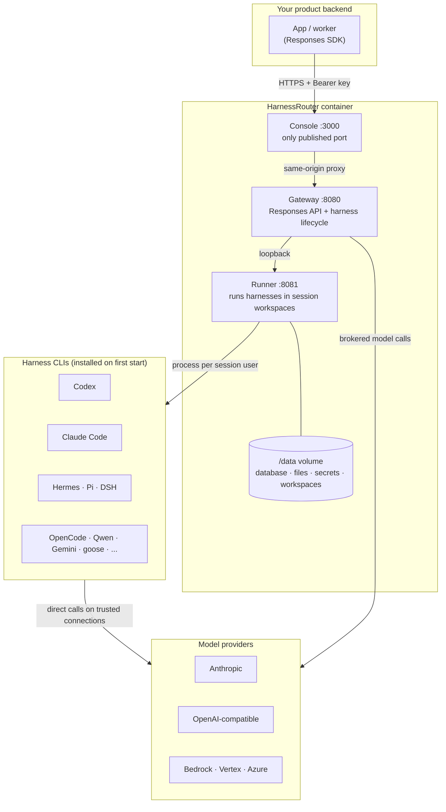

import Card from '@site/src/components/Card/Card';
import CardGroup from '@site/src/components/Card/CardGroup';
import Accordion from '@site/src/components/Accordion/Accordion';
import AccordionGroup from '@site/src/components/Accordion/AccordionGroup';
import Steps from '@site/src/components/Steps/Steps';
import Step from '@site/src/components/Steps/Step';

# HarnessRouter: Self-Hosted Unified Interface for Agent Harnesses

Every team that puts an agent inside a product ends up with the same shape: one feature request, and a pile of harness CLIs (Codex, Claude Code, and whatever else looked good that quarter). Each one has its own authentication, its own session model, its own streaming format, its own way of handing back files, and its own idea of what a failure looks like. **HarnessRouter** collapses that pile into a single HTTP contract. **Community Edition** is the part you run yourself: one Docker container, Apache-2.0, your provider keys, your volume.

It implements the **Unified Harness Protocol (UHP)**, an open, versioned standard whose task surface is deliberately compatible with the OpenAI Responses API. That compatibility is the operationally interesting bit: existing Responses SDKs, streaming parsers and UI components can talk to a self-hosted instance, and choosing a harness becomes a field in the request body (`metadata.harness_id`) instead of a second client library.

:::info
The repository ships the Apache-2.0 reference implementation, machine-readable schemas, and a conformance suite. The project advertises full UHP conformance and an OpenAI Responses-compatible surface.
:::

## The Problem: N Harnesses, N Integrations

The README frames it with numbers: wiring four harnesses into a product directly means 36 integration responsibilities, and adding a fifth pushes that to 45. With a router in the middle, the product keeps exactly one integration while the harness count grows.

Concretely, those responsibilities are:

- **Credentials**: which key authorizes which harness, and where it is stored.
- **Sessions**: how a follow-up turn finds the conversation it belongs to.
- **Streaming**: how progress arrives, and in what event shapes.
- **Files**: how inputs get in and generated outputs get out.
- **Cancellation**: how work you no longer need is stopped.
- **Failure modes**: what a structured error looks like, as opposed to a stack trace in a log.

Doing that once per harness is the harness engineering tax. The point of the router is to pay it once.

## Architecture: One Container, Three Processes

Community Edition is a single container with a deliberate internal split. Only the Console port is published; the Gateway and Runner listen on loopback.



Two design decisions are worth knowing before you deploy:

- **Sessions are isolated by workspace and operating-system user, not by container.** Each agent CLI runs as its own per-session user that owns that session's workspace and nothing else.
- **State is SQLite plus files on one volume** (`/data`). That volume is the instance; deleting it deletes everything durable.

The container intentionally starts as root to create and manage those per-session users, then runs the Console and Gateway unprivileged. There is no `--user`, no `--privileged`, and no added capabilities.

## What the API Handles

The Console is the entry point for both the UI and the API. Your backend talks to the Responses-compatible surface at `/api/harness/v1/responses` and names the harness per request.

| Your application can... | How |
| :--- | :--- |
| Start tasks | Send instructions and check execution status |
| Continue sessions | Send follow-up instructions with `previous_response_id` |
| Stream progress | Receive server-sent events as the agent works |
| Work with files | Attach input files and retrieve generated outputs |
| Cancel tasks | Stop work that is no longer needed |
| Inspect execution | Review structured errors and execution traces |

A minimal call against your own instance:

```bash
export HARNESSROUTER_BASE_URL=http://localhost:3000/api/harness

curl --fail-with-body -sS "$HARNESSROUTER_BASE_URL/v1/responses" \
  -H "Authorization: Bearer ${HARNESSROUTER_API_KEY:?}" \
  -H 'content-type: application/json' \
  -d '{
    "input":"Reply with exactly: it works.",
    "metadata":{"harness_id":"codex"},
    "model":"gpt-5.4-mini",
    "stream":false
  }'
```

The full contract is served by the instance itself at `/v1/openapi.json`, with a browsable copy at `/v1/docs`. Both are generated from the routes, so they cannot drift from the deployed version.

### Details That Save You an Incident

- **Idempotency**: send the same request with the same `Idempotency-Key` to retry safely. The retry returns the first result without starting a second execution, or waits for the running one. Reusing a key with a different body returns `409`; changing only `stream` counts as the same request.
- **Tracing**: W3C `traceparent` and `tracestate` headers on the request become the parent of the task's model calls, so your trace and the provider's log are one trace. Malformed headers are dropped, never refused.
- **Model validation**: a task naming a model no connected provider serves on that base is refused before it starts (`400 model_not_available`), never silently rerun on another model.
- **Files over prose**: a long token or hash pasted into a prompt gets retyped, and models drop characters in strings like that. Attach it with `POST /v1/files` plus an `input_file` block, or pass it through the harness's `env` map, where `$headers.X-Name` reads a declared request header and `vault:name` reads a stored secret.

## Supported Harnesses

The README claims 31 harness bases, with a support matrix deciding which provider can drive which base. A default install advertises the enabled set in the startup log:

```text
[harnessrouter] data=/data  backends available: claude codex hermes pi dsh opencode qwen gemini cline omp goose kimi grok
```

That list is what actually installed, not what was intended, so a backend that failed is named instead of silently missing. Not every pairing fits: an Anthropic connection cannot drive Codex, because Codex speaks the Responses format. A mismatched pairing is refused before the runner is called, with an error naming the connection and the reason.

The same rule applies when you save a harness. A default model its base does not run is refused with `422 model_not_available`, and a field the harness does not have is refused with `422` naming the nearest field it does have. A harness read with `GET` and sent back unchanged saves.

## Install Community Edition

You need Docker, about 4 GB of disk, and a provider API key. There is no account, no trial key, and no bundled model.

<Steps>
  <Step title="Pull the image">
    About 700 MB to download. Pin a version tag or digest if you need reproducible deploys.

    ```bash
    docker pull harnessrouter/harnessrouter
    ```
  </Step>

  <Step title="Run the container">
    Bind to loopback until you have changed the default login.

    ```bash
    docker run -d --name harnessrouter \
      -p 127.0.0.1:3000:3000 \
      -v harnessrouter:/data \
      harnessrouter/harnessrouter
    ```

    On Compose, edit the published port in `docker-compose.yml` to `127.0.0.1:3000:3000`, copy `.env.example` to `.env`, then `docker compose up -d`.
  </Step>

  <Step title="Wait for first launch">
    The first start installs the enabled harness CLIs from upstream, so the Console is not reachable for about half a minute. Watch for the ready line instead of guessing.

    ```bash
    docker logs -f harnessrouter
    ```

    ```text
    [harnessrouter] ready on :3000
    ```

    Installed CLIs are cached on the volume, so later starts are faster. New or previously failed backends can still trigger install work.
  </Step>

  <Step title="Sign in and set your own password">
    The instance generated a password at first start and refuses the published default.

    ```bash
    docker exec harnessrouter cat /data/selfhost-initial-password
    ```

    Sign in as `harnessrouter`, then change the password from **Profile**. Saving briefly restarts the Console and signs out other browsers.
  </Step>

  <Step title="Connect a model provider">
    Open the account menu, choose **Bring your own key**, pick the provider and paste its key. This key authorizes model requests and is separate from the HarnessRouter API key you create later for product integration.

    Nothing runs until this step is done. A backend with no connection answers with an explicit error rather than a mystery timeout.
  </Step>

  <Step title="Run a task and mint an API key">
    Send a task from the Console, then open **API Keys**, name a key and create it. Store the secret once, as `HARNESSROUTER_API_KEY`, in your backend. Never put it in browser code.
  </Step>
</Steps>

:::warning
Keep the instance local until you have set a real password. Every agent the instance runs can reach the Console from inside the container, which is why the published default password is rejected outright.
:::

## Configuration That Matters in Production

<AccordionGroup>
  <Accordion title="Console credentials" icon="account-key">
    `HR_AUTH_USER` and `HR_AUTH_PASSWORD` set the login at container start, which is what a scripted deploy wants. Once the password is changed from the profile page, the values in `/data/selfhost-auth.json` (username, salt, hash - never the password) take precedence over the environment.

    Forgotten password? Delete `/data/selfhost-auth.json` and restart; the instance falls back to `HR_AUTH_USER` / `HR_AUTH_PASSWORD`.

    Authentication applies to the Console. Backend integration uses a separate API key, which never grants Console access.
  </Accordion>

  <Accordion title="Encryption key for stored secrets" icon="shield-key">
    Stored credentials - provider keys, plugin credentials, database connection strings - are encrypted at rest under a key derived from `HR_SECRET_KEY`. An instance given none generates one at first start and keeps it in `/data/secret-key` (mode 600).

    That protects a copy of `/data/secrets`, not a copy of the whole volume, because the key sits beside the data. Set `HR_SECRET_KEY` yourself before the first start if the two need to stay apart. A different value later cannot open what is already stored: the log reports how many records it could not open, and you re-enter those credentials.
  </Accordion>

  <Accordion title="Provider wiring without the Console" icon="console-line">
    For a box built by a script, a connection names a provider and its credential, and a policy says which connection a backend uses:

    ```bash
    -e HR_SECRET_GLOBAL_HARNESS_CONN_ANTHROPIC='{"name":"anthropic","provider":"anthropic","api_key":"sk-ant-..."}'
    -e HR_SECRET_GLOBAL_HARNESS_POLICY_CLAUDE='{"chain":["anthropic"]}'
    ```

    There is one policy variable per backend: `...POLICY_CLAUDE`, `...POLICY_CODEX`, `...POLICY_HERMES`. An OpenAI-compatible endpoint of your own takes the same pair with a `base_url` added and `"provider":"openai"`.
  </Accordion>

  <Accordion title="Sandbox trust, browsers, and other knobs" icon="tune">
    - `HR_SANDBOX_TRUST=owner` hands a plain API-key connection straight to the agent. Connections with custom headers, an Anthropic Messages endpoint, or an Entra-issued token always go through the Gateway so the credential is never held by the agent.
    - `HR_BROWSER_CDP_URL` points the browser plugin at your own Chrome DevTools Protocol endpoint instead of a vendor browser. One browser context per task; no metered vendor session.
    - `HR_MCP_BIND_STRICT=1` holds a stored MCP token that is named in more than one place, so it is sent nowhere until you store it again with its server address.
    - `HR_ENTRA_AUTHORITY` overrides the Microsoft Entra authority for sovereign clouds.
  </Accordion>
</AccordionGroup>

## Operating It: Restarts, Upgrades, Backups

- **Restart**: `docker start harnessrouter` or `docker restart harnessrouter`. Re-running the original `docker run` line against an existing container gives a name conflict, not a second instance.
- **Upgrade**: back up first, pull the new image, stop and remove *only* the old container, recreate it with the same volume, ports and configuration. Keep `HR_SECRET_KEY` unchanged. Never delete the data volume.
- **Compose upgrade**: `docker compose pull` then `docker compose up -d`. Avoid `docker compose down -v`, which removes volumes.
- **Backup**: stop the container before copying the volume so the SQLite databases and files form a consistent snapshot. Preserve the volume's permissions, and keep any encryption key with your deployment records, not with the backup.
- **Remove `--user` on old deployments**: images from 0.8.2 onward refuse to start under a foreign user, because root is needed for exactly one job, creating per-session users.
- **Retention**: deleting a task removes its conversation, trace, files and workspace at once. Harnesses, responses deleted on their own, environments and uploads are kept 30 days and can be restored. Inspect and act with the bundled CLI:

```bash
docker exec harnessrouter hr-retention                       # what is due, removes nothing
docker exec harnessrouter hr-retention sweep                 # remove it now
docker exec harnessrouter hr-retention restore harnesses chrn_...
```

Backups are the caveat to retention: removing something from the instance does not remove it from an older copy of the volume. Rotate backups to match the promise you make to the people using the instance.

## Security Model

The isolation story is unusual for a single container and worth stating plainly:

- Each agent process runs under its own per-session user. It cannot read or write another session's files, the databases, the blob store or the secret store. Not "is told not to": the paths belong to other users.
- Provider keys stay with the server. A session gets a local address and a token that stops working when the turn ends.
- Environment values that came through `$headers.` or `vault:` references are redacted from everything that leaves the sandbox: the response, the stream, the trace and the stored record.
- Community Edition disables the Console's product analytics pipeline. Model traffic still leaves to the provider you configured, which is the one egress path you must account for.

What it cannot hide from an agent, by construction:

- During a turn, the agent can use what it is given: call your MCP tools, spend against your provider key, and send out what it reads.
- A stdio MCP server and a harness's `env` values run inside the session, so the agent can read them. Do not put a long-lived credential there.
- Redaction protects the record, not the agent. A value the agent can read, it can also send elsewhere if a prompt or a page tells it to. Hand it a token scoped to the user and the task, short-lived and least privilege.

## Benchmarks: Harness Choice as a Cost Lever

The project's own benchmark compares eight harness and model configurations on the same task. Best versus worst came out at 99.8% lower cost (223 credits down to 0.47) and 3.2 times faster end to end (4m 36s down to 1m 25s).

:::info
The useful reading is not "harness X is cheapest". It is that the lowest-cost and fastest configuration varies by task, so the choice has to be a routing decision per workload, not a one-time standard. Treat vendor-published figures as a reason to measure your own tasks.
:::

## When to Use It

<CardGroup cols={2}>
  <Card title="One API, Many Harnesses" icon="mdi:swap-horizontal">
    Your product's value is not harness plumbing, and you do not want to maintain four SDK integrations plus the fifth one sales promised.
  </Card>
  <Card title="Cost and Latency Routing" icon="mdi:speedometer">
    You want to pick the harness per task and re-measure, instead of committing every workload to one vendor's agent.
  </Card>
  <Card title="Your Keys, Your Infrastructure" icon="mdi:server-security">
    Provider keys, sessions, files and workspaces must stay on infrastructure you control, with no third-party analytics pipeline in the path.
  </Card>
  <Card title="Existing Responses Clients" icon="mdi:api">
    You already have an OpenAI Responses SDK, streaming parser or UI wired up and want a self-hosted backend behind it rather than a rewrite.
  </Card>
</CardGroup>

## When Not to Use It

- **One harness, one operator.** If you run Codex or Claude Code from a terminal for yourself, a gateway adds a component between you and the tool with nothing to route. Run the CLI directly, as covered in [OpenCode](../Agents/opencode.md).
- **You want zero ops.** Community Edition is a container you patch, back up and monitor. The managed Cloud variant is the answer to that, not this.
- **You cannot give it Docker root, disk and egress.** It needs about 4 GB, outbound access to your provider, and network access on first start to download the harness CLIs. No bundled model means no offline story.
- **You need container-level or VM-level per-tenant isolation.** Sessions inside one container are separated by workspace and OS user. That is a real boundary for files and secrets, but it is not a hypervisor. Multi-tenant untrusted code with a hard requirement for separate kernels is a different design.
- **You only need provider routing, not harness routing.** Swapping Anthropic for OpenAI behind one model id is [OmniRoute](../Proxy/omniroute.md) or a [Claude Code proxy](../Proxy/free-claude-code-proxy.md) problem. HarnessRouter routes whole agents, including their tools and skills.
- **Licence hygiene is the blocker.** The Apache-2.0 licence covers HarnessRouter, not the harness CLIs it installs. Each stays subject to its upstream terms (Claude Code under Anthropic's terms, for example), so review `NOTICE` and each tool's licence before shipping.

## HarnessRouter vs a Provider Gateway

It is a common mix-up, because both sit in the request path and both are called routers.

| Concern | Provider gateway (e.g. [Agentgateway](agentgateway.md), OmniRoute) | HarnessRouter |
| :--- | :--- | :--- |
| Unit being routed | A model request | A whole agent run |
| State | Stateless per call | Sessions, files, workspaces |
| Isolation boundary | Policy on the request | OS user per session |
| Failure surface | HTTP status and provider error | Structured task failures plus execution trace |
| Typical buyer | Platform team enforcing policy | Product team shipping an agent feature |

You can run both: the gateway in front for policy and observability on model traffic, HarnessRouter behind it for the agent run itself.

## References

- [GitHub Repository](https://github.com/HarnessRouter/harnessrouter)
- [Community Edition self-hosting guide](https://github.com/HarnessRouter/harnessrouter/blob/main/docs/self-hosting-guide.md)
- [Support matrix (harness base x provider)](https://github.com/HarnessRouter/harnessrouter/blob/main/docs/support-matrix.md)
- [Unified Harness Protocol](https://unifiedharnessprotocol.org)
- [Benchmark methodology](https://harnessrouter.ai/benchmarks)
- [HarnessRouter Cloud and API docs](https://harnessrouter.ai/docs)
- [Starter kits](https://github.com/HarnessRouter/starter-kit)
- [Announcement thread on X](https://x.com/akshay_pachaar/status/2117605592999313843)
- [OmniRoute](../Proxy/omniroute.md)
- [Free Claude Code Proxy](../Proxy/free-claude-code-proxy.md)
- [Agentgateway](agentgateway.md)
