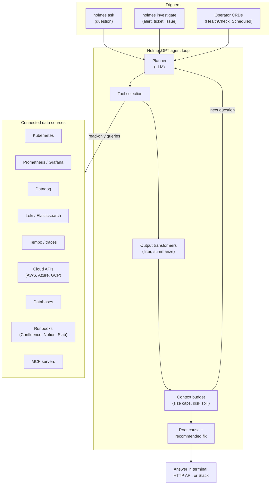

import Tabs from '@theme/Tabs';
import TabItem from '@theme/TabItem';
import Card from '@site/src/components/Card/Card';
import CardGroup from '@site/src/components/Card/CardGroup';
import Steps from '@site/src/components/Steps/Steps';
import Step from '@site/src/components/Steps/Step';
import Accordion from '@site/src/components/Accordion/Accordion';
import AccordionGroup from '@site/src/components/Accordion/AccordionGroup';

# HolmesGPT: SRE Agent - CNCF Sandbox Project

HolmesGPT is an open source (Apache-2.0) AI agent built for one job: take a production problem, query the observability stack until the evidence explains it, and hand back a root cause with the fix. It started at [Robusta](https://robusta.dev) with major contributions from Microsoft and is now a [CNCF sandbox project](https://www.cncf.io/).

The important part is not "an LLM reads your logs". It is that HolmesGPT owns the investigation loop: it decides which datasource to query next, runs read-only tools inside your existing permissions, transforms oversized payloads before they reach the model, and keeps going until the hypotheses run out or the answer is supported. You can run it as a CLI against a live cluster, feed it an alert from PagerDuty or Alertmanager, or let the operator run health checks on a schedule while nobody is watching.

:::info
Unlike a coding agent pointed at `kubectl`, HolmesGPT is wired to 38+ built-in integrations (Prometheus, Grafana, Datadog, Loki, Tempo, Kubernetes, AWS, Azure, GCP, databases, ITSM and more) and defaults to read-only access that respects the RBAC and cloud IAM you already granted.
:::

## The Problem It Actually Solves

Incident context is scattered. The metric that spiked lives in Prometheus, the trace that shows the latency hop lives in Tempo, the deploy that introduced it lives in ArgoCD, the runbook that explains the workaround lives in Confluence, and the reason the pod got OOM-killed lives in a Kubernetes event nobody kept.

A human spends the first 20 minutes of an incident collecting that evidence. An LLM with a shell does the same thing, badly: it pulls a 200 MB JSON response into the context window, gets truncated, and hallucinates the rest.

HolmesGPT addresses both halves:

- **Retrieval breadth**: 38+ built-in toolsets, plus MCP servers, HTTP connectors and database connectors, so no single vendor defines what the agent can see.
- **Context discipline**: server-side filtering and aggregation, JSON tree traversal with depth limits, tool output transformers, per-tool memory limits and automatic output budgeting. Large results spill to disk instead of blowing up the context window.

By default a single tool response is capped at 15% of the context window (or 25,000 tokens, whichever is lower), and tool subprocesses get a virtual memory cap (800 MB on x86_64, 1500 MB on ARM). Both are tunable, and the defaults are deliberate: they stop one noisy query from ending the investigation.

## How an Investigation Runs



The loop is unremarkable on purpose. What makes it useful in production is what surrounds it:

- **Tool selection is metadata-driven**. Holmes auto-discovers which toolsets are configured and only offers those tools to the model, so an unconfigured Grafana is never proposed as a source of truth.
- **Evidence is passed through, not re-drawn**. When Holmes queries Prometheus, the raw time series goes to the client alongside the written analysis, so the graph cannot be hallucinated. Clients that support this render interactive charts, log tables and trace waterfalls (the Robusta UI is one such client).
- **Dependency chains are inferred from live data**. Span parent-child relationships from traces, Kubernetes ownership chains, and Prometheus `job` / `instance` labels reconstruct what calls what at runtime, not what the architecture diagram claims.

## Data Sources

All built-in integrations are read-only by default. The ones that matter most for a first deployment:

| Category | Integrations |
| :--- | :--- |
| Metrics | Prometheus (including AMP, Grafana Cloud, Azure and Google managed variants), VictoriaMetrics, Datadog, New Relic, Coralogix |
| Logs | Loki, Elasticsearch / OpenSearch, VictoriaLogs, Splunk, Datadog, Coralogix |
| Traces | Tempo, Datadog, New Relic |
| Kubernetes | Core resources, events and pod logs, plus AKS, OpenShift, Cilium, KubeVela, Crossplane, Helm, ArgoCD |
| Cloud | AWS (any API via the hosted AWS MCP server), Azure, GCP |
| Databases | PostgreSQL, MySQL, MariaDB, ClickHouse, SQL Server, SQLite, MongoDB, MongoDB Atlas |
| Knowledge | Confluence, Atlassian Rovo (Jira + Confluence), Notion, Slab, internet search |
| ITSM and CI | ServiceNow, Jenkins, GitHub, GitLab, Sentry, PagerDuty |
| Messaging | Kafka, RabbitMQ |

Anything without a built-in toolset can usually be reached three ways: an [HTTP connector](https://holmesgpt.dev/latest/data-sources/api-toolsets/) in YAML (with host, path and method allowlists), a database connector, or an existing MCP server. The HTTP connector is the pragmatic option for internal admin APIs: it turns a REST endpoint into an LLM-friendly tool with `jq` and `max_depth` parameters so the model can navigate large responses instead of swallowing them.

## When to Use HolmesGPT

- **Evidence spans systems.** The failure is visible in metrics, logs, traces, Kubernetes events and a recent rollout, and nobody has all five open at once.
- **You want triage, not another dashboard.** Holmes reads alerts from Alertmanager, PagerDuty, Opsgenie, Jira or GitHub issues, investigates, and can write the finding back to the ticket with `--update`.
- **Runbooks should be usable by the agent.** Confluence, Notion and Slab integrations let Holmes apply the procedure your team already documented.
- **The infrastructure is not all Kubernetes.** The CLI works against VMs, bare metal, cloud services and SaaS platforms. Kubernetes is the common case, not a requirement.
- **You want one governed instance instead of personal credentials.** Deploy Holmes once with scoped read-only access and let engineers ask questions through it, rather than every laptop holding production tokens with write scope.
- **You need background checks.** Operator mode verifies a deployment right after rollout, runs scheduled health checks, and messages Slack when something is wrong.
- **You are debugging CI/CD.** Holmes can be pointed at pipelines and build logs, which is a different context window than the one you use for monitoring.

## When Not to Use HolmesGPT

- **You expect autonomous remediation.** Built-in toolsets are read-only. Writing (remediation MCP, ticketing) is opt-in and bounded only by the credentials you grant. Holmes is a diagnosis engine first.
- **Telemetry cannot leave your network.** Investigations send data to whichever LLM provider you configure. Use Ollama or a self-hosted OpenAI-compatible endpoint if that is a hard constraint, and accept that smaller models degrade investigation quality noticeably.
- **The problem is detection.** Holmes consumes alerts; it does not replace your alerting rules or SLOs. Gaps in monitoring stay gaps.
- **You have no observability data connected.** With only the Kubernetes toolset you get a capable `kubectl` investigator, which is useful but far from the product's ceiling.
- **You want a managed SaaS.** This is self-hosted by design. The web UI and the Slack and Teams bots are third-party integrations built by Robusta, not part of the core project.
- **You plan to gate production on operator mode today.** Holmes Operator is explicitly alpha and subject to breaking changes, and every health check triggers at least one LLM call. Start with hourly or daily schedules, watch spend, then scale.
- **You cannot give it read access to anything.** The agent is only as good as the sources it can query. No Prometheus, no Loki, no cloud read role means no useful root cause.

## Install and Run

Most users should run the CLI or a UI. The project's own Helm guidance says the chart is mainly for teams building a custom integration on top of the HTTP API.

<Steps>
  <Step title="Install the CLI">
    <Tabs groupId="holmes-install">
      <TabItem value="brew" label="Homebrew" default>
        ```bash
        brew tap robusta-dev/homebrew-holmesgpt
        brew install holmesgpt
        holmes ask --help
        ```
      </TabItem>
      <TabItem value="pipx" label="pipx">
        ```bash
        pipx install holmesgpt
        holmes ask --help
        ```
      </TabItem>
      <TabItem value="docker" label="Docker">
        ```bash
        docker run -it --net=host \
          -e OPENAI_API_KEY="your-api-key" \
          -v ~/.holmes:/root/.holmes \
          -v $HOME/.kube/config:/root/.kube/config \
          us-central1-docker.pkg.dev/genuine-flight-317411/devel/holmes \
          ask "what pods are unhealthy and why?"
        ```
      </TabItem>
    </Tabs>
  </Step>

  <Step title="Pick a model provider">
    OpenAI needs only `OPENAI_API_KEY`. Other providers generally need their key plus an explicit `--model` prefix such as `anthropic/`, `bedrock/`, `azure/`, `gemini/`, `vertex_ai/` or `ollama_chat/`.

    ```bash
    export ANTHROPIC_API_KEY="your-api-key"
    holmes ask "what is wrong with the user-profile-import pod?" \
      --model="anthropic/claude-sonnet-4-5-20250929"
    ```

    For Gemini, also export `TOOL_SCHEMA_NO_PARAM_OBJECT_IF_NO_PARAMS=true`. For Bedrock, install `boto3>=1.28.57` and set the `AWS_*` variables. See the [AI providers documentation](https://holmesgpt.dev/latest/ai-providers/) for the exact combinations.
  </Step>

  <Step title="Connect data sources">
    Minimal: point Holmes at Prometheus with an environment variable.

    ```bash
    export PROMETHEUS_URL="http://prometheus-server.monitoring.svc.cluster.local:9090"
    ```

    Everything else lives in `~/.holmes/config.yaml` (override the path with `HOLMES_CONFIG_PATH`). A Prometheus toolset entry looks like this:

    ```yaml
    toolsets:
      prometheus/metrics:
        enabled: true
        subtype: prometheus
        config:
          prometheus_url: http://prometheus-server.monitoring.svc.cluster.local:9090
          additional_headers:
            Authorization: "Basic <base64_credentials>"
    ```

    Datadog, Loki, Grafana, AWS, Azure, GCP and the rest follow the same `toolsets:` shape with different `config:` keys. The [built-in toolsets reference](https://holmesgpt.dev/latest/data-sources/builtin-toolsets/) has the exact schema for each.
  </Step>

  <Step title="Ask a real question">
    ```bash
    holmes ask "what Prometheus alerts are currently firing and why?"
    holmes ask "what is the health of my Elasticsearch cluster?"
    holmes ask "are there any issues with my production databases?"
    ```

    In interactive mode Holmes streams each tool call, its duration, and the output size. From there you can follow up, or pull the raw output with `/show 3` when the summary is not enough.
  </Step>
</Steps>

### Interactive commands worth memorizing

| Command | Purpose |
| :--- | :--- |
| `/tools` | Show configured toolsets and whether each one is enabled or missing configuration |
| `/context` | Token usage and the tools eating the most context |
| `/show [number\|name]` | Full tool output, including the parts the summary dropped |
| `/run <command>` | Run a local command and optionally share the output with the model |
| `/clear` | Reset the conversation when you switch incidents |

`/run` is the escape hatch that makes Holmes practical on messy infrastructure: `ssh` into the box, run `sudo` commands the agent cannot run itself, then choose whether to share the output. Nothing is shared without confirmation.

## Investigating Alerts Directly

Instead of asking a question, hand Holmes the incident:

```bash
# Prometheus / Alertmanager
holmes investigate alertmanager --alertmanager-url http://alertmanager:9093

# PagerDuty, and write the finding back to the incident
holmes investigate pagerduty --pagerduty-api-key <key> --update

# Opsgenie
holmes investigate opsgenie --opsgenie-api-key <key>

# Jira, and write the finding back to the ticket
holmes investigate jira --jira-url https://company.atlassian.net \
  --jira-username user@example.com --jira-api-key <key> --update

# GitHub issues
holmes investigate github --github-owner org --github-repository repo \
  --github-pat <token>
```

Holmes extracts labels, severity and annotations from the alert, selects the relevant toolsets, and starts the investigation without you restating context. Writing results back requires `--update` and the credentials to do it.

## Operator Mode: 24/7 Background Checks

The CLI only helps when a human already noticed something. Holmes Operator closes that gap by running inside Kubernetes and defining checks as CRDs, following the Job / CronJob pattern:

- `HealthCheck`: one-time run, useful as a post-deploy verification step.
- `ScheduledHealthCheck`: creates `HealthCheck` resources on a cron schedule.
- `TriggeredHealthCheck`: runs automatically when a matching Deployment rolls out.

A scheduled check that reports to Slack looks like this:

```yaml
apiVersion: holmesgpt.dev/v1alpha1
kind: ScheduledHealthCheck
metadata:
  name: hourly-cluster-health
spec:
  schedule: "0 * * * *"
  query: "Is the cluster healthy? Check pods, deployment rollouts, error rates, resource pressure, and recent log anomalies."
  timeout: 60
  destinations:
    - type: slack
      config:
        channel: "#platform-alerts"
```

Enable the operator in the Helm values of an existing Holmes deployment:

```yaml
operator:
  enabled: true
  holmesApiTimeout: 300
  maxHistoryItems: 10
  resources:
    requests:
      memory: 256Mi
      cpu: 100m
    limits:
      memory: 512Mi
```

Then verify the CRDs and the controller:

```bash
helm upgrade holmes robusta/holmes -f values.yaml
kubectl get crd | grep holmesgpt.dev
kubectl get hc
kubectl logs -l app.kubernetes.io/name=holmes-operator --tail=50
```

:::warning
Two costs hide in operator mode. First, every check is at least one LLM call, so a five-minute schedule across twenty checks is a real bill. Second, the operator is alpha, so pin the chart version and keep the checks you depend on small and explicit. The operator needs Kubernetes 1.19+ and a reachable Holmes API service.
:::

The checks are not limited to Kubernetes. Because each `HealthCheck` is just a query, a scheduled check can ask about a database, an AWS account or a SaaS endpoint as long as that data source is connected to Holmes.

## Safety, Permissions and Cost

- **Read-only by default.** Kubernetes access uses a ServiceAccount with the chart's ClusterRole (or namespace-scoped RBAC if you enable it); cloud access uses whatever IAM role you attach. No separate credential store, no privilege escalation.
- **Scope the blast radius.** If you must not have cluster-wide visibility, enable namespace-scoped RBAC and set `SCOPED_NAMESPACES` so investigations start scoped instead of discovering the restriction through `Forbidden` errors.
- **Protect the API.** When running the server, set `HOLMES_API_KEY`; every request then needs an `X-API-Key` or bearer token. `HOLMES_APPROVAL_SIGNING_KEY` keeps tool-approval tokens valid across restarts.
- **Audit everything.** Export tool calls, prompts and answers with OpenTelemetry if you need a trail of what the agent read.
- **Watch the spend.** Token usage per `/api/chat` request can be logged with `TRACE_TOKEN_USAGE=true`. Model choice changes result quality far more than it changes the prompt, so check the project's benchmarks before optimizing on price.

<AccordionGroup>
  <Accordion title="HolmesGPT vs a general coding agent with kubectl access" icon="mdi:compare">
    A coding agent can run `kubectl` and `curl`. HolmesGPT differs in three ways that matter during an incident: it has pre-built, read-only integrations with the schema for each datasource; it manages context so a large query does not truncate the investigation; and it produces an incident-shaped answer (root cause, evidence, recommended fix) rather than a code change. If your incident response already lives in a well-structured runbook and you only need shell access, a general agent is cheaper. If you need cross-datasource evidence in one pass, Holmes is the narrower and better tool.
  </Accordion>

  <Accordion title="HolmesGPT vs OpenSRE" icon="mdi:scale-balance">
    [OpenSRE](../Workflows/opensre.md) is a framework for building your own AI SRE agents, with masking of sensitive identifiers before external LLM calls and a strong focus on customization. HolmesGPT is an opinionated agent with a CLI, an HTTP API, a Kubernetes operator and a large built-in integration catalogue. Choose OpenSRE when you want to own the pipeline and the data handling; choose HolmesGPT when you want a working investigation agent this week and a CRD-driven background checker.
  </Accordion>

  <Accordion title="What the answer actually looks like" icon="mdi:file-document-outline">
    A completed investigation reports the probable root cause, the supporting evidence (with links to dashboards, traces and log queries where the client supports it), and recommended actions. It does not silently change anything. Treat the output as a senior engineer's hypothesis with receipts: verify the evidence before acting, especially when the conclusion depends on a single noisy metric.
  </Accordion>
</AccordionGroup>

## Beyond the CLI

<CardGroup cols={2}>
  <Card title="Helm Chart" icon="mdi:kubernetes" href="https://holmesgpt.dev/latest/installation/kubernetes-installation/">
    Deploy Holmes as a service with an HTTP API and cluster-wide read access, for custom integrations and the operator.
  </Card>
  <Card title="Operator Docs" icon="mdi:robot" href="https://holmesgpt.dev/latest/operator/">
    HealthCheck, ScheduledHealthCheck and TriggeredHealthCheck resources, plus Slack and PagerDuty destinations.
  </Card>
  <Card title="Recommended Setup" icon="mdi:tune" href="https://holmesgpt.dev/latest/data-sources/recommended-setup/">
    The combination of data sources the project recommends before you trust an investigation in production.
  </Card>
  <Card title="Benchmarks" icon="mdi:chart-box" href="https://holmesgpt.dev/latest/development/evaluations/latest-results/">
    Per-model evaluation results, which is the only sane way to pick a model for root cause analysis.
  </Card>
</CardGroup>

## References

- [HolmesGPT Documentation](https://holmesgpt.dev/) - Installation, AI providers, data sources, operator and reference material.
- [GitHub Repository](https://github.com/HolmesGPT/holmesgpt) - Source code, configuration examples and issue tracker.
- [CLI Installation](https://holmesgpt.dev/latest/installation/cli-installation/) - Homebrew, pipx, Poetry and Docker install paths.
- [Built-in Toolsets](https://holmesgpt.dev/latest/data-sources/builtin-toolsets/) - Full integration list with the YAML schema for each.
- [Environment Variables Reference](https://holmesgpt.dev/latest/reference/environment-variables/) - Every supported variable, default and side effect.
- [Holmes Operator](https://holmesgpt.dev/latest/operator/) - Background health checks and alert destinations.
- [Related Article: OpenSRE](../Workflows/opensre.md) - A framework-first approach to building AI SRE agents.
