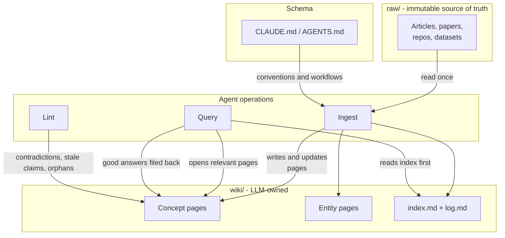

import Card from '@site/src/components/Card/Card';
import CardGroup from '@site/src/components/Card/CardGroup';
import Steps from '@site/src/components/Steps/Steps';
import Step from '@site/src/components/Steps/Step';

# Karpathy's LLM Wiki: Your AI Stops Searching Your Documents and Compiles Them Into a Wiki

Most AI setups over documents are retrieval systems. You upload a pile of files, the model fetches the most similar chunks at question time, and it writes an answer from those fragments. The answer may be good, but the same synthesis work happens again on the next question, and the one after that. Nothing accumulates.

**LLM Wiki** is Andrej Karpathy's alternative: let the agent read each source once and compile it into a persistent, interlinked wiki of Markdown pages. Questions are answered against that wiki, not against the raw folder. The knowledge is compiled once and then kept current, instead of being rediscovered on every query.

Karpathy published the pattern in April 2026 as a short GitHub gist he calls "an idea file". It contains no code and no product. You paste it into an agent such as Claude Code, Codex, or OpenCode, and the agent builds the concrete structure with you.

:::info
The core shift is where the work happens. Retrieval spends effort at query time, on every question. Compilation spends it at ingest time, once per source, and stores the result as pages you can read, diff, and correct by hand.
:::

## The Problem with Pure Retrieval

Basic RAG reduces your documents to chunks and embeddings. A vector store can tell you which chunk looks semantically similar to a question. It cannot tell you that one chunk contradicts another, that a newer paper superseded an older claim, or that three sources describe the same idea with different names. Those relationships are not in the embeddings.

The result is a system that starts from zero on every question. Ask something that needs five documents synthesized, and the model has to find and reassemble the relevant fragments each time. It works, but the corpus never gets smarter. This is roughly how NotebookLM, chat file uploads, and most RAG pipelines behave.

Advanced RAG variants extract relationships into a graph ahead of time, which moves some of the work to ingest. The LLM Wiki goes further: it writes the synthesis down as prose, with explicit cross-references and explicit notes about contradictions.

## The Three Layers

The pattern is deliberately small. There are only three layers.


{/*
Mermaid source for the diagram above, kept for agents and future edits. It is not rendered.


*/}

- **Raw sources**: your curated documents. Articles, papers, images, data files. The agent reads them and never edits them, so they remain the ground truth you can always check against.
- **The wiki**: a directory of agent-written Markdown pages. Summaries, entity pages, concept pages, comparisons, an overview. The agent owns this layer completely; you read it.
- **The schema**: one document, for example `CLAUDE.md` or `AGENTS.md`, that tells the agent how the wiki is organized and which workflow to follow. This is the file that turns a generic chatbot into a disciplined maintainer, and you refine it over time.

A wiki page is not a summary of a document. It is a page about a concept, assembled from every source that touched it. That difference is what makes the corpus feel like a knowledge base instead of a folder of summaries.

## The Three Operations

<Steps>
  <Step title="Ingest">
    Drop a source into the raw collection and tell the agent to process it. The agent reads it, discusses the takeaways with you, writes a summary page, updates the index, revises every related concept and entity page, and appends a log entry. Per the gist, a single source might touch 10 to 15 pages.

    You can ingest one source at a time and stay involved, or batch a week of material with less supervision. Batch ingest has an advantage: the agent can notice that the same constraint appeared in three separate sources, which a strictly one-at-a-time flow cannot see.
  </Step>

  <Step title="Query">
    Ask a question against the wiki. The agent reads the index, opens the relevant pages, and synthesizes an answer with citations. Answers can be a Markdown page, a comparison table, a slide deck, or a chart.

    The step that is easy to miss: a good answer gets filed back into the wiki as a new page. Comparisons and connections you worked out in chat should not disappear into chat history. Your explorations compound the same way sources do.
  </Step>

  <Step title="Lint">
    Periodically ask the agent to health-check the whole wiki. Look for contradictions between pages, claims that newer sources have superseded, orphan pages with no inbound links, concepts mentioned everywhere but lacking their own page, missing cross-references, and gaps worth filling with a new source.

    Code has linters. A knowledge base needs one too, because drift is silent.
  </Step>
</Steps>

## Index and Log: Two Small Files That Do the Heavy Lifting

Two special files keep the wiki navigable, and they answer different questions.

| File | Role | What it holds |
|---|---|---|
| `index.md` | Content-oriented catalog | One entry per page with a link and a one-line summary, grouped by category. The agent reads it first, then drills into the pages that matter. |
| `log.md` | Chronological record | An append-only diary of ingests, queries, and lint passes. A consistent prefix per entry makes it greppable with ordinary Unix tools. |

The index is the quiet trick of the whole design. Karpathy notes that it works surprisingly well at moderate scale, around 100 sources and a few hundred pages, which is enough to avoid embedding-based RAG infrastructure entirely.

## Compilation Versus Retrieval

The two approaches are not enemies. They are two places to spend the same effort.

| | RAG over raw documents | Compiled wiki |
|---|---|---|
| **When the work happens** | At query time, every time | At ingest time, once per source |
| **What is searched** | Raw chunks, with noise and repetition | Synthesized pages, one concept each |
| **Cost shape** | Cheap to build, a cost per query | Expensive per ingest, cheap per query |
| **New material** | Searchable as soon as it is embedded | Available after the next ingest |
| **Change over time** | Returns fragments, cannot flag a reversal | The page holds the history and the supersession |
| **Accretion** | None, every query starts from the same corpus | Every ingest improves the corpus for later questions |
| **Inspectability** | Embeddings you cannot read | Markdown files you can open, diff, and fix |
| **Characteristic failure** | Fetches the wrong passage: visible, transient | Writes a wrong claim: durable, quiet, read as fact |

Read the last two rows together and the division of labor is clear. If your questions are mostly "where was that mentioned", compilation is overhead on top of search. If they are mostly "what do we currently think about X, and how did we get here", retrieval keeps handing you fragments to reassemble by hand.

## When to Use It, by Corpus Size

The right answer depends less on the tooling than on how much material you have and how long you plan to keep it.

| Corpus size | Recommendation |
|---|---|
| **A handful of documents** | Skip the wiki. Upload the files or paste the relevant sections. The schema and the ingest pass cost more than they save. |
| **Around 10 to 100 sources, a few hundred pages** | The sweet spot. An index file plus well-written pages is enough navigation, and no vector database is needed. |
| **Hundreds to low thousands of sources** | Keep the wiki, add a local search tool over the Markdown pages. The gist suggests a Markdown search engine such as `qmd`, which combines keyword and vector search with local re-ranking. Search the compiled pages, not the raw pile. |
| **Tens of thousands of documents, or a corpus you did not curate** | Treat the wiki as a curated layer for the topics you actually care about, not as an index of everything. For pure recall across a huge corpus, hybrid search or a graph layer earns its place. |

Three more signals say the pattern fits:

- You return to the same subject for weeks or months, not once.
- Your questions need synthesis across several sources, not a single passage.
- You want to see how a conclusion changed as new material arrived.

## When Not to Use It

- **Your questions are needle lookups.** Exact quotes, contract clauses, log lines, a specific page number. A search index is cheaper and more precise. The compiled wiki is weakest exactly at the aside that no page thought worth keeping.
- **The corpus changes faster than you ingest.** If the source of truth is a live feed, a fast-moving repository, or today's tickets, a compiled wiki is stale by design. Retrieve from the live source instead.
- **You need a canonical, auditable answer.** The agent authors every page. A wrong claim becomes durable and quiet, and readers treat wiki prose as fact. For compliance, legal, or medical decisions, keep a human review gate or point to the raw source.
- **You cannot review what it writes.** The pattern assumes you browse the diffs, follow the links, and correct it. An unread wiki rots while looking healthy.
- **Multiple people with different permissions need it.** A folder of Markdown has no access control. Per-user visibility belongs in a system built for it.
- **You only need one answer.** Building the schema, the ingest flow, and the lint cycle is wasted on a one-off question.

:::warning
The most dangerous failure of a compiled wiki is not a missing page. It is a confident, well-linked, outdated page. Lint passes and a visible `log.md` are the cheap defense; reading the diffs is the real one.
:::

## Setting One Up

The pattern is intentionally abstract. Everything below is a starting shape, not a specification.

<Steps>
  <Step title="Create the folders">
    Keep the layers physically separate. Only the agent writes to `wiki/`, and nothing ever writes to `raw/`.

    ```text
    knowledge/
    ├── raw/        sources, immutable
    ├── wiki/       agent-owned Markdown pages
    │   ├── index.md
    │   └── log.md
    └── CLAUDE.md   or AGENTS.md
    ```
  </Step>

  <Step title="Collect sources as Markdown">
    Convert web articles with a clipper such as Obsidian Web Clipper, and convert PDFs and Office files with a converter. [MarkItDown](markitdown.md) and [Docling](https://github.com/docling-project/docling) both produce clean Markdown from formats an LLM reads poorly.

    Download images locally if the agent should be able to look at them. A broken image URL is a lost source.
  </Step>

  <Step title="Write the schema">
    Describe the folder layout, the page types, the frontmatter conventions, and the exact steps for ingest, query, and lint. Then tell the agent to follow that file. This is the highest-leverage document in the setup, and it should change as you learn what your domain needs.
  </Step>

  <Step title="Ingest one source and inspect the result">
    Watch which pages the agent touches, whether it created a near-duplicate instead of extending an existing page, and whether the index entry reads well. Fix the schema, not just the page, so the next ingest goes better.
  </Step>

  <Step title="Add lint and a cadence">
    Schedule a periodic health-check pass, and keep `log.md` append-only. When the wiki outgrows the index, add search before adding complexity.
  </Step>
</Steps>

Two companion articles cover this pattern inside Obsidian: [Obsidian Skills & LLM Wiki Setup](../Skills/obsidian-skills-setup.md) walks through the vault, the schema file and the ingest workflow, and [Obsidian as a Backend, Not a Second Brain](../Skills/obsidian-as-a-backend.md) covers the human/machine vault layout that surrounds the wiki.

:::tip
Karpathy's own description of the workflow is worth keeping: Obsidian is the IDE, the LLM is the programmer, and the wiki is the codebase. The wiki is just a Git repository of Markdown, so you get diffs, history, and blame for free.
:::

## How It Relates to Other Tools

<CardGroup cols={2}>
  <Card title="NotebookLM" icon="mdi:notebook" href="notebooklm">
    Grounded Q&A over a fixed set of sources. Excellent for one research session, but it does not persist a compounding synthesis between sessions.
  </Card>
  <Card title="OpenWiki" icon="mdi:book-open" href="openwiki">
    The same instinct applied to a codebase: an agent generates and maintains repository documentation. OpenWiki keeps the wiki in the repo; Karpathy's pattern keeps it over your sources.
  </Card>
  <Card title="Graphify" icon="mdi:graph" href="graphify">
    Compiles a folder into a knowledge graph instead of prose. A graph is better for structure and traversal; a wiki is better for reading and argument.
  </Card>
  <Card title="MarkItDown" icon="mdi:file-document" href="markitdown">
    The ingest step needs clean Markdown. MarkItDown strips Office and PDF noise before the agent reads a source.
  </Card>
</CardGroup>

The closest conceptual relative outside software is Vannevar Bush's Memex: a private, curated store where the links between documents matter as much as the documents. The part Bush could not solve was who does the maintenance. That is the part the LLM now handles.

## References

- [LLM Wiki gist by Andrej Karpathy](https://gist.github.com/karpathy/442a6bf555914893e9891c11519de94f) - The original idea file, including the three layers, three operations, indexing tips, and optional tooling.
- [Video: La LLM Wiki de Karpathy](https://youtu.be/4U2FESAGoHg) - Spanish-language walkthrough of the pattern and why it differs from RAG.
- [Obsidian](https://obsidian.md/) - Local-first Markdown editor and viewer for the generated wiki.
- [Graphify](graphify.md) - Knowledge graph alternative for codebases and mixed folders.
- [Karpathy's LLM Coding Guidelines](../Skills/karpathy-skills.md) - A different Karpathy contribution: behavioral rules for coding agents.
