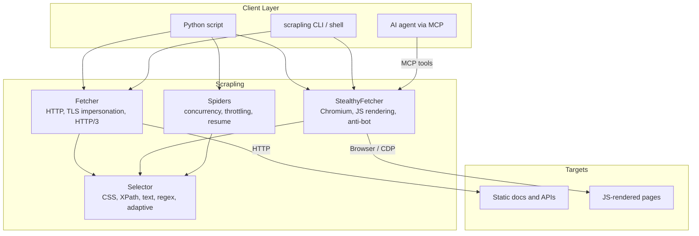

import Tabs from '@theme/Tabs';
import TabItem from '@theme/TabItem';
import Card from '@site/src/components/Card/Card';
import CardGroup from '@site/src/components/Card/CardGroup';
import Accordion from '@site/src/components/Accordion/Accordion';
import AccordionGroup from '@site/src/components/Accordion/AccordionGroup';
import Steps from '@site/src/components/Steps/Steps';
import Step from '@site/src/components/Steps/Step';

# Scrapling: Self-Healing Python Scraping

Fetching documentation for an AI agent is usually three tools glued together: `requests` for static pages, Playwright for the JavaScript-rendered ones, and a parser that breaks the moment a site redesigns its markup. **Scrapling** is a Python framework by Karim Shoair (D4Vinci) that puts all three layers behind one API, from a single `Fetcher.get()` call up to a concurrent spider that crawls a whole documentation site and exports clean Markdown.

Its headline feature is **adaptive scraping**, marketed as "self-healing": you save the properties of an element once, and when the site changes its class names or nesting, Scrapling relocates that element by similarity instead of failing. No LLM in the loop.

The framework is BSD-3-Clause licensed and aims to be familiar to anyone coming from Scrapy or BeautifulSoup: the same `::text` pseudo-elements, the same CSS/XPath selection style.

## How It Fits Together

Scrapling is layered. You pick the fetcher that matches the target, then run every selection method against the same `Selector` object, whether the bytes came from an HTTP client or a full browser.



The same `Selector` API also works offline, which is useful when replaying saved HTML in tests:

```python
from scrapling.parser import Selector

page = Selector(open("saved.html").read())
print(page.css("h2::text").getall())
```

## Requirements & Installation

- **Python 3.10 or higher.**
- The base package ships only the parser. Importing `scrapling.fetchers` or `scrapling.spiders` without the extras raises `ModuleNotFoundError`.
- Browser fetchers need Chromium and its system dependencies, installed with `scrapling install`. Plain HTTP requests do not.

<Steps>
  <Step title="Install the package">
    <Tabs groupId="install-method">
      <TabItem value="pip" label="pip (all features)" default>
        ```bash
        pip install "scrapling[all]"
        ```
        The individual extras are `[fetchers]`, `[ai]` (MCP server), `[shell]` (interactive shell and `extract` command) and `[rag]` (Markdown conversion). Pick only the ones you need.
      </TabItem>
      <TabItem value="docker" label="Docker">
        ```bash
        docker pull pyd4vinci/scrapling
        # or
        docker pull ghcr.io/d4vinci/scrapling:latest
        ```
        The image already bundles the browsers and every extra.
      </TabItem>
    </Tabs>
  </Step>
  <Step title="Install the browsers">
    Only needed for `StealthyFetcher` and the browser-based spiders.
    ```bash
    scrapling install
    ```
    Use `scrapling install --force` to reinstall a broken browser bundle.
  </Step>
  <Step title="Verify the CLI">
    ```bash
    scrapling --help
    ```
  </Step>
</Steps>

## Basic Usage: Gathering Tool Documentation

One request, three selection styles, one Markdown export. `Fetcher` impersonates a real browser's TLS fingerprint at the HTTP layer, which is enough for most documentation sites:

```python
from scrapling.fetchers import Fetcher

page = Fetcher.get("https://scrapling.readthedocs.io/en/latest/parsing/selection.html")

title = page.css("h1::text").get()            # CSS with a text pseudo-element
headings = page.css("h2::text").getall()      # every match
links = page.xpath("//nav//a/@href").getall() # XPath when the structure is awkward

markdown = page.markdown()                    # sanitized, LLM-ready Markdown

print(title)
print(f"{len(headings)} sections, {len(links)} nav links")
```

:::info
`markdown()` needs the `rag` extra (`pip install "scrapling[rag]"`, already included in `[ai]`, `[shell]` and `[all]`). It always strips scripts, styles and hidden prompt-injection content; pass `main_content_only=True` to drop navigation and keep the page body.
:::

For more than one page, reuse a session so cookies, connections and the TLS fingerprint persist:

```python
from scrapling.fetchers import FetcherSession

with FetcherSession(impersonate="chrome") as session:
    for slug in ["parsing/selection", "fetching/choosing", "spiders/architecture"]:
        page = session.get(
            f"https://scrapling.readthedocs.io/en/latest/{slug}.html",
            stealthy_headers=True,
        )
        print(slug, page.css("h1::text").get())
```

When the docs site renders its content client-side, swap the fetcher. `StealthyFetcher` runs a real Chromium with fingerprint spoofing and can solve Cloudflare's Turnstile and interstitial challenges:

```python
from scrapling.fetchers import StealthyFetcher

page = StealthyFetcher.fetch("https://example.com/docs", solve_cloudflare=True)
print(page.css("article h2::text").getall())
```

:::tip
Both fetchers return the same `Selector` object, so parsing code written against `Fetcher` works unchanged against `StealthyFetcher`. That is the main reason to keep the fetch and parse steps in separate functions.
:::

## Adaptive Selectors: The "Self-Healing" Part

The adaptive mode works in two phases. On a healthy page you save the target element's properties (`auto_save=True`); later, when the selector no longer matches, you ask Scrapling to relocate it by similarity (`adaptive=True`) using a local SQLite store keyed by domain.

```python
from scrapling import Fetcher

Fetcher.configure(adaptive=True)

page = Fetcher.get("https://example.com/changelog")
entry = page.css("#release-notes .version", auto_save=True)

# Months later, the site renames the classes:
page = Fetcher.get("https://example.com/changelog")
entry = page.css("#release-notes .version", adaptive=True)  # still resolves
```

The comparison scores tag names, text, attribute names and values, sibling tag names, path and the parent's attributes, so renames and wrapper `div`s are survivable.

:::warning
Adaptive matching is a recovery net, not a licence to write brittle selectors. It saves only the first element of a selection result, so a selector returning many items relocates only one of them. Re-saving overwrites the previous data. Keep saving and matching per logical block, and log when the adaptive path is used so you notice a real site change.
:::

## Crawling a Documentation Site

`Spider` is a Scrapy-like class with async parsing, concurrency limits, per-domain throttling, `robots_txt_obey`, and pause/resume through a `crawldir`. For a docs corpus, the useful part is `page.markdown()` combined with the built-in JSONL export, which gives you one record per page ready for a retrieval index:

```python
from scrapling.spiders import Spider, Response


class DocsSpider(Spider):
    name = "docs"
    start_urls = ["https://scrapling.readthedocs.io/en/latest/"]
    allowed_domains = {"scrapling.readthedocs.io"}
    concurrent_requests = 8
    robots_txt_obey = True

    async def parse(self, response: Response):
        yield {
            "url": response.url,
            "title": response.css("h1::text").get(),
            "markdown": response.markdown(main_content_only=True),
        }

        for href in response.css("a::attr(href)").getall():
            yield response.follow(href, callback=self.parse)


result = DocsSpider(crawldir="./crawl_data").start()
print(len(result.items))
result.items.to_jsonl("docs.jsonl")
```

With `crawldir` set, `Ctrl+C` saves pending requests and seen URLs; restarting with the same directory resumes. Exporters are available as `to_json`, `to_jsonl`, `to_csv` and `to_xml`.

Ready-made templates cover the common shapes: `CrawlSpider` for rule-based link following, `SitemapSpider` for sitemap-driven crawls, `XMLFeedSpider` and `CSVFeedSpider` for feeds, and `ContentSpider`, which crawls a site straight into a Markdown corpus.

## CLI and Agent Access

The `extract` command scrapes a page to a file without writing Python. The extension picks the format (`.md`, `.txt`, `.html`):

```bash
# Whole page to Markdown
scrapling extract get "https://scrapling.readthedocs.io/en/latest/" docs.md

# Only matching elements, with browser impersonation
scrapling extract get "https://quotes.toscrape.com/" quotes.txt \
  --css-selector ".quote" --impersonate "chrome"

# JavaScript-rendered page: wait for the content before extracting
scrapling extract fetch "https://quotes.toscrape.com/js/" quotes.md \
  --css-selector ".quote" --wait-selector ".quote"
```

`pip install "scrapling[shell]"` also adds `scrapling shell`, an IPython shell with Scrapling preloaded, plus a curl-to-Scrapling converter.

For an agent that should browse on its own, the MCP server exposes HTTP and stealth-browser tools with ad blocking and prompt-injection sanitization of hidden content:

```bash
pip install "scrapling[ai]"
claude mcp add ScraplingServer "$(which scrapling-mcp)"
```

<AccordionGroup>
  <Accordion title="Which MCP tools does it expose?" icon="mdi:tools">
    One-shot tools (`make_request`, `browser_fetch_once`), session tools (`browser_open`, `open_request_session`, `browser_fetch`, `session_make_request`, `close_session`, `list_sessions`), plus `browser_actions`, `browser_evaluate`, `browser_extract`, `browser_screenshot` and network-history inspection. Sessions keep cookies and login state across calls, so the agent can paginate or log in once.
  </Accordion>
  <Accordion title="Why not just send raw HTML to the model?" icon="mdi:token">
    A docs page carries navigation, scripts and styling that cost tokens without adding meaning. `page.markdown()` and the MCP server's `browser_extract` return sanitized content instead, and the one-shot tools strip roughly 3,500 known ad and tracker domains before the page is even read.
  </Accordion>
</AccordionGroup>

## Comparison With Other Options

| Option | Fetch layer | Parse layer | Crawl layer | Adaptive selectors | Setup cost |
| :--- | :--- | :--- | :--- | :--- | :--- |
| **Scrapling** | HTTP impersonation + stealth Chromium | CSS, XPath, text, regex, Markdown | Built-in spiders, exports, resume | **Yes** | `pip` + `scrapling install` |
| **requests + BeautifulSoup** | HTTP only | CSS via `soupsieve` | None | No | Minimal |
| **Playwright / Selenium** | Full browser | None (bring your own) | None | No | Browser download per environment |
| **Scrapy** | HTTP via Twisted | CSS/XPath (Parsel) | **Mature**, plugin ecosystem | No | Framework scaffolding |
| **Crawl4AI / Firecrawl** | HTTP + browser | Markdown-first, LLM-oriented | Varies | No | Service or self-hosted stack |

### Advantages

- **One API for all fetch modes.** Switching between a static page and a JavaScript app is a class swap, not a rewrite.
- **Parser speed.** The project benchmarks its parser at 1.99 ms for 5000 nested elements, ahead of Parsel/Scrapy (2.06 ms) and roughly 785x faster than BS4 with Lxml (1562.1 ms).
- **Adaptive element tracking.** The only option in this table that survives markup changes without external AI calls.
- **Crawl features included.** Concurrency, AutoThrottle, retries, proxy rotation, `robots.txt` compliance, pause/resume and JSON/JSONL/CSV/XML exports ship in the same package.
- **Markdown without an LLM.** `page.markdown()` produces clean text for a RAG pipeline at zero token cost and zero API dependency.
- **Familiar surface.** Scrapy-style `::text` pseudo-elements and BeautifulSoup-style `find_all`, so existing scraper code ports easily. A `scrapling_response` decorator even lets you parse Scrapy responses with Scrapling's parser.
- **Full type hints**, useful when the scraper is generated by an agent and reviewed by a human.

### Disadvantages

- **Python only.** Node.js and Go shops need a separate service.
- **Browser bundle is heavy.** `scrapling install` pulls Chromium and its system dependencies, which is a real cost in slim CI images. Static HTTP scraping still works without it.
- **Newer than Scrapy.** The plugin and middleware ecosystem is smaller, so exotic requirements (custom schedulers, deep pipelines) are more likely to need custom code.
- **Adaptive matching has documented edges.** Only the first element of a selection is saved, and similarity matching can pick a plausible wrong element after a large redesign. It needs monitoring, not blind trust.
- **Anti-bot is a moving target.** Cloudflare bypass works today, but betting production reliability on challenge-solving always carries maintenance risk.
- **Two install layers.** Forgetting the `[fetchers]` extra is the most common first error: the base package imports fine and fails at the first fetch.

## When to Use It

- **Building a documentation or knowledge corpus** from many pages of the same site, where you want Markdown plus a URL per record.
- **Sites that change their markup**, and where a selector break silently empties your dataset: changelogs, pricing pages, docs portals.
- **Mixed targets in one pipeline**, some static, some JavaScript-rendered, some behind Cloudflare, without maintaining two codebases.
- **Agent-driven scraping**, where the same library has to serve a Python tool and an MCP client.
- **Replacing a fragile `requests` + `BeautifulSoup` script** that keeps needing maintenance after each redesign.

## When Not to Use It

- **You need a single field from a public JSON API.** `httpx` or `requests` is lighter and needs no browser layer.
- **You need a browser to test your own UI.** Playwright's test runner, tracing and assertions are the right tool; Scrapling is built for extraction, not end-to-end testing.
- **You are already deep into Scrapy** with custom middlewares and pipelines. Porting costs more than adding `scrapy-playwright` for the tricky pages.
- **Non-Python runtime.** A Node or Go service is better served by its own HTTP client and parser than by a Python sidecar.
- **The site forbids it.** Check `robots.txt`, the terms of service and local law first. `robots_txt_obey` exists, but compliance is still your decision.
- **You need a managed, zero-ops API** with SLAs and no browser to maintain. A hosted scraping service fits better.

## References

- [GitHub Repository: Scrapling](https://github.com/D4Vinci/Scrapling) - Source code, benchmarks and release notes.
- [Official Documentation: Scrapling](https://scrapling.readthedocs.io/) - Full guides for fetchers, parsing, spiders and the CLI.
- [Adaptive Scraping Guide](https://scrapling.readthedocs.io/en/latest/parsing/adaptive.html) - How element saving and relocation work, including known limits.
- [MCP Server Guide](https://scrapling.readthedocs.io/en/latest/ai/mcp-server.html) - Tool list, installation and session management.
- [CLI Overview](https://scrapling.readthedocs.io/en/latest/cli/overview.html) - `extract`, the interactive shell and utility commands.
- [midudev on X](https://x.com/midudev/status/2117634091327557893) - Post that surfaced the project.
- [Korben: Scrapling, a self-healing Python scraper](https://korben.info/en/scrapling-python-self-healing-scraper.html) - Independent overview.

<CardGroup cols={2}>
  <Card title="Headless Browsers for AI" icon="mdi:web" href="../../comparatives/headless-browser">
    How lightweight browser engines such as Obscura and Lightpanda fit under a scraping framework.
  </Card>
  <Card title="Obscura Headless Browser" icon="mdi:shield-check" href="obscura">
    Rust headless browser with a native MCP server, usable as the browser layer behind extraction pipelines.
  </Card>
  <Card title="MarkItDown" icon="mdi:file-document" href="markitdown">
    Convert the PDFs and Office files you downloaded into Markdown before indexing them.
  </Card>
  <Card title="Lightpanda Headless Browser" icon="mdi:zap" href="lightpanda">
    Zig-based engine focused on high-concurrency crawling with a small memory footprint.
  </Card>
</CardGroup>
