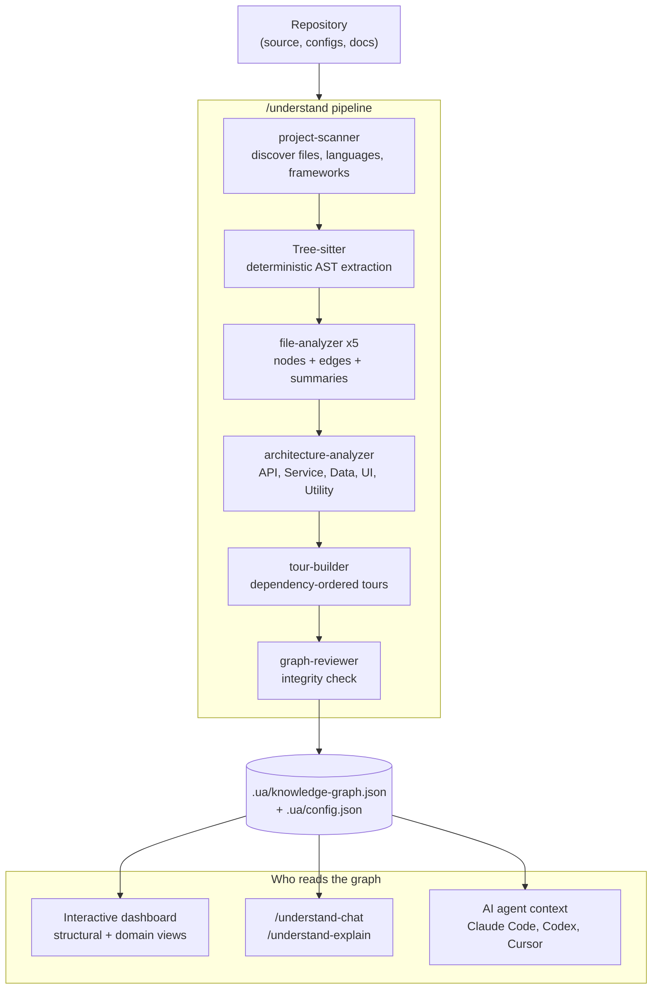

import Tabs from '@theme/Tabs';
import TabItem from '@theme/TabItem';
import Card from '@site/src/components/Card/Card';
import CardGroup from '@site/src/components/Card/CardGroup';
import Steps from '@site/src/components/Steps/Steps';
import Step from '@site/src/components/Steps/Step';
import Accordion from '@site/src/components/Accordion/Accordion';
import AccordionGroup from '@site/src/components/Accordion/AccordionGroup';

# Understand Anything

Understand Anything turns a repository into an interactive knowledge graph: every file, function, class, and dependency becomes a node you can click, search, and ask questions about in a browser dashboard. It runs as a plugin inside your AI coding agent, so the agent that is supposed to work on the codebase is also the one that maps it.

Its tagline is the whole design brief: **graphs that teach beat graphs that impress**. The goal is not a hairball diagram that shows how complex your project is. The goal is a map that quietly tells you how the pieces fit together, in the order you should learn them.

## Summary

Onboarding onto a large repository usually means reading blind: `grep` for a symbol, open a file, follow an import, repeat. Understand Anything does that exploration once, ahead of time, and stores the result as plain JSON that both humans and agents can query.

- It analyzes the codebase with a multi-agent pipeline and writes a knowledge graph to `.ua/knowledge-graph.json`.
- It renders an interactive dashboard with structural and business-domain views, guided tours, fuzzy and semantic search, and diff impact analysis.
- It keeps answering questions after the dashboard closes, through commands like `/understand-chat` and `/understand-explain`.
- It ships the graph as JSON, so a team can commit it once and let everyone browse it without re-running the pipeline or spending LLM tokens.

:::info
The graph is the deliverable, not the agent's answer. Once `.ua/` is committed, any teammate can open the full dashboard with a single `npx` command - no agent, no API key, and no model call.
:::

## What You Get

<CardGroup cols={2}>
  <Card title="Structural Graph" icon="mdi:graph-outline" href="https://github.com/Egonex-AI/Understand-Anything#explore-the-structural-graph">
    Files, functions, and classes as clickable nodes with plain-English summaries, relationships, and colour coding by architectural layer.
  </Card>
  <Card title="Domain View" icon="mdi:domain" href="https://github.com/Egonex-AI/Understand-Anything#understand-business-logic">
    A horizontal graph of business domains, flows, and steps, so non-engineers can see what the code actually does for the product.
  </Card>
  <Card title="Guided Tours" icon="mdi:map-marker-path" href="https://github.com/Egonex-AI/Understand-Anything#-guided-tours">
    Auto-generated walkthroughs of the architecture, ordered by dependency, so you learn the codebase in a sensible sequence.
  </Card>
  <Card title="Diff Impact Analysis" icon="mdi:source-branch" href="https://github.com/Egonex-AI/Understand-Anything#-diff-impact-analysis">
    See which parts of the system a change touches before you commit, instead of discovering the ripple effects during review.
  </Card>
  <Card title="Search by Meaning" icon="mdi:magnify" href="https://github.com/Egonex-AI/Understand-Anything#-fuzzy--semantic-search">
    Fuzzy search by name and semantic search by intent, so "which parts handle auth?" returns relevant nodes rather than string matches.
  </Card>
  <Card title="Knowledge Base Mode" icon="mdi:book-open-variant" href="https://github.com/Egonex-AI/Understand-Anything#analyze-knowledge-bases">
    Point `/understand-knowledge` at a Markdown wiki and get a force-directed graph of entities, claims, and relationships.
  </Card>
</CardGroup>

## How It Works

Understand Anything splits the work between a deterministic parser and an LLM, so each does what it is good at:

- **Tree-sitter (deterministic)**: parses source into a syntax tree and extracts facts - imports, exports, function and class definitions, call sites, inheritance. The same input produces the same edges every run. It also powers fingerprint-based change detection for incremental updates.
- **LLM (semantic)**: reads the parsed structure alongside the source and produces what a parser cannot - plain-English summaries, tags, architectural layer assignment, business-domain mapping, tour narration.

The `/understand` command orchestrates five agents. `project-scanner` finds files and detects languages and frameworks, `file-analyzer` extracts nodes and edges, `architecture-analyzer` assigns layers, `tour-builder` writes the guided tours, and `graph-reviewer` validates completeness and referential integrity. Two specialized agents exist for the other commands: `domain-analyzer` for `/understand-domain` and `article-analyzer` for `/understand-knowledge`.

File analyzers run in parallel, up to 5 concurrent workers with 20 to 30 files per batch.



## Installation

Claude Code installs it natively through the plugin marketplace. Every other supported platform uses the one-line installer, which clones the project to `~/.understand-anything/repo` and creates the right symlinks.

<Steps>
  <Step title="Install the plugin or run the installer">
    <Tabs groupId="ua-install">
      <TabItem value="claude" label="Claude Code" default>
        ```bash
        /plugin marketplace add Egonex-AI/Understand-Anything
        /plugin install understand-anything
        ```
      </TabItem>
      <TabItem value="unix" label="Codex, OpenCode, Gemini, others">
        ```bash
        curl -fsSL https://raw.githubusercontent.com/Egonex-AI/Understand-Anything/main/install.sh | bash
        ```
        Skip the platform prompt by passing it directly, for example:
        ```bash
        curl -fsSL https://raw.githubusercontent.com/Egonex-AI/Understand-Anything/main/install.sh | bash -s codex
        ```
        Supported platforms: `gemini`, `codex`, `opencode`, `pi`, `openclaw`, `antigravity`, `vibe`, `vscode`, `hermes`, `cline`, `kimi`, `trae`, `nanobot`, `kiro`.
      </TabItem>
      <TabItem value="windows" label="Windows">
        ```powershell
        iwr -useb https://raw.githubusercontent.com/Egonex-AI/Understand-Anything/main/install.ps1 | iex
        ```
      </TabItem>
      <TabItem value="cursor" label="Cursor / VS Code">
        Clone the repository and open it: both Cursor and VS Code with GitHub Copilot (v1.108+) auto-discover the bundled plugin. If that fails in Cursor, add `https://github.com/Egonex-AI/Understand-Anything` from Settings, Plugins.
      </TabItem>
    </Tabs>
  </Step>
  <Step title="Restart your agent">
    Close and reopen the CLI or IDE so the new slash commands are registered.
  </Step>
  <Step title="Analyze the project">
    Run the analysis from the repository root. The first run analyzes the whole codebase.
    ```bash
    /understand
    ```
  </Step>
  <Step title="Open the dashboard">
    ```bash
    /understand-dashboard
    ```
    A local web dashboard opens with the graph, colour-coded by architectural layer.
  </Step>
</Steps>

:::warning
The first `/understand` run analyzes the entire project and can consume a large number of tokens on big repositories. The README recommends running it on a subscription plan or against a local model provider such as Ollama. Later runs are incremental: only changed files are re-analyzed.
:::

:::tip
The invocation prefix is platform-specific. Most platforms use `/understand`, but **Codex uses `$understand`**. If neither prefix is recognized, ask in plain language: "Use the understand skill to analyze this project."
:::

## Sample Usage

<Steps>
  <Step title="Analyze a subset of a monorepo">
    Scope the scan to a subdirectory to keep the first run cheap on huge repositories.
    ```bash
    /understand src/frontend
    ```
  </Step>
  <Step title="Ask a question about the system">
    ```bash
    /understand-chat How does the payment flow work?
    ```
  </Step>
  <Step title="Inspect a single file or function">
    ```bash
    /understand-explain src/auth/login.ts
    ```
  </Step>
  <Step title="Check the blast radius of your changes">
    Analyze the impact of the current working tree before you commit.
    ```bash
    /understand-diff
    ```
  </Step>
  <Step title="Generate onboarding material">
    ```bash
    /understand-onboard
    ```
  </Step>
  <Step title="Extract business domains">
    Produces the domain view: domains, flows, and process steps rather than code structure.
    ```bash
    /understand-domain
    ```
  </Step>
  <Step title="Keep the graph fresh">
    A post-commit hook patches the graph incrementally on every commit, so it never drifts far from the code.
    ```bash
    /understand --auto-update
    ```
  </Step>
</Steps>

### Command Reference

| Command | What it does |
|:---|:---|
| `/understand` | Build or incrementally update the knowledge graph |
| `/understand src/frontend` | Scope the analysis to a subdirectory |
| `/understand --language zh` | Generate node summaries and dashboard UI in another language (`en`, `zh`, `zh-TW`, `ja`, `ko`, `ru`, `vi`) |
| `/understand --auto-update` | Install a post-commit hook that keeps the graph current |
| `/understand-dashboard` | Open the interactive browser dashboard |
| `/understand-chat <question>` | Ask a natural-language question about the codebase |
| `/understand-explain <path>` | Deep-dive into one file or function |
| `/understand-diff` | Impact analysis for the current changes |
| `/understand-onboard` | Generate a guide for new team members |
| `/understand-domain` | Extract business domains, flows, and steps |
| `/understand-knowledge <path>` | Analyze a Karpathy-pattern Markdown wiki |

## Sharing the Graph With Your Team

The graph is plain JSON in `.ua/` (older projects use `.understand-anything/`, which is still honored). Commit it once and teammates skip the pipeline entirely, which makes it useful for onboarding, PR reviews, and docs-as-code.

```bash
# Everything in .ua/ except local scratch
.ua/intermediate/
.ua/diff-overlay.json
```

Anyone can then open the dashboard without an agent or an API key. Only Node.js 18 or newer is required:

```bash
npx https://github.com/Egonex-AI/Understand-Anything/releases/latest/download/understand-anything-viewer.tgz /path/to/analyzed/project
```

The terminal prints a tokenized local URL and opens the dashboard. Everything is served read-only from disk.

:::tip
Graphs of 10 MB or more are better tracked with Git LFS: `git lfs track ".ua/*.json"`.
:::

## Best Case for Using It

Understand Anything is strongest when someone has to *learn* a system rather than edit it immediately:

- **Onboarding onto a large inherited codebase.** The guided tour orders the architecture by dependency, so a new engineer reads the system in the right order instead of the order the file tree happens to present.
- **Legacy code nobody fully understands.** The combination of layer grouping, node summaries, and impact analysis turns oral history into something browsable.
- **Cross-functional explanation.** The domain view maps code onto business flows, which makes it usable by PMs, QA, and support engineers without translating source into process.
- **PR review and risk assessment.** `/understand-diff` shows the ripple effects of a change before review, which catches "you also broke this" comments early.
- **Repositories with a written knowledge base.** `/understand-knowledge` extracts entities, claims, and relationships from a Markdown wiki, so design notes and code can be explored with the same mental model.

## When to Use It

Use it when the bottleneck is comprehension, not typing:

- You are joining a team or inheriting a service and need the big picture within days, not months.
- You keep answering the same "where is X handled?" questions in chat and want a durable artifact instead.
- You want onboarding material that is generated from the code and can be regenerated, rather than a wiki that rots.
- You want to share an architectural map with non-engineers.
- You already pay for a coding-agent subscription that absorbs the token cost of the initial run.

## When Not to Use It

- **Small projects.** If a README and one afternoon of reading cover the whole repo, the graph is overhead.
- **Highly confidential code without a local model.** The semantic pass sends code to an LLM. If that is not acceptable, configure a local provider such as Ollama first, or skip the tool.
- **Pay-per-token budgets on large monorepos.** The initial full analysis is explicitly called out as expensive by the maintainers. Scope it with a subdirectory or use a subscription plan.
- **You need deterministic, byte-stable output.** The structural edges are reproducible, but LLM-written summaries can be phrased differently between runs. Do not diff them as if they were generated code.
- **You need live agent query performance during coding.** Understand Anything is an exploration and teaching tool. If your goal is fewer tool calls and lower context per coding turn, a pre-indexed code graph queried over MCP is a better fit.

## How It Compares to Graphify and Codegraph

All three turn a codebase into a graph, but they optimize different things.

| | Understand Anything | Graphify | Codegraph |
|:---|:---|:---|:---|
| **Primary output** | Interactive teaching dashboard | Navigable knowledge graph + Obsidian vault | Pre-indexed SQLite code graph over MCP |
| **Built for** | Humans learning a system | Agents reasoning across code and docs | Agents navigating code with fewer tool calls |
| **Parsing** | Tree-sitter + LLM summaries | Tree-sitter + LLM semantic extraction | Tree-sitter only |
| **Storage** | JSON in `.ua/` | JSON + HTML | SQLite in `.codegraph/` |
| **Agent integration** | Slash commands inside the agent | MCP server | MCP server |
| **Business-domain view** | Yes | No | No |
| **Guided tours** | Yes | No | No |
| **LLM required at build time** | Yes | Yes for docs ingestion | No |
| **Install** | Plugin marketplace or `install.sh` | `pip` | `npx` |

:::tip
They compose rather than compete. Use Understand Anything to onboard humans and produce a shareable architecture map, and a code graph such as Codegraph or Graft for per-turn agent navigation during day-to-day coding.
:::

## Caveats

<AccordionGroup>
  <Accordion title="Token cost of the first run">
    The initial `/understand` scans the whole repository. On large projects the maintainers recommend a subscription plan or a local model. Subsequent runs are incremental and re-analyze only changed files.
  </Accordion>
  <Accordion title="The graph moves fast">
    The project ships frequently and has renamed things along the way, notably the data directory from `.understand-anything/` to `.ua/`. Legacy directories still work, but check which one your project contains before writing scripts around it.
  </Accordion>
  <Accordion title="Semantic output is not deterministic">
    Tree-sitter edges are stable across runs. LLM-written summaries, tags, and layer assignments may vary in wording. Treat them as documentation, not as a source of truth to assert on.
  </Accordion>
  <Accordion title="Not an MCP server">
    Understand Anything works through slash commands in the host agent. It is not the same integration model as MCP-based code graph tools, so agents do not automatically query it on every turn.
  </Accordion>
</AccordionGroup>

## References

- [GitHub Repository - Egonex-AI/Understand-Anything](https://github.com/Egonex-AI/Understand-Anything)
- [Official Website](https://understand-anything.com/)
- [Live Demo](https://understand-anything.com/demo/)
- [Release Notes](https://github.com/Egonex-AI/Understand-Anything/releases)
- [Community Walkthrough by Better Stack](https://www.youtube.com/watch?v=VmIUXVlt7_I)
- [Graphify - Multi-modal Knowledge Graph](./graphify.md)
- [Codegraph - Pre-indexed Semantic Code Graph](./codegraph.md)
- [Graft - Context Layer for Coding Agents](./graft.md)
