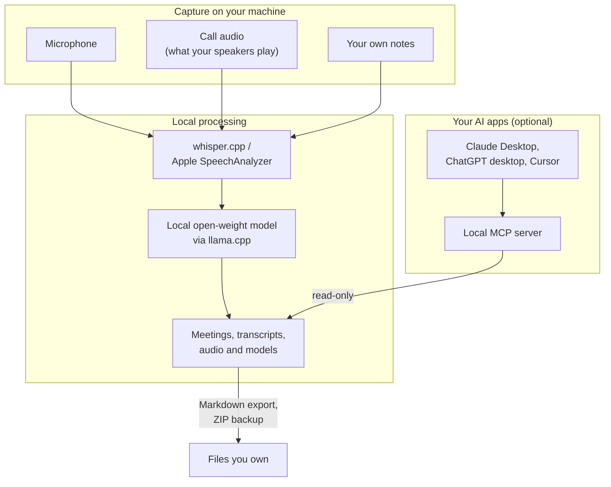

import Card from '@site/src/components/Card/Card';
import CardGroup from '@site/src/components/Card/CardGroup';
import Accordion from '@site/src/components/Accordion/Accordion';
import AccordionGroup from '@site/src/components/Accordion/AccordionGroup';
import Steps from '@site/src/components/Steps/Steps';
import Step from '@site/src/components/Steps/Step';

# Yogurt: Private AI Meeting Notes

**Yogurt** is a free, open-source desktop app that records your meetings, transcribes them and writes a summary without sending anything to a cloud service. There is no meeting bot: it captures your microphone and the audio your computer is already playing, so the other side of the call never sees a new participant join.

It is built by [Frigade](https://frigade.com) under the MIT license and aims at the same job as Granola, Otter and Fireflies, with one difference that matters: your audio, transcripts, notes and AI processing stay on your computer. Yogurt goes online only to download models and check for updates.

:::info
Same output as a cloud notetaker, none of the data leaving the machine. Transcription runs on whisper.cpp (plus Apple SpeechAnalyzer on supported Macs) and summaries run on a local open-weight model through llama.cpp.
:::

## Core Features

- **Live transcripts**: speech is turned into text as the call happens, while you type your own notes in the same window.
- **Meeting summaries**: a local LLM writes up the conversation together with the notes you added during the call.
- **Speaker names**: Yogurt names who said what from Zoom, Teams and Meet on Mac, Windows and Linux. Calendar details and speaker detection from call apps are Mac-only for now.
- **Answers with sources**: ask a question across past meetings and get an answer that links back to the meeting it came from.
- **99 languages**: multi-language mode follows each side of the call in its own language and keeps up when someone switches mid-meeting.
- **Folders, search and Markdown export**: find meetings by folder, title, notes or transcript, then copy or export as Markdown.
- **Local MCP server**: opt in and apps on your computer, such as Claude Desktop, ChatGPT desktop or Cursor, can read your notes, transcripts, saved audio and each meeting's calendar details.
- **Recording reminders and automatic stop**: Yogurt offers to record when a supported call starts and stops when it detects the call has ended.

## When to Use It

Yogurt fits best when the meeting content is sensitive or when you sit in a lot of them.

<CardGroup cols={2}>
  <Card title="Confidential conversations" icon="mdi:shield-lock">
    Sales calls, legal reviews, incident retros and anything under an NDA, where uploading audio to a third party is not an option.
  </Card>
  <Card title="Back-to-back meetings" icon="mdi:calendar-clock">
    Recording reminders, folders and search mean the notes from Tuesday are still findable on Friday.
  </Card>
  <Card title="Trainings and workshops" icon="mdi:school">
    Long sessions where you want a transcript to skim later, plus your own notes merged into the summary.
  </Card>
  <Card title="Offline or unreliable networks" icon="mdi:wifi-off">
    Once the models are downloaded, notes and questions work with no connection at all.
  </Card>
</CardGroup>

### Good candidates

- You want a notetaker that does not join the call as a visible participant.
- Your organization forbids cloud transcription, or you simply do not want another SaaS holding your recordings.
- You want the notes as plain Markdown you can drop into Obsidian, a wiki or a repo.
- You already use a local-first AI assistant and want it to read your meeting history through MCP.

## When Not to Use It

- **You need team collaboration on notes.** There is no shared workspace, no comments and no live co-editing. Everyone runs their own copy.
- **The machine is weak or old.** The hardware floor is 8 GB of memory, and the installers stop setup if transcription cannot keep up. See [Requirements](#requirements).
- **You depend on mobile or web access.** Yogurt is a desktop app only. No phone app, no browser version.
- **You need certified compliance out of the box.** Local processing helps a lot, but retention, consent and audit controls are yours to arrange.
- **Everyone on the call must be told they are being recorded.** With no bot in the room, there is nothing visible to signal recording. That is a process obligation you have to handle.

## Requirements

| | Minimum |
| :--- | :--- |
| **Memory** | 8 GB of RAM on every platform |
| **Mac** | Apple Silicon, macOS 14.4 or later |
| **Windows** | Windows 10 version 2004 or later, x64 |
| **Linux** | Ubuntu 22.04 or a compatible newer system, x64, with PulseAudio or PipeWire |
| **Disk** | The app plus the models it downloads; plan several GB and more if you let it pull the largest model your machine can run |
| **Network** | Only for the initial model download, optional Apple speech assets and update checks |

:::warning
Linux on Wayland needs PipeWire and the GNOME AppIndicator extension if you want the tray icon. If the AppImage does not start, install FUSE 2: `sudo apt install libfuse2` on Ubuntu 22.04, `sudo apt install libfuse2t64` on 24.04 and newer.
:::

More memory buys a better local model, and the difference is real: Yogurt keeps upgrading to the largest notes model your computer can run, which can reach roughly 14 GB of download on a 64 GB Mac and about 63 GB on a machine with 96 GB or more.

## How It Works



Recording, transcription and summarisation all happen on the same machine. The only network calls are model downloads from Hugging Face, optional Apple on-device speech assets and GitHub update checks. There is no telemetry.

Your data lives in one folder per platform:

| Computer | Folder |
| :--- | :--- |
| Mac | `~/Library/Application Support/Yogurt` |
| Windows | `%APPDATA%\Yogurt` |
| Linux | `~/.config/Yogurt` (or `$XDG_CONFIG_HOME/Yogurt` if set) |

## Setup

<Steps>
  <Step title="Download">
    Grab the installer for your platform from the [latest release](https://github.com/FrigadeHQ/yogurt/releases/latest): the DMG for Apple Silicon Macs, the `.exe` for Windows x64, or the `.AppImage` for Linux x64. On a Mac you can also use Homebrew:

    ```bash
    brew install --cask frigadehq/yogurt/yogurt
    ```
  </Step>
  <Step title="Install and open">
    Drag Yogurt into Applications on Mac, run the signed installer on Windows, or mark the AppImage executable and open it on Linux.
  </Step>
  <Step title="Grant permissions">
    On Mac, allow microphone and call audio access when asked. Call audio appears under **Screen & System Audio Recording**. Calendar, notifications and accessibility are optional.
  </Step>
  <Step title="Let the models download">
    Yogurt checks transcription speed on Windows and Linux and stops setup if the machine cannot keep up. Recording works as soon as setup finishes; the notes model keeps downloading in the background.
  </Step>
  <Step title="Record your first meeting">
    Start a call. Yogurt offers to record when it detects one, or start a note yourself. Add your own notes while it transcribes, then read the summary when you stop.
  </Step>
</Steps>

## Connect Your AI Assistant over MCP

Yogurt ships an optional local MCP server, off by default. When enabled, an AI app can read meetings, notes, transcripts, saved audio and calendar details from each meeting. It cannot change anything.

<Steps>
  <Step title="Enable access">
    Open **Settings → AI apps** and turn access on.
  </Step>
  <Step title="Copy the helper command">
    Yogurt shows the command to register itself as a local MCP server. Copy it.
  </Step>
  <Step title="Add it to your assistant">
    Paste it into your AI app's MCP configuration. Supported setups include Claude Desktop, ChatGPT desktop with a local plugin, and Cursor.
  </Step>
</Steps>

:::warning
Read access means exactly that. Whatever a connected assistant reads may be sent to that assistant's own online model, which moves the data off your machine. Turn access off in Yogurt when you do not need it.
:::

## Yogurt vs Cloud Notetakers

| | Yogurt | Granola, Otter, Fireflies |
| :--- | :--- | :--- |
| **Where processing happens** | Your computer | Vendor cloud |
| **Meeting bot** | None, captures system audio | Bot joins, or cloud capture |
| **Account required** | No | Yes |
| **Price** | Free, MIT licensed | Subscription tiers |
| **Offline use** | Yes, after model download | No |
| **Team features** | None | Sharing, comments, CRM sync |
| **Mobile and web** | Desktop only | Usually both |
| **Model quality** | Bounded by your hardware | Bounded by the vendor's budget |

The trade is simple. You give up cloud convenience, team collaboration and the very best hosted models. You get notes that never leave your machine and no recurring bill.

## Common Questions

<AccordionGroup>
  <Accordion title="Can I turn an existing recording into notes?" icon="mdi:file-music">
    Yes. Import a recording and Yogurt transcribes and summarises it the same way as a live call.
  </Accordion>
  <Accordion title="Does Yogurt join my Zoom, Teams or Meet call?" icon="mdi:account-off">
    No. It records your microphone and the audio your computer plays, so nobody sees a bot join. Because of that, tell the other participants they are being recorded.
  </Accordion>
  <Accordion title="Can I ask questions across all my meetings?" icon="mdi:comment-question">
    Yes. Answers come with links to the meeting they were drawn from, so you can check the source.
  </Accordion>
  <Accordion title="How do I move my data to another machine?" icon="mdi:backup-restore">
    Finish any recording, then use **Settings → Backup** to export meetings and audio as one ZIP file. Import it on the other machine, on any of the three platforms. Meetings in the Trash are not included.
  </Accordion>
  <Accordion title="How accurate is it compared to cloud transcription?" icon="mdi:chart-line">
    whisper.cpp with a large model is close to hosted transcription for clear meeting audio. A small model on an 8 GB machine is noticeably weaker, especially with accents, crosstalk and jargon. Hardware sets the ceiling.
  </Accordion>
  <Accordion title="Does Yogurt train AI on my meetings?" icon="mdi:robot-off">
    No. Nothing is uploaded, there is no telemetry, and nobody at Frigade can read your notes unless you send them a file yourself.
  </Accordion>
</AccordionGroup>

## References

- [Official Website](https://www.yogurt.so/)
- [GitHub Repository](https://github.com/FrigadeHQ/yogurt)
- [Help and Install Guide](https://github.com/FrigadeHQ/yogurt/blob/main/docs/README.md)
- [Releases](https://github.com/FrigadeHQ/yogurt/releases)
- [How to Organize Your Obsidian Vault](../../../Productivity/organize-obsidian-vault.md): where the exported Markdown notes can live
