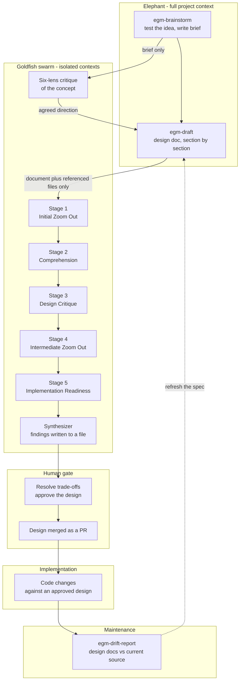

import Tabs from '@theme/Tabs';
import TabItem from '@theme/TabItem';

# Elephant-Goldfish Model (EGM)

**EGM is an Apache-2.0 plugin of agent skills that implements spec-driven development (SDD).** You install it into a coding harness (Claude Code, Codex, Antigravity, and a few others), and it changes the shape of the loop: a design document is written first, then reviewed by agents that did not sit through the conversation that produced it.

:::note
Despite the name, EGM is not a model and not an LLM. "Elephant" and "Goldfish" are roles played by the agent you already use.
:::

The problem it targets is not "the model writes bad code". It is a context problem, and it shows up in two opposite ways:

- **Context-starved reviewers.** A reviewer that only sees the diff has no idea that the module is deprecated, that the migration is already half done, or that the retry budget is fixed by an SLO. It approves what looks locally reasonable and quietly violates a constraint nobody wrote down.
- **Context-poisoned reviewers.** The agent that drafted the plan also reviews it. It remembers why it chose that queue, that retry policy, that schema. It defends the reasoning instead of testing it, and the review becomes a restatement of the draft.

EGM's answer is deliberate asymmetry: the agent with the most context writes, and agents with the *least* context review.

## How It Works



| Role | Context it holds | What it does |
| :--- | :--- | :--- |
| **Elephant** | The project, the requirements, earlier decisions, the whole conversation | Explores the problem and drafts the specification |
| **Goldfish** | The document and the source files it references, nothing else | Finds missing assumptions, unclear requirements, implementation risks |
| **You** | Goals and constraints | Resolves trade-offs, approves the design, decides what to build |

The isolating step is what makes the review mean something. A Goldfish reviewer gets the design doc and the files it references, in a fresh conversation. It does not see the exploration, the rejected alternatives, or the reasoning behind the draft. Whatever it flags is missing from the artifact that will be committed, which is the artifact your team inherits.

The isolation is not total. A fresh conversation does not necessarily exclude project instruction files such as `AGENTS.md` or `CLAUDE.md`. The upstream docs call that distinction out explicitly, and it is the reason your conventions belong in instruction files rather than in the draft.

That is also the cost: the review is loud on purpose. Reviewers are instructed to stress-test rather than agree, to skip flattery, and to lead with what is wrong. You take what is relevant and ignore the rest. EGM does not pretend to auto-triage that for you.

## The Flow, Step By Step

Seven skills ship in the plugin. They are usable individually, not a mandatory pipeline with gates that refuse to run.

1. **`egm-brainstorm`** tests an idea before anyone commits to it and writes a `concepts_brief.md`. It spawns a six-lens Goldfish swarm to attack the idea from different angles.
2. **`egm-draft`** turns a brief or a pile of notes into a design document under `docs/designs/`. It writes section by section and pauses for feedback after each one, which keeps you in the loop instead of reviewing a 40-page surprise at the end.
3. **`egm-review`** runs five stages, each in a fresh context: Initial Zoom Out, Comprehension, Design Critique, Intermediate Zoom Out, and Implementation Readiness. Reports go to files, not chat. The skill ships presets, so you can run the whole sequence or jump straight to implementation readiness when the design has already survived a review.
4. **`egm-review-loop`** runs a configured group of reviewers against a specific review task, for repeated passes.
5. **`egm-resolve`** works through the findings with you and agrees what actually changes.
6. **`egm-bootstrap`** creates or updates documentation for a codebase that was never designed this way. It works bottom-up: leaf directories get a README describing each file, parent READMEs summarize their children, the root README becomes a system map. Humans still review the output.
7. **`egm-drift-report`** compares checked-in design documents with the current source and reports where they diverged.

The recommended end-to-end loop is short: brainstorm, draft, review, human PR review of the design, implement, drift report.

:::tip
Do not force this on a small, clear bug fix. The upstream docs say so explicitly, and it is the difference between a useful process and a tax on every ticket.
:::

:::info
A full review is five fresh agent runs plus a synthesizer, and a brainstorm adds a six-lens swarm. Cost scales with the number of stages you run, not with the size of the repo, which is why the presets exist. Large documents are split into sections and reviewed in pieces, so an oversized specification multiplies the number of runs. Keep designs scoped to what one review pass can cover.
:::

## Adopting It In A Repo

Two directories matter. Design documents live in the repo next to the code they describe:

```text
path/to/project
|-- _agents/skills/<project>_elephant/SKILL.md   # optional custom context loader
`-- docs/designs/
    |-- SITEMAP.md          # index of design artifacts
    `-- FEATURE.md          # a design specification
```

Keeping specs in the repo, merged through PRs, is the part that matters for platform teams. The design becomes reviewable like code: it has a diff, a reviewer, a history, and a reason recorded next to the module it governs. `SITEMAP.md` is just an index so agents and humans can find the relevant artifact without scanning the tree.

The optional `<project>_elephant` skill is a small `SKILL.md` that tells the agent what this repository is and points at the context that matters most: code paths, docs, past designs. It is how you avoid re-explaining your architecture in every session.

For an existing repo, `egm-bootstrap` is the entry point. Expect a large first PR and budget time to review it, since the output is only as good as the code it read.

`egm-drift-report` fits a maintenance rotation. Once a week, or inside the maintenance slot you already have, is the recommended cadence. More often than that mostly produces churn on docs nobody changed.

## Installation

Install into the harness you already use, then start a new session so the skills are registered.

<Tabs groupId="egm-harness">
  <TabItem value="claude" label="Claude Code" default>
    ```bash
    claude plugin marketplace add google/elephant-goldfish-model
    claude plugin install egm@egm
    ```
  </TabItem>
  <TabItem value="codex" label="Codex">
    ```bash
    codex plugin marketplace add google/elephant-goldfish-model
    codex plugin add egm@egm
    ```
  </TabItem>
  <TabItem value="antigravity" label="Antigravity CLI">
    ```bash
    agy plugin install https://github.com/google/elephant-goldfish-model
    ```
  </TabItem>
  <TabItem value="opencode" label="OpenCode (experimental)">
    Needs a local clone. The adapter targets OpenCode **1.18.29** and the V1 `task` and `permission` interfaces, not the [V2 `subagent` interface](https://github.com/google/elephant-goldfish-model/issues/282).

    ```bash
    git clone https://github.com/google/elephant-goldfish-model.git
    cd elephant-goldfish-model
    python3 adapters/opencode/install.py /absolute/egm-opencode-candidate
    OPENCODE_CONFIG=/absolute/egm-opencode-candidate/opencode.json opencode --agent egm
    ```

    The installer refuses an existing destination and leaves global and project config alone. Inspect the generated `opencode.json` before the first run. Start with `--agent egm`, because other primary agents do not get the reviewer dispatch instructions. Bootstrap worker and scout delegation are out of scope for this adapter.
  </TabItem>
</Tabs>

Claude Cowork, ChatGPT Work (plugin upload or workspace import), omp, and Muse are also supported, and OpenCode has the experimental adapter above. In Antigravity and Claude Code the skills are prefixed: `/egm:egm-review`, `/egm:egm-draft`, and so on. In Codex you pick the skill from the skill picker instead.

:::caution
The OpenCode path is experimental. Maintainer approval and isolation verification are pending in upstream issue #146, so treat it as something to try in a sandbox, not as a supported install.
:::

:::warning
Install the **whole plugin**. Skill-only installers that copy just the `skills/` directory break EGM, because the skills read `agents/` and `resources/document_standards/` at runtime. Copying the skill folder alone produces an install that looks fine and fails mid-review.
:::

## Where It Fits In A DevOps Workflow

The process pays for itself where the blast radius of a wrong assumption is larger than the cost of writing a document.

- **Terraform module changes.** A stateful resource replacement, an IAM boundary, or a provider upgrade has constraints that a diff-only reviewer never sees. A design doc records the intended plan and the rollback, and a Goldfish pass can surface the missing `prevent_destroy`, the forgotten dependency ordering, the namespace collision.
- **CI/CD pipeline changes.** Pipeline edits fail in ways that are invisible in review: a job that no longer runs on tag builds, a cache key that invalidates everything, a required check that stopped being required. Spec-first forces those requirements to be written before the YAML changes.
- **Kubernetes platform changes.** Admission policies, resource quotas, pod disruption budgets, and upgrade paths interact in ways that a single manifest hides. Writing the design first puts those interactions in one place where a reviewer can see them.
- **Runbook and on-call automation.** A runbook is already a spec. Routing it through draft and review catches steps that assume knowledge the on-call engineer will not have at 3am.

Where it is overkill: small bug fixes, a config tweak, a dependency bump, a typo in a dashboard. If the change is clear and the risk is contained, the document is pure overhead. The skills are standalone, so you can use `egm-review` alone on an existing doc, or `egm-bootstrap` once and never touch the rest.

## Limitations And Guardrails

A Goldfish review needs a harness that can spawn fresh subagent contexts. If the harness cannot, the review skill **stops** rather than running the review in the same context, because a same-context review defeats the entire mechanism. Standalone Antigravity IDE (tested on macOS and Linux) does not expose the required `invoke_subagent` tool, and some ChatGPT modes have no fresh-context delegation. Check your harness before planning a rollout.

The other limits, plainly:

- **The review output is noisy.** It is written by design to over-report. Expect to discard a meaningful share of findings, and do not wire it into a gate that blocks on finding count.
- **A review is not a test.** It does not replace unit tests, integration tests, plan output, `terraform validate`, or a human who knows the system.
- **EGM has no opinion on implementation.** Style guides, profiling, testing strategy, and release process are yours to bring.
- **It is not an officially supported Google product.** The repo says so. Built by Google engineers, Apache-2.0 licensed, but no support contract behind it.
- **It depends on the model behind the harness.** A weak reviewer with clean context is still a weak reviewer; the mechanism removes bias, not incompetence.

The guardrail that holds the whole thing together is the human gate. Goldfish produces findings, not decisions. You resolve trade-offs and approve the design, and the design is merged as a PR like any other change, which is also where your existing review rules, CODEOWNERS, and branch protection keep applying.

## References

- [GitHub Repository](https://github.com/google/elephant-goldfish-model) - Source, skills, agents, and reviewer personas.
- [egm.dev](https://egm.dev) - Project site.
- [Getting Started Guide](https://github.com/google/elephant-goldfish-model/blob/main/docs/getting_started.md) - First install and first review.
- [Harness and Setup Guide](https://github.com/google/elephant-goldfish-model/blob/main/docs/harnesses.md) - Which harnesses support fresh-context delegation.
- [Dave Rensin: Elephants, Goldfish, and the New Golden Age of Software Engineering](https://medium.com/@drensin/elephants-goldfish-and-the-new-golden-age-of-software-engineering-c33641a48874) - The essay the model comes from.
- [AI LABS: EGM, Google's New Way To Use Claude Code Is Insane](https://youtu.be/xxf6D9jynFw) - Community video that surfaced EGM. Useful as an introduction, not as a specification.
