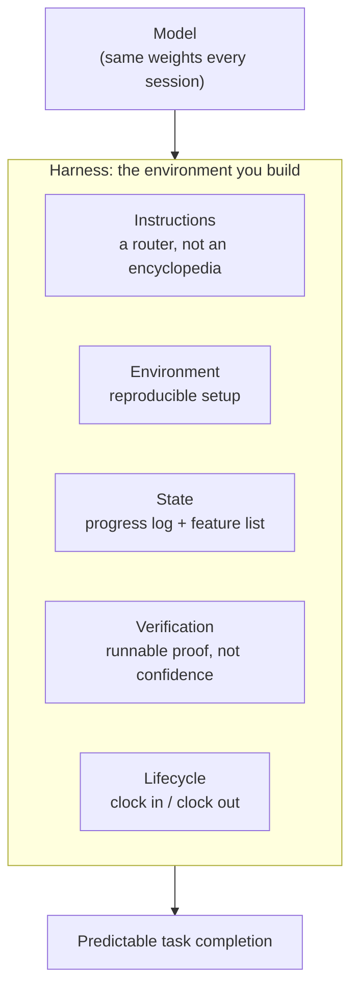
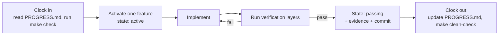

import Card from '@site/src/components/Card/Card';
import CardGroup from '@site/src/components/Card/CardGroup';
import Accordion from '@site/src/components/Accordion/Accordion';
import AccordionGroup from '@site/src/components/Accordion/AccordionGroup';
import Steps from '@site/src/components/Steps/Steps';
import Step from '@site/src/components/Steps/Step';

# Harness Engineering: From 0 to 1

You point a coding agent at a repository. It reads files, writes code, runs a command, and looks productive. Then it skips a step, breaks a test, and announces that the task is done while nothing works. The usual reaction is "the model is not good enough". It is almost never the model. It is the environment around the model.

**Harness engineering** is the discipline of building that environment: the instruction files, the state that survives a session, the commands that prove work is finished, the scope limits, and the start and end of every session. This article is a beginner tutorial that takes a repo from zero harness to a working minimal one, using a normal service repository as the example and the open-source [Learn Harness Engineering](https://github.com/walkinglabs/learn-harness-engineering) course as the reference model.

The course README cites an Anthropic experiment worth keeping in mind: same model, same prompt ("build a 2D retro game editor"), about 9 USD and 20 minutes without a harness for something that did not work, and about 200 USD and 6 hours with a planner, generator and evaluator harness for a game you could play. The model did not change. The harness did.

:::info
Harness engineering is not prompt engineering. The output of this work is files in your repository, not better sentences in a chat box. If a rule is not written down where the agent reads it, the rule does not exist.
:::

## What a Harness Actually Is

A harness has five subsystems, and each has one job. The course lecture L02 names them as instructions, state, verification, scope and session lifecycle. The audit tool shipped with the course groups them the same way.



- **Instructions** tell the agent what the system is, how to run it, and what it must never do. One entry file that links to deeper documents.
- **Environment** is the setup an agent (or a new hire) can reproduce: a lockfile, a pinned runtime, and one command per operation.
- **State** is what has been done, what is in progress, and what is next, written to disk so the next session does not start from memory.
- **Verification** is the command whose exit code decides whether work is finished. Not the agent's opinion.
- **Lifecycle** is a clock-in routine at the start and a clock-out routine at the end, leaving a clean restart path.

A repository with all five is boring to work in: the agent reads the instructions, activates one feature, does the work, runs the gate, logs the result, and commits. Boring is the goal.

## Prerequisites

You need four things before writing any harness file:

- A repository you can run locally, ideally one with a test suite and a CI pipeline you already trust.
- One coding agent that can edit files and run shell commands: [OpenCode](../Agents/opencode.md), [Claude Code](https://claude.com/claude-code), Codex CLI, or any equivalent.
- A task runner you already have. A `Makefile` is the simplest choice and the one the course assumes.
- About an hour for the minimal harness. The first pass is small; the value comes from enforcing it.

If your CI pipeline is the only thing that runs tests, you have a harness gap: the agent cannot use a pipeline it cannot run. The whole point is a verification command with a fast, local exit code.

## Build the Minimal Harness

Four files take a repository from prompt-only to rules-first. This is the course's Project 01: run the same task twice and compare. Do the same, with any small feature you already planned to build.

<Steps>
  <Step title="Write the entry instruction file">
    Create `AGENTS.md` at the repository root. If you use Claude Code, `CLAUDE.md` works too; keep one and link the other, so there is a single source of truth.

    Keep it between 50 and 200 lines. It is a router, not an encyclopedia. The first ten lines must say what the system is, because that is the cheapest context you can give a new session.

    ```markdown
    # Payments API

    This repository is a Go service that serves payment intents behind an
    HTTP API, backed by PostgreSQL. Deployments run on Kubernetes.

    ## Verification

    Run `make check` before every commit. It must exit 0.
    A change is not complete until `make check` passes.

    ## Constraints (MUST)

    - MUST run `make check` and paste the exit status in the summary.
    - MUST NOT edit `migrations/` by hand; generate them with `make migrate`.
    - MUST NOT commit secrets, `.env` files or cluster credentials.

    ## State files

    - `PROGRESS.md` - current state, in-progress work, next steps.
    - `feature_list.json` - the only file that says a feature is done.
    - `docs/decisions/` - architectural decisions and their reasons.

    ## Clock-in

    Before touching code: read `PROGRESS.md`, then run `make check` to
    confirm a green baseline. If it is red, fix that first.

    ## Clock-out

    Before closing: update `PROGRESS.md`, run `make clean-check`, and commit
    one logical change. Do not leave the repo half-finished.
    ```

    Two rules carry most of the weight and are easy to forget: update documentation in the same commit as the code, and never leave the repository in a state where `make check` fails on purpose.
  </Step>

  <Step title="Make every operation one command">
    An agent that has to discover how to install, test and lint will invent steps. Put the commands in a `Makefile` where they are impossible to miss.

    ```make
    .PHONY: setup check test e2e clean-check

    setup:
    	go mod download
    	docker compose up -d db

    check: test e2e
    	go vet ./...

    test:
    	go test ./... -count=1

    e2e:
    	go test ./test/e2e/... -count=1

    clean-check:
    	git diff --check
    	grep -rn "fmt.Println(\"DEBUG" --include="*.go" . && exit 1 || true
    	@echo "clean state: OK"
    ```

    This is the environment subsystem, and it is the part a DevOps engineer already knows how to do well. Pin the runtime (`.tool-versions` or `.nvmrc` equivalent) and commit the lockfile so the agent's install and yours are the same install.
  </Step>

  <Step title="Write the feature list">
    Scope lives in `feature_list.json`. It is machine-readable, so the agent cannot quietly redefine "done" in prose.

    ```json
    [
      {
        "id": "F01",
        "behavior": "A request without an Idempotency-Key returns 400.",
        "verification": "make test T=TestIdempotencyKeyRequired",
        "state": "not_started",
        "evidence": "",
        "layers": [
          { "label": "static",  "cmd": "go vet ./...", "repair": "Fix the vet error in the named file." },
          { "label": "runtime", "cmd": "go test ./internal/api/... -run Idempotency -count=1", "repair": "Read the failing assertion; the handler rejects before reading the key." }
        ]
      }
    ]
    ```

    Three rules make the list work:

    - **One feature active at a time.** WIP=1. Do not activate a new feature while another has `state: "active"`.
    - **The state machine has three values.** `not_started` to `active` to `passing`, no skipping. Only the verification script moves a feature to `passing`.
    - **Each feature fits one session.** If it does not, split it. A feature that spans sessions is a planning bug.

    The ratio worth tracking is **VCR**, the verified completion rate: features passing divided by features activated. A VCR below 1.0 means the agent is starting more than it finishes, and the list is the evidence.
  </Step>

  <Step title="Add the progress log">
    `PROGRESS.md` is the memory the model does not have. Four sections are enough.

    ```markdown
    # Progress

    ## Current State
    Last commit: a1b2c3d | make check: passing | branch: feat/F01

    ## In Progress
    F01 - idempotency key validation. Handler returns 400; tests not written.

    ## Next Steps
    1. Add the missing table-driven case for a duplicate key.
    2. Run `make verify-feature F=F01`.

    ## Blockers
    None.
    ```

    The course uses `claude-progress.md` in older material for compatibility, but the file is agent-agnostic. Any coding agent can read it if the root instructions say to.

    Two habits keep it honest. Write the current commit hash and the test status, because "passing" without a reference is a claim. And when context is running low, stop and checkpoint instead of rushing the last step: a rushed finish is exactly how a half-implemented feature ends up marked done.
  </Step>
</Steps>

At this point the repository has a harness. The next task you hand the agent should show the difference: it reads `AGENTS.md`, confirms a green baseline, activates one feature, implements it, runs the gate, and updates `PROGRESS.md`. The comparison against your prompt-only attempt is the whole lesson of Project 01.

## Verification Is Not Confidence

An agent will tell you a task is complete because the code is written. Code being written is not evidence. The course splits verification into three layers, and the ordering rule is the useful part: do not proceed to the next layer until the current one passes.

| Layer | Question it answers | Typical command |
| :--- | :--- | :--- |
| 1 - static | Does it compile, lint and type-check? | `go vet ./...`, `tsc --noEmit`, `terraform validate` |
| 2 - runtime | Does the behavior match the spec? | the unit or integration test for that feature |
| 3 - system | Does the whole path work end to end? | `make e2e`, a container run, a smoke test against staging |

Two rules turn this from advice into a gate:

- **The definition of done is a command with an exit code.** "All tests pass locally and I ran them" is not a result. `make check` exiting 0 is.
- **Layer 3 is required when the change crosses a boundary.** A schema change, an API contract change or a new queue topic cannot be verified by a unit test alone. That boundary is where agents cause the expensive failures.

Put the gate in a script rather than trusting the session to remember the sequence. `scripts/verify-feature.sh` reads the feature's `layers` array, runs each command in order, prints the `repair` text on failure, and only then sets `state` to `passing`. `make verify-feature F=F01` is the only path to a passing feature, and `AGENTS.md` says so.

## The Session Lifecycle

A session is not a chat thread that happens to touch a repo. It has a beginning, a middle and an end, and the beginning and end are what make the next session cheap.



The clock-out list has five items, and the course calls it the clean-state protocol. A session is not finished until all five hold:

1. The build passes.
2. The tests pass.
3. `feature_list.json` reflects reality, with evidence attached to every passing feature.
4. No debug artifacts remain: no stray prints, no commented-out code, no temporary files.
5. The startup path works, so the next session can run the app.

Cleanup has two speeds. The immediate pass happens at every session end and costs minutes. The periodic pass, weekly or monthly, looks for structural drift that a single feature never touches: duplicated helpers, a growing `AGENTS.md`, tests that no longer assert anything. Only the first one is the agent's job; the second is yours.

## Observability Inside the Harness

You cannot fix a session you cannot see. The course front-loads three lightweight practices instead of a monitoring stack:

- **A sprint contract before the feature starts.** The scope, the definition of done and the explicit exclusions, agreed in writing. This is the same change-freeze discipline as a release plan, and it prevents the agent from expanding scope at step four.
- **A session trace during the work.** Structured JSONL events, one per verification run, collected by a script rather than remembered. Any log pipeline can ingest it.
- **An evaluator rubric after the feature.** Score correctness, architectural compliance, test coverage and verification evidence. A feature that passes the tests but scores a C on architecture is a harness finding, not a success.

:::tip
For DevOps work, the trace is also the audit trail. If an agent touched a manifest, a pipeline or a cluster, "which command produced this change and what did it return" should be answerable from the trace alone.
:::

## Audit What You Built

The course ships `tools/audit-harness.sh`, a zero-dependency shell script that checks a repository against the five subsystems and exits non-zero when a critical item is missing. Run it after the first pass and again after every harness change.

```bash
curl -fsSL https://raw.githubusercontent.com/walkinglabs/learn-harness-engineering/main/tools/audit-harness.sh \
  | bash -s -- /path/to/your/repo
```

Its critical items are a useful checklist on their own, and they are a fair summary of the minimal harness:

- `AGENTS.md` or `CLAUDE.md` at the root, describing the system in the first ten lines and naming the verification command.
- A committed dependency lockfile, so installs are reproducible.
- `PROGRESS.md` with a current-state block that references a commit and a test status.
- The verification command documented in the instructions file, so the gate is discoverable.

The script also reports recommended items: a 50 to 200 line entry file, a `make check` and `make test` target, a feature list with evidence, WIP=1, the three-layer model, a clean-state checklist, and the architectural rules file. Treat those as the roadmap for the second pass, not as a single afternoon of work.

:::warning
Do not add every recommended item at once. A harness with twenty files nobody reads is worse than one with four that are enforced, because the agent now has contradictory instructions to reconcile. Add a mechanism when a real failure shows the need for it.
:::

## Where Harness Engineering Stops

A harness makes one agent reliable inside one task. It does not decide what runs next, how much it costs, or when two features conflict.

The course draws the boundary clearly. **Loop engineering** (lecture L13) is what happens when you stop prompting and start running goal loops, timer loops and maker-checker pairs against the harness. **Graph engineering** (lecture L14) is what happens when one loop grows nodes, edges, shared state and routing decisions, plus a human approval node where the risk justifies it. Harness engineering is the vehicle; the loop is the road; the graph is the road network.

For a first pass, that boundary is a reason to stay small. Build the harness, then run ten features through it and measure the VCR before automating anything.

## Common Failure Modes

<AccordionGroup>
  <Accordion title="The instruction file grew into a novel">
    A 300-line `AGENTS.md` gets partially read, and poor compliance is blamed on the model. Split module detail into `docs/` topic files and keep the root file as a router with links. The audit script flags entry files longer than 200 lines for this reason.
  </Accordion>
  <Accordion title="Features get closed by editing the JSON">
    If the agent can set `state: "passing"` directly, the gate is decorative. Make the verification script the only writer of that field and state the rule in the instructions.
  </Accordion>
  <Accordion title="The progress log is written only at the start">
    A stale `PROGRESS.md` is worse than no file, because the next session trusts it. Make the clock-out routine part of every session, not an optional cleanup.
  </Accordion>
  <Accordion title="Tests exist but nobody can run them quickly">
    An agent that waits ten minutes per verification run will skip verification. Separate the fast gate (`make check`) from the slow suite, and keep the fast one under a couple of minutes.
  </Accordion>
  <Accordion title="Every review finding stays in the review">
    When a reviewer catches the same class of mistake twice, promote it to a rule: a constraint in `AGENTS.md`, an entry in `.harness/arch-rules.json`, or a new test. That promotion is how a harness gets better without getting longer.
  </Accordion>
</AccordionGroup>

## Where to Go Next

Start with four files: `AGENTS.md`, `Makefile` targets, `feature_list.json` and `PROGRESS.md`. Run one feature end to end, audit the repo, then add one mechanism per real failure you observe. The course's 8 projects apply exactly that progression to one Electron app, so the harness changes are the only variable.

<CardGroup cols={2}>
  <Card title="Learn Harness Engineering" icon="mdi:school" href="https://walkinglabs.github.io/learn-harness-engineering/">
    14 lectures and 8 hands-on projects, MIT licensed, with copy-ready templates for `AGENTS.md`, `init.sh` and `feature_list.json`.
  </Card>
  <Card title="Awesome Harness Engineering" icon="mdi:format-list-checks" href="https://github.com/walkinglabs/awesome-harness-engineering">
    The curated reference list behind the course, with design breakdowns of how Claude Code, Codex, Pi and DeepSeek structure their own harnesses.
  </Card>
</CardGroup>

## References

- [Learn Harness Engineering](https://github.com/walkinglabs/learn-harness-engineering) - Project-based course, including the `harness-creator` skill and `audit-harness.sh`.
- [Course documentation](https://walkinglabs.github.io/learn-harness-engineering/) - Full lecture text, projects and the multilingual resource library.
- [OpenAI: Harness engineering: leveraging Codex in an agent-first world](https://openai.com/index/harness-engineering/)
- [Anthropic: Effective harnesses for long-running agents](https://www.anthropic.com/engineering/effective-harnesses-for-long-running-agents)
- [Anthropic: Harness design for long-running application development](https://www.anthropic.com/engineering/harness-design-long-running-apps)
- [Martin Fowler: Harness engineering for coding agent users](https://martinfowler.com/articles/harness-engineering.html)
- [HarnessRouter](../Tools/harnessrouter.md) - Routing several agent harnesses behind one API, once you run more than one.
- [Vercel CEO AI Workflow](vercel-ai-workflow.md) - A practitioner workflow that enforces much of this with fewer files.
