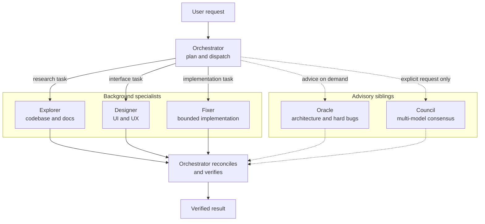

import Tabs from '@theme/Tabs';
import TabItem from '@theme/TabItem';
import Steps from '@site/src/components/Steps/Steps';
import Step from '@site/src/components/Steps/Step';
import Card from '@site/src/components/Card/Card';
import CardGroup from '@site/src/components/Card/CardGroup';

# Oh My Opencode Slim

## Summary

**Oh My Opencode Slim** is an MIT-licensed plugin for [OpenCode](https://opencode.ai) that replaces a single all-purpose agent with a small staff. One orchestrator plans the work and routes it to a roster of specialists, each running on the model you assign to it. The default mental model is a team with a manager, not a smarter chatbot.

It is the slim fork of [Oh My OpenAgent](https://github.com/code-yeongyu/oh-my-openagent), covered in the [sibling article](../Agents/oh-my-openagent.md). Same core idea, different scope: where OMO ships hooks for everything, this one ships orchestration plus a single hook you can switch off. At v3.0.6 (November 2026) it carries roughly 10k stars, 615 forks, and 12.4k weekly npm downloads, so it is a real community project rather than a weekend experiment.

The pitch is about cost. Reconnaissance does not need the same model as an architectural review, and paying flagship prices for a file search is how agent bills get silly. Slim makes the routing explicit and puts the model choice in a JSON file you control.

## What "slim" changes

Oh My OpenAgent is a harness. It bundles multi-model orchestration, background waves, state tracking, and more than 40 lifecycle hooks that wire the agent into CI, testing, and review. That is a lot of surface, and a lot of it is opinionated about how you work.

Slim keeps the delegation model and drops the sprawl. There is no hook catalog to learn, no mandatory planning pipeline, and no state machine to reason about. The plugin registers the agents, the skills, a small tool and MCP surface, and the routing between them, with one configurable injection hook instead of a forty-hook catalog.

The trade-off it optimizes is the one every multi-agent setup actually faces:

- **Quality** comes from giving hard work to a strong model with a high reasoning variant.
- **Latency** comes from giving mechanical work to a small, fast model.
- **Cost** comes from not using the strong model for the mechanical work.

A single model forces one answer to all three. Routing per agent lets you answer each separately: a high variant on the oracle, a medium on the orchestrator, a low on the fixer and the explorer.

:::info
Nothing here is a benchmark. The plugin does not ship performance numbers, and the gains depend almost entirely on which models you plug in. Treat the routing as a budget allocation you can reason about, not as a measured speedup.
:::

## The Pantheon

Five agents work out of the box. Council does nothing until you add a `council.presets` block, and the Observer stays off until you enable it. The table below is the shipped roster.

| Agent | Role | Default model |
| :--- | :--- | :--- |
| **Orchestrator** | Plans the work, dispatches specialists, reconciles results | `openai/gpt-6.1-sol` (medium) |
| **Explorer** | Codebase reconnaissance, external research, fresh docs | `openai/gpt-6-luna` (low) |
| **Oracle** | Architecture, hard debugging, code review, last resort | `openai/gpt-6.1-sol` (high) |
| **Council** | Multi-LLM consensus on one question | config-driven |
| **Designer** | UI and UX implementation, visual polish | `openai/gpt-6-luna` (medium) |
| **Fixer** | Fast implementation from bounded instructions | `openai/gpt-6.1-sol` (low) |
| **Observer** | Read-only visual analysis (optional) | `openai/gpt-6-luna` (set a vision model to enable) |

### Orchestrator

The master delegator. It reads the request, builds a plan, dispatches background specialists, then reconciles what comes back and verifies the outcome rather than trusting the reports. Everything else in the system exists to serve this loop.

### Explorer

Cheap and fast, on purpose. It maps unfamiliar code, greps the repository, and fetches current documentation when the question is about a library rather than the repository. It is the agent you want running in parallel, not the one you want reasoning about design.

### Oracle

The advisor. It handles the questions that stall a session: which of two architectures survives load, why a bug only appears under a specific ordering, whether a diff is safe to merge. It runs at a high reasoning variant because the whole point is depth over speed. The Orchestrator dispatches it like any other subagent, but the work it receives is advice rather than output.

### Council

Consensus as a service. Council sends the same question to several models in parallel and synthesizes one verdict from their answers. It is configured through `council.presets` plus the `council` agent entry, so the panel is whatever you want it to be. It is also the most expensive path in the plugin, which is why nothing delegates to it automatically.

### Designer

Front-end and interface work: layout, component structure, spacing, states, and the visual polish that usually gets skipped when an agent is focused on making tests pass. It runs on the lighter model because the work is iterative and the feedback is visual.

### Fixer

The implementation workhorse. It takes bounded, well-specified instructions from the Orchestrator and executes them at a low reasoning variant. The constraint is the feature: the better the Orchestrator decomposes the job, the less thinking the Fixer has to do, and the cheaper the whole run gets.

### Observer

Off by default. The Observer reads images, screenshots, PDFs, and diagrams and reports what it sees, without editing anything. `disabled_agents` lists it by default, so enabling it is a top-level empty list plus a vision-capable model in the preset:

```json
{
  "disabled_agents": [],
  "presets": {
    "openai": {
      "observer": { "model": "openai/gpt-6-luna", "skills": [] }
    }
  }
}
```

Swap in whichever vision model you actually have.

## How delegation works



Background subagents are the default workflow, not an option. The Orchestrator spawns a specialist, keeps planning, and collects the result when it lands. Work therefore happens in places you cannot see, which is why Multiplexer Integration is strongly recommended upstream.

Manual delegation is available when you already know who should do the job: `@agentName <task>` addresses an agent directly, useful for a quick `@explorer where is the retry budget defined` and less useful for anything that needs coordination.

One flag matters if your subagents read images. Hosts on OpenCode v2 deny nested image reads by default, so a subagent asked to look at a screenshot fails quietly. Add this to your OpenCode config:

```json
{
  "experimental": { "subagent_depth": 2 }
}
```

## Council is opt-in on purpose

Council is the only agent the Orchestrator never picks on its own, and the reason is arithmetic. Each councillor is a separate model call, so a three-seat council costs about three answers plus a synthesis pass, and the output is a paragraph of consensus rather than a change to your repository. Auto-delegating it would mean every ambiguous request quietly becomes the most expensive request.

It has to be configured before it can be used at all: a `council` model entry plus at least one `council.presets` block, or the agent has no seats to dispatch to.

So it is triggered by language instead. Mention `council`, `@council`, or `consensus` in a message, and the Council Mode procedure is injected into the session. The trigger fires once per session, so the second mention does not re-inject anything.

The interesting part is the accounting. The procedure is not carried statically in the system prompt; it is loaded only when a keyword appears. A session that never asks for a council pays zero tokens for the capability existing. That is the same trick as a lazily imported module, applied to prompt budget.

If you do not want it at all, disable the injector:

```json
{
  "disabled_hooks": ["council-inject"]
}
```

## Install and verify

The published CLI is a Node-compatible bundle, so either runtime works. Bun is the path upstream documents first.

<Steps>
  <Step title="Install the plugin">
    <Tabs groupId="oh-my-opencode-slim-runtime">
      <TabItem value="bun" label="Bun" default>
        ```bash
        bunx oh-my-opencode-slim@latest install
        ```
      </TabItem>
      <TabItem value="npx" label="npx">
        ```bash
        npx oh-my-opencode-slim@latest install
        ```
      </TabItem>
    </Tabs>

    The installer adds the plugin to the `plugin` array in `~/.config/opencode/opencode.json` (or `opencode.jsonc`) and generates an `openai` preset plus an `opencode-go` preset, the latter targeting the OpenCode Go model gateway. Add `--preset=opencode-go` to install with the second one selected.
  </Step>
  <Step title="Authenticate">
    ```bash
    opencode auth login
    ```
  </Step>
  <Step title="Refresh the model list">
    <Tabs groupId="oh-my-opencode-slim-models">
      <TabItem value="v1" label="OpenCode v1" default>
        ```bash
        opencode models --refresh
        ```
      </TabItem>
      <TabItem value="v2" label="OpenCode v2">
        ```bash
        opencode models
        ```
      </TabItem>
    </Tabs>

    The flag exists only on v1. On v2 the plain command already reads the current provider list.
  </Step>
  <Step title="Edit the agent config">
    Open `~/.config/opencode/oh-my-opencode-slim.json` and set the models you actually have access to. The bundled preset is a starting point, not a promise.
  </Step>
  <Step title="Verify inside a session">
    Start OpenCode and run:

    ```text
    ping all agents
    ```

    Each agent answers. Anything that fails here is a model reference or an auth problem, and it is much cheaper to find it now than mid-task.
  </Step>
</Steps>

There is a from-master path if you want to run unreleased code:

```bash
git clone https://github.com/alvinunreal/oh-my-opencode-slim.git
cd oh-my-opencode-slim
bun install
bun run build
bun dist/cli/index.js install
```

Same result, different source.

:::tip
Run `ping all agents` after every config change. A typo in a model id does not surface until an agent is dispatched, and by then the Orchestrator has already spent tokens planning around a specialist that will never answer.
:::

## Configuration

Everything is one JSON file. A minimal setup looks like this:

```json
{
  "$schema": "https://unpkg.com/oh-my-opencode-slim@latest/oh-my-opencode-slim.schema.json",
  "preset": "openai",
  "presets": {
    "openai": {
      "orchestrator": { "model": "openai/gpt-6.1-sol", "variant": "medium", "skills": ["*"] },
      "oracle": { "model": "openai/gpt-6.1-sol", "variant": "high", "skills": ["simplify"] },
      "explorer": { "model": "openai/gpt-6-luna", "variant": "low", "skills": [] },
      "designer": { "model": "openai/gpt-6-luna", "variant": "medium", "skills": [] },
      "fixer": { "model": "openai/gpt-6.1-sol", "variant": "low", "skills": [] }
    }
  }
}
```

### Presets and inheritance

A preset is a named bundle of per-agent settings. Presets support `extends`, so you can define a base once and override a single field:

```json
{
  "presets": {
    "base": { "orchestrator": { "model": "openai/gpt-6.1-sol", "variant": "medium", "skills": ["*"] } },
    "design": { "extends": "base", "designer": { "model": "anthropic/claude-5", "variant": "high", "skills": [] } }
  }
}
```

Upstream is explicit that presets are starting points rather than recipes. Model names change fast, and a bundled preset that names a model you cannot access is worse than no preset at all. Keeping a `base` preset that matches your provider account is the sane long-term setup.

### Applying a preset

On OpenCode v2, `/preset` inside a session applies a preset to the current session without a restart, or changes the global default. On v1, reload OpenCode after applying. The scope is narrower than it sounds: main-session models, prompts, tools, skills, and MCP servers are not switched by the session action, and children that already exist keep the configuration they were created with. Presets govern agents, not the whole host.

### Where config is read from

Two locations, in priority order:

- **Global:** `~/.config/opencode/oh-my-opencode-slim.json`
- **Project:** `.opencode/oh-my-opencode-slim.json` or `.jsonc`

Project settings are inherited from ancestor directories, and the closest one wins field by field. That means a repository can pin a cheaper explorer without restating the whole config. On v2 the walk goes to the filesystem root; on v1 it stops at the Git worktree boundary. Setting `OPENCODE_DISABLE_PROJECT_CONFIG` turns the ancestor walk off entirely, which is what you want in a shared checkout you do not control.

### Skills as permissions

The `skills` array on each agent is a grant, not a hint. An agent can activate only the skills it was given: an explicit list, `"*"` for everything, or `"!skill-name"` to deny one. An explorer with `[]` cannot run `deepwork` even if you ask it to in a message. This matters more than it looks, since a skill is instructions plus tool access, and granting all of them to every agent re-creates the single-agent setup you were trying to leave.

## Bundled skills

Eleven skills ship with the plugin. They are registered in-process when the plugin loads, so nothing is copied into your config directory, and a directory with the same name under `~/.config/opencode/skills/` overrides the bundled version.

| Skill | Purpose | Invocation |
| :--- | :--- | :--- |
| `codemap` | Hierarchical repository maps so agents stop re-reading everything | `run codemap` |
| `deepwork` | Pass-by-pass workflow (sketch, structure, detail) with one review gate per pass | `/deepwork <task>` |
| `verification-planning` | Plans a project-specific evidence path before non-trivial changes | automatic |
| `simplify` | Behavior-preserving simplification for readability | ask, or during review |
| `worktrees` | Git worktrees as isolated coding lanes | `work in a worktree` |
| `clonedeps` | Clones dependency source so agents can inspect library internals | `clone dependencies` |
| `step-back` | Pauses snowballing patches to reassess direction | automatic when fixes stack |
| `deanchor` | Generalizes from examples instead of copying them with light edits | automatic when a request includes examples |
| `ai-estimates` | Estimates duration for a human working with AI, not alone | ask |
| `reflect` | Turns repeated friction into reusable skills, agents, or config | `/reflect` |
| `oh-my-opencode-slim` | Configures and improves the plugin setup itself | ask |

The interesting ones are the automatic triggers. `step-back` fires when fixes start stacking, which is exactly the moment an agent is least likely to stop on its own. `deanchor` fires when your request contains examples, because agents otherwise reproduce the example's shape instead of its intent. Neither needs a command.

`deepwork` is the heavy option: for large, risky changes it runs in passes, sketching first, then structuring, then filling in detail, with a review gate between them. It is the closest thing here to a full process, and it is optional by design.

## Extending it

### Agent Marketplace

The marketplace holds community specialists, installed by name and then enabled:

```bash
bunx oh-my-opencode-slim@latest marketplace install <publisher>/<agent>
bunx oh-my-opencode-slim@latest marketplace enable <publisher>/<agent>
```

Restart OpenCode so the new agent registers. The published examples are review shaped: **Paladin** for read-only security review at trust boundaries, **Arbiter** for merge readiness, **Hunter** for swallowed errors and retry exhaustion, **Proctor** for behavioral test coverage gaps, **Janitor** for maintainability, plus **Documenter** and **Chronicler** for docs and history. Adding an agent costs a config entry and tokens, not a code change.

### ACP agents

ACP (Agent Client Protocol) is the interface Claude Code and Gemini expose. Registering one as an ACP agent makes it a delegatable subagent inside the same orchestration, so a task can be routed to a different vendor's agent without leaving the session. Setup is documented in [ACP agents](https://github.com/alvinunreal/oh-my-opencode-slim/blob/master/docs/acp-agents.md).

### Multiplexer panes

Background agents deserve a window. [Multiplexer Integration](https://github.com/alvinunreal/oh-my-opencode-slim/blob/master/docs/multiplexer-integration.md) opens each one in a dedicated pane, with support for Tmux, Zellij, Herdr, cmux, kitty, WezTerm, and Orca. Without it you are trusting a progress line, which is the one thing multi-agent work makes hard to trust.

### Companion window

An optional floating desktop window shows live agent activity. `bunx oh-my-opencode-slim@latest companion install` downloads the binary and sets `"companion": { "enabled": true }` for you, so the only remaining step is a restart. Same idea as the panes, less terminal.

<CardGroup cols={2}>
  <Card title="Repository" icon="mdi:github" href="https://github.com/alvinunreal/oh-my-opencode-slim">
    Source, config schema, bundled agents and skills, issue tracker.
  </Card>
  <Card title="Project Site" icon="mdi:web" href="https://ohmyopencodeslim.com">
    Documentation for install, presets, delegation, and the agent roster.
  </Card>
  <Card title="Marketplace" icon="mdi:store" href="https://github.com/alvinunreal/oh-my-opencode-marketplace">
    Community specialist agents installable by name.
  </Card>
  <Card title="Parent Project" icon="mdi:family-tree" href="https://github.com/code-yeongyu/oh-my-openagent">
    Oh My OpenAgent, the full harness this plugin trims down.
  </Card>
</CardGroup>

## Caveats

- **It needs OpenCode as the host.** This is a plugin, not a standalone CLI. No OpenCode, no Pantheon.
- **Background work is invisible by default.** Without a multiplexer or a shared server you get a progress line and no view into what a specialist is doing. Enable the panes before you form an opinion about the workflow.
- **Presets go stale.** Model ids, variants, and availability move faster than a bundled JSON file, so expect to maintain your own `base` preset.
- **Council and Observer are opt-in for a reason.** Both cost extra model calls, and neither works without configuration: Council needs seats, Observer needs a vision model.
- **Skill grants are real permissions.** An agent with an empty `skills` array cannot run the skill you just described in chat, and the failure reads like the agent ignoring you.

## References

- [GitHub Repository](https://github.com/alvinunreal/oh-my-opencode-slim) - Source, config schema, agents, skills, and marketplace client.
- [Project Site](https://ohmyopencodeslim.com) - Official documentation for install, presets, and delegation.
- [Agent Marketplace](https://github.com/alvinunreal/oh-my-opencode-marketplace) - Community specialist agents.
- [Oh My OpenAgent article](../Agents/oh-my-openagent.md) - The parent harness, its hook catalog, and its planning pipeline.
- [Oh My OpenAgent repository](https://github.com/code-yeongyu/oh-my-openagent) - Upstream project this plugin forks.
- [OpenCode](https://opencode.ai) - The host application the plugin extends.
