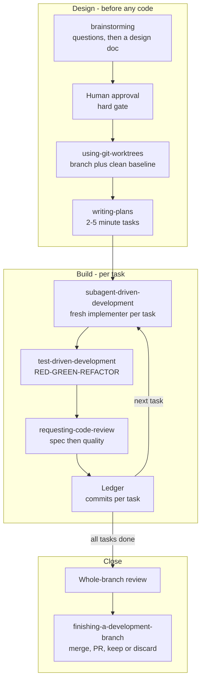

import Tabs from '@theme/Tabs';
import TabItem from '@theme/TabItem';
import Steps from '@site/src/components/Steps/Steps';
import Step from '@site/src/components/Steps/Step';

# Superpowers: A Software Development Methodology For Coding Agents

**Superpowers is a plugin of composable agent skills wrapped in an explicit process.** It is MIT licensed, built by Jesse Vincent and the team at [Prime Radiant](https://primeradiant.com), and it installs into more than a dozen coding harnesses. The skills are the easy part. What makes it a methodology is a bootstrap instruction, `using-superpowers`, that is injected at session start and tells the agent to check for a relevant skill before it touches a task.

That single instruction changes the default behaviour. An agent with Superpowers installed does not start editing files because you asked for a feature. It runs a brainstorming skill first, asks what you actually want, writes a design document, waits for your approval, writes a plan of two to five minute tasks, then executes that plan in an isolated worktree with a fresh subagent per task and a review between tasks.

The loop is opinionated on purpose. Test-driven development is not a suggestion here, the spec is a hard gate, and the skill descriptions are written as mandates ("You MUST use this before any creative work"). Whether that is discipline or friction depends on the repo you point it at, which is the main thing to decide before installing.

:::info
Superpowers is a process layer, not a model and not a harness. It is installed separately per harness and does not share state between them.
:::

## How It Works



The loop has seven named steps, and the agent moves through them by skill description rather than by you typing commands.

| Step | Skill | What it decides |
| :--- | :--- | :--- |
| 1 | `brainstorming` | What you actually want, and why. Small changes are agreed in chat; projects get a written design document. |
| 2 | `using-git-worktrees` | An isolated workspace on a new branch, project setup, and a verified clean test baseline. |
| 3 | `writing-plans` | Tasks of two to five minutes each, with exact file paths, complete code, and a verification step. |
| 4 | `subagent-driven-development` or `executing-plans` | Who writes the code. A fresh subagent per task with a review after each, or one context plus a single review of the branch. |
| 5 | `test-driven-development` | RED-GREEN-REFACTOR, enforced. Code written before its test is deleted. |
| 6 | `requesting-code-review` | Whether the task matches the plan. Critical findings block progress. |
| 7 | `finishing-a-development-branch` | Merge, PR, keep or discard, and worktree cleanup. |

Two artifacts anchor the run. The design goes to `docs/superpowers/specs/YYYY-MM-DD-<topic>-design.md` and the plan to `docs/superpowers/plans/YYYY-MM-DD-<feature>.md`, both committed, both living next to the code they describe. The execution workspace is separate: a git-ignored ledger under `.superpowers/sdd/` records the commits each task produced, so a session that runs out of context can resume from git history instead of re-planning or, worse, re-dispatching work that is already done.

:::tip
The design document is a hard gate. Until you approve it, the `brainstorming` skill refuses to build, scaffold, install dependencies, or hand off to implementation. That is the part that makes the rest of the process mean something.
:::

The two execution modes are the main cost dial. `subagent-driven-development` is the thorough one: a fresh implementer per task, a task reviewer that returns two verdicts (spec compliance and code quality), a scoped fix loop with a round cap, and a final whole-branch review on the most capable model you have. `executing-plans` is the cheap one: the same plan, implemented inline in one context, with a single fresh review at the end. The skill recommends a mode based on how tightly the tasks depend on each other and what a shipped mistake would cost.

## The Skill Set

Fifteen skills ship in the library. They are grouped by phase in the repo, and the descriptions are the trigger: the agent loads a skill because the situation matches, not because you remembered its name.

| Group | Skill | What it does |
| :--- | :--- | :--- |
| Planning | `brainstorming` | Draws out intent one question at a time, lays out approaches, writes the design, runs an optional builder-check subagent. |
| Planning | `writing-plans` | Turns an approved design into small tasks with exact paths, signatures, tests, and commit steps. |
| Execution | `using-git-worktrees` | Creates the isolated branch and workspace, and proves the test suite was green before you started. |
| Execution | `subagent-driven-development` | Fresh implementer per task, two-stage review, fix loop, ledger, final branch review. |
| Execution | `executing-plans` | Same plan, one context, one review at the end. |
| Execution | `dispatching-parallel-agents` | Concurrent subagent workflows for work that is genuinely independent. |
| Testing | `test-driven-development` | The RED-GREEN-REFACTOR cycle, plus a reference of testing anti-patterns. |
| Debugging | `systematic-debugging` | A four-phase root-cause process, with techniques for tracing and condition-based waiting. |
| Debugging | `verification-before-completion` | Proves a fix is actually a fix before anyone claims success. |
| Collaboration | `requesting-code-review` | The pre-review checklist and severity rules. |
| Collaboration | `receiving-code-review` | How to respond to findings instead of arguing with them. |
| Collaboration | `finishing-a-development-branch` | Verifies tests, then presents merge, PR, keep or discard. |
| Meta | `writing-skills` | Authoring new skills, including how to test whether they fire. |
| Meta | `using-superpowers` | The bootstrap that makes the agent check for a skill before acting. |
| Meta | `diagnosing-superpowers` | Reads a session transcript and reports, with evidence, why a skill fired or stayed silent. |

The debugging skills are the part DevOps readers tend to undervalue. `systematic-debugging` refuses the "change something and rerun" loop: it builds a reproduction, narrows it, instruments it, then fixes it. `verification-before-completion` exists because an agent that says "fixed" without running the check is the most common way a session wastes an afternoon.

## Setup

Install it into the harness you already use, then start a new session so the bootstrap runs. This is a plugin install, not a copy of skill folders, and the bootstrap is the piece that makes the skills fire.

<Tabs groupId="superpowers-harness">
  <TabItem value="claude" label="Claude Code" default>
    From Anthropic's official marketplace:

    ```bash
    /plugin install superpowers@claude-plugins-official
    ```

    The project also runs its own marketplace, which carries Superpowers and related plugins:

    ```bash
    /plugin marketplace add obra/superpowers-marketplace
    /plugin install superpowers@superpowers-marketplace
    ```
  </TabItem>
  <TabItem value="codex" label="Codex CLI">
    Open the plugin picker, search for `superpowers`, and choose Install Plugin:

    ```bash
    /plugins
    ```

    The Codex app has the same plugin in its Plugins sidebar under Coding.
  </TabItem>
  <TabItem value="cursor" label="Cursor">
    From Cursor Agent chat:

    ```text
    /add-plugin superpowers
    ```

    Searching "superpowers" in the plugin marketplace does the same thing.
  </TabItem>
  <TabItem value="opencode" label="OpenCode">
    OpenCode uses its own plugin path, so a Superpowers install in Claude Code does not carry over:

    ```text
    Fetch and follow instructions from https://raw.githubusercontent.com/obra/superpowers/refs/heads/main/.opencode/INSTALL.md
    ```

    The repo keeps longer notes in `docs/README.opencode.md`.
  </TabItem>
  <TabItem value="gemini" label="Gemini CLI">
    Installed as an extension, updated with the same command family:

    ```bash
    gemini extensions install https://github.com/obra/superpowers
    gemini extensions update superpowers
    ```
  </TabItem>
</Tabs>

Antigravity (`agy plugin install https://github.com/obra/superpowers`), GitHub Copilot CLI, Devin CLI, Factory Droid, Grok Build CLI, Kimi Code, Qwen Code, Pi, Hermes and Muse are also supported, each with its own command in the README. Claude Code, Codex, Cursor, Gemini, Pi and Muse get the bootstrap through a session-start hook. Hermes has no post-compaction hook, so a very long session can lose the bootstrap and start behaving like a plain agent.

### Verify The Install

<Steps>
  <Step title="Start A Fresh Session">
    Plugin installs register at session start. A session that was already open will not have the bootstrap.
  </Step>
  <Step title="Ask For Something Small">
    Send a request such as "let's make a react todo list" or "add a flag to the export command". A working install triggers `brainstorming` before any code appears. If the agent starts writing files immediately, the bootstrap did not load.
  </Step>
  <Step title="Check The Artifacts">
    Approve a small design and confirm you get a spec under `docs/superpowers/specs/`. That file, not the chat history, is what the plan is generated from.
  </Step>
</Steps>

:::warning
Do not install both the Claude Code plugin and a hand-copied `skills/` directory. The skills fire twice, the agent gets two copies of the same instruction, and token cost goes up for no benefit. Pick one install path per harness.
:::

## When To Use It

The methodology pays for itself where the failure mode is an agent that drifts, skips verification, or declares victory early.

- **Multi-day feature work.** The plan, the worktree, the ledger and the per-task review are exactly what a session that outlives its context window needs.
- **Changes with a real test suite behind them.** TDD needs a fast, automated check. If the repo has one, Superpowers turns it into a gate on every task.
- **Terraform and platform modules.** Write the failing check (`terraform test`, a policy test, a plan assertion), watch it fail, then change the module. The worktree keeps a half-applied refactor off your main branch.
- **CI/CD pipeline changes.** Pipeline edits fail in ways that review does not catch. The brainstorming step forces the requirements into a document, and the review step compares the diff against that document rather than against vibes.
- **Handing a defined feature to an agent and walking away.** The README describes runs of a couple of hours without deviation. That is the payoff of the plan plus the ledger, and it is also the thing to supervise the first few times.
- **Legacy repos where you want a review trail.** Committed specs and plans give you a diffable record of what was intended, which is useful in an audit or a postmortem.

## When Not To Use It

- **One-line fixes and config tweaks.** A brainstorming gate, a design document and a worktree for a typo is pure overhead. The skills are supposed to recognize a clear request and move on, but the bootstrap check still costs a turn on every task.
- **Repos without a fast feedback loop.** If there is no test command that runs in seconds, RED-GREEN-REFACTOR degenerates into the agent asserting that it probably works. Fix the feedback loop first.
- **Exploratory spikes.** Use a throwaway spike instead. The brainstorming skill will offer one, and keeping the spike is deliberately treated as a new request that goes back through the gate.
- **Work already specified elsewhere.** If an approved design or a ticket already fixes the requirements, the design phase is a duplicate, and you get two artifacts that will disagree within a month. Point the plan at the existing spec, or skip Superpowers and use `executing-plans` style discipline by hand.
- **Harnesses without subagents.** The per-task review is the core of the quality claim. Without a subagent tool the workflow falls back to `executing-plans`, which is one context and one review at the end. Fine, but not the thing the README is selling.
- **When you need an independent design critique.** Superpowers reviews code against a plan. It does not run a fresh-context attack on the design itself. That is the gap the [Elephant-Goldfish Model](elephant-goldfish-model.md) fills.
- **When the team cannot absorb the process change.** Mandatory workflows are a cultural change, not a plugin install. A team that will not read specs will route around the gate or turn it off.

## Compared With Matt Pocock's Skills

The two are often mentioned together because both are "skills for coding agents", but they answer different questions. Superpowers ships a process and asks you to follow it. [Matt Pocock's skills](matpocock.md) ship a toolkit and ask you to pick. Matt's README states the position directly: approaches like GSD, BMAD and Spec-Kit "try to help by owning the process", and his skills are deliberately small, adaptable and composable instead.

| Aspect | Superpowers | Matt Pocock's skills |
| :--- | :--- | :--- |
| Shape | One opinionated methodology with hard gates | A toolkit of small skills, routed by `ask-matt` |
| How it triggers | Bootstrap forces a skill check before every task; descriptions are mandates | User-invoked entry points (`/grill-me`, `/to-spec`, `/implement`) plus model-invoked discipline skills |
| Design artifact | `docs/superpowers/specs/`, written and approved before any code | Spec pushed to your issue tracker by `to-spec`, then `to-tickets` |
| Shared language | Not covered | `GLOSSARY.md` plus ADRs, built by `grill-with-docs` and `domain-modeling` |
| Planning | 2-5 minute tasks with exact paths, code and verification steps | Tracer-bullet tickets that declare their blocking edges |
| Execution | Worktree, fresh subagent per task, review after each, ledger | `implement`, or `implement-spec` running implementer subagents across a task graph |
| Testing | TDD enforced; code written before its test is deleted | `/tdd` at pre-agreed seams, red-green-refactor encouraged |
| Code review | Review against the plan, then a whole-branch review at the end | `code-review` runs two axes, Standards and Spec, as parallel subagents |
| Architecture and domain health | Not covered | `improve-codebase-architecture`, `codebase-design`, `domain-modeling` |
| Issue tracker | Not covered; specs and plans are files | First-class: `triage`, `to-spec`, `to-tickets`, `wayfinder` |
| Tailorability | Low by design. Fork it or follow it | High. Files are meant to be edited and made your own |
| Finishing the branch | `finishing-a-development-branch` presents merge, PR, keep or discard | No equivalent; you decide and run git yourself |
| Install | Plugin across more than a dozen harnesses, updates itself | Plugin, or `npx skills@latest add mattpocock/skills` which copies editable files in |

**Where Superpowers wins.** The process has a finish line. Design, plan, isolated branch, task, test, review, next task, branch review, merge. An agent can run that loop for hours without you, and the ledger means a lost context resumes instead of restarting. The per-task review gate is stronger than a single review at the end because critical findings stop the run before the next task builds on them. And it is genuinely cross-harness: one method, sixteen supported harnesses, the same skills in each.

**Where Superpowers costs you.** The gates are not advisory, and they do not know that your "small change" is genuinely small. On a legacy repo the instruction to delete code written before its test is correct in principle and expensive in practice. There is no domain glossary, no architecture survey, and no issue-tracker integration, so the artifacts it writes live in `docs/superpowers/` even when your team tracks everything else in Jira or GitHub Issues. Contributions of new skills are not generally accepted upstream, so tailoring means forking.

**Where Matt Pocock's skills win.** Control and fit. The grilling skills attack misalignment before a spec exists, the glossary attacks verbosity across every later session, the architecture skills attack the slow rot that agents accelerate, and the tracker integration means the spec lives where the work already lives. Because the files are small and you are expected to edit them, they adapt to a house process instead of replacing it.

**Where Matt Pocock's skills cost you.** You own the process. There is no bootstrap enforcing a skill check, no worktree automation, no ledger, no per-task review gate, and no branch-finishing step. That is a feature when you know what you are doing and a gap when the failure mode is an agent quietly skipping the boring part. The user-invoked routing also means the discipline is only as consistent as your memory to type the right command.

:::tip
Pick by failure mode, not by feature list. If agents drift, skip tests and quit halfway, Superpowers gives you the structure. If agents build the wrong thing, write verbose code and slowly turn the codebase into mud, Matt Pocock's skills give you the leverage. Running both is possible and the overlap is real: both have a design phase, so choose one owner per phase.
:::

## Where It Fits With EGM

Superpowers and the [Elephant-Goldfish Model](elephant-goldfish-model.md) cover opposite ends of the same loop: EGM is strongest before code exists and after it ships, Superpowers is strongest during the build. Nothing formal connects them. Both are plugins of skills the harness discovers by description, so the cooperation is a convention you enforce and not an integration either project ships. The [EGM article's pairing section](elephant-goldfish-model.md#combining-egm-with-superpowers) has the ownership table and the concrete workflow.

## Limitations And Guardrails

- **The gates assume a competent model.** A weak model with a perfect process still writes weak code. The process removes drift, not incompetence.
- **Autonomy needs supervision at first.** A run that does not stop between tasks is exactly what you want after you trust it, and a bad idea on day one. Read the ledger and the per-task reviews before you let it run for hours.
- **Specs and plans are files in the repo.** They will go stale unless someone owns them, and Superpowers has no drift report to tell you when they have.
- **One telemetry default is on.** The optional visual companion in `brainstorming` loads the Prime Radiant logo from their site, which reports the Superpowers version. No prompt or project details are sent. Disable it with `SUPERPOWERS_DISABLE_TELEMETRY`, or reuse Claude Code's existing opt-outs.
- **Support is commercial.** The license is MIT, but the project offers paid support for enterprise use. Community help is the Discord and GitHub issues.

## References

- [GitHub Repository](https://github.com/obra/superpowers) - Skills, harness install commands, contribution rules, and the full skill reference.
- [Release Announcement](https://blog.fsck.com/2025/10/09/superpowers/) - Jesse Vincent on why the methodology exists.
- [Prime Radiant](https://primeradiant.com/superpowers/) - Project page and release announcements.
- [superpowers-evals](https://github.com/prime-radiant-inc/superpowers-evals) - The drill harness used to test skill behaviour.
- [Matt Pocock's skills](https://github.com/mattpocock/skills) - The composable toolkit this article compares against.
- [Matt Pocock Skills: A Complete AI Coding Workflow](matpocock.md) - The deep dive on that toolkit.
- [Elephant-Goldfish Model (EGM)](elephant-goldfish-model.md) - The fresh-context design review that pairs with Superpowers for the build.
