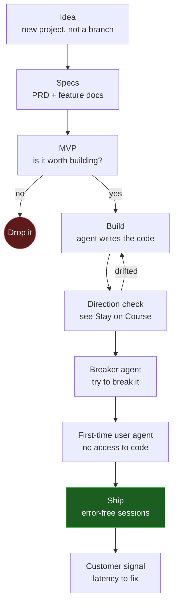

import Card from '@site/src/components/Card/Card';
import CardGroup from '@site/src/components/Card/CardGroup';

# Vercel CEO AI Workflow

[Guillermo Rauch](https://x.com/rauchg) is the CEO of Vercel. His take on AI coding is less about prompting tricks and more about **keeping control** while agents write most of the code: validate the idea cheaply, keep the build pointed at a written plan, and let other agents attack, audit and use the product before customers do.

He does not measure progress by tokens spent or commits shipped. Those only tell you how much you are doing, not where it is taking you.



## Test Ideas First

Rauch keeps a habit: any new idea gets its own project, launched from a one-letter shell alias, and an agent validates it **from scratch** instead of trusting what people say online. A lot of teams pick prompts and models by vibes ("this guide said model X likes this format") without ever checking.

Inside a project, the order is:

1. Write the **PRD** first. It lists the features the app is supposed to have.
2. Ask the agent for an **MVP** covering those basic features.
3. Only then build the rest.

Skipping the MVP is the expensive mistake. If you take a PRD straight into a full app, you discover late that the idea itself was wrong, and every early decision is already built on top of it. An MVP is cheap to throw away - a half-built product is not.

:::tip
The MVP is not a demo for investors. It is the answer to one question: after seeing it work, is this worth building?
:::

## Project Structure and Build Order

Everything the agent needs to stay on track lives in the repo, as plain files. The numbers are the build order:

```text
my-app/
├── specs/                 # 1. the plan, source of truth
│   ├── PRD.md             # 2. problem, users, core features
│   └── features/          # 3. one requirement doc per feature
├── AGENTS.md              # 4. conventions + "must not trade off"
├── .claude/commands/      # 5. direction, breaker, first-user
└── src/                   # 6. generated code
```

Feature docs stay small on purpose: that is what lets the direction check review each one separately. Nothing outside `specs/` is authoritative about what the app must do.

### The `features/` Folder

The video shows the folder holding files named `fr-01-rd.md`, `fr-02-rd.md`, and so on. The naming is a convention, and a useful one:

| Part | Meaning |
| :--- | :--- |
| `fr` | feature requirement |
| `01` | sequence number, so the PRD order stays visible in the folder |
| `rd` | requirement document |

One feature per file. The direction check runs a separate subagent per document, so a single giant `requirements.md` collapses back into one review pass and loses the whole point.

Each doc should say what the feature does **and** how to tell it works - the check grades your code against those statements, and so does the review agent.

## Stay on Course

With agents, building is the cheap part. Every idea you have while building can become a feature in minutes, and every new feature feels like progress. The agent will not stop you, because it has no idea which features actually matter.

So the plan in `specs/` needs an enforcement loop. Ask the agent to create a command (for example `/direction`) that:

- reads every document in the plan folder, one subagent per document
- compares what is actually built against each of them
- reports drift, a scorecard, and a list of what is missing

Then you make one of two choices on purpose: **keep the drift** and update the spec to match, or **revert** the change. Both are fine. Drifting by accident is not.

:::warning
Commits and token spend are activity metrics. They go up whether you are moving toward the product or away from it.
:::

## Security Debt

Rauch calls security one of the biggest challenges of this era, for himself and for Vercel. Two things changed at once:

- Agents write far more code than anyone can read, so manual review no longer covers the surface.
- The people attacking you have the same cheap models. Finding holes is now a commodity.

That is **security debt**: the vulnerabilities that accumulate faster than you can pay them down. The practical response:

- Run a security scan after each finished feature, not once before launch. Vercel built [DeepSec](https://vercel.com/security/deepsec) for exactly this: setup creates a config folder, the agent writes a short description of the app and its auth, then runs the scans and reports findings.
- Track **slop debt** separately. Messy code accepted for speed is a fine trade in a low-risk area. It is not a fine trade in auth, payments or customer data.
- Prefer secure by construction: sandboxes, memory-safe languages, generated code with real assertions instead of short clever code.

:::info
Short, naive code hides corner cases. The shorter the happy path, the more the failure path has to be written down and tested.
:::

## Non-Negotiables

Every task the agent takes comes with trade-offs: speed against safety, size against latency, effort against polish. It cannot spend unlimited effort, so it will pick for you unless you pick first.

The fix is a **must not trade off** section in `AGENTS.md`: the things your app has to have, and the things you would never give up. Without it, the model goes in whatever direction it wants.

Written rules are not enough, though. Agents carry a lot of context and forget instructions, so every rule needs a way to be checked. Commit the test file that proves it, so the rule cannot be skipped silently.

:::tip
Spend your design effort on the edges of the system: correctness, performance budget, UX and aesthetic standards. Rauch is skeptical of micro unit tests, including the ones agents happily write (asserting that a constant equals four proves nothing).
:::

## Breaker Agent

An agent checks the app the way it designed it: happy path, intended flow, everything green. Real users skip steps, double-click, open two tabs and do things concurrently. Those are the cases nobody wrote down.

A **breaker agent** attacks your own app the way an outsider would:

- runs in its own context window
- tries concurrency, race conditions, slow paths and half-finished flows
- measures latency and compares it with alternatives
- works on copies of the data, so production stays intact
- reports every way it managed to break the app

Then you close the loop: fix, rerun the breaker, repeat until nothing new falls over. Finding a hole yourself is cheap. Someone else finding it first is not.

## First-Time User Agent

One of Vercel's values is knowing your customer, and the metric Rauch likes for that is **error-free sessions**: how many people get all the way through your product without anything going wrong.

You cannot be a first-time user of your own app. You know where every button is, so a confusing sign-up step never stops you - it stops the customer, who leaves silently.

So build an agent that only knows what a new visitor knows:

- it runs the app in a browser and nothing else
- it is **blocked from reading the code**, because that would hand it the answers
- a hook allows only the browser tool, and blocks edits or deletions
- it reports every place a new user would get stuck

Its feedback is honest only while it stays blind. Pair it with a second agent that walks the critical paths start to finish (sign up, log in, pay) and writes the results to a JSON report. Run both before every ship. For the browser half, Vercel Labs ships [agent-browser](https://github.com/vercel-labs/agent-browser), a CLI built for agents driving a real browser.

## Customer Feedback Latency

Rauch grades how agentic a company really is with one question: **what happens when a customer reports a problem?** Does someone reply properly, investigate and ship a fix? And how long does the whole thing take? A company that fixes everything in 30 minutes beats one that takes two days.

Not all feedback is the same:

| Signal | Action |
| :--- | :--- |
| Screenshot of a broken button, failing payment | Turn it into a prompt, fix it immediately |
| "Your navigation confuses me" | Talk to the person first, then decide |
| Exception in prod nobody reported | Fix it before a customer notices |

The first and third can be automated. Connect the agent to where feedback already lands, via MCP servers: Gmail for support mail, Sentry for production errors. It reads each new report, sorts it, fixes the obvious breakage, and escalates anything that needs human judgment.

:::warning
Autonomy is not "let the agents ship slop". The judgment layer stays yours. What changes is the latency between signal and fix.
:::

## References

<CardGroup cols={2}>
  <Card title="Vercel CEO reveals his Agentic Engineering Workflow" icon="mdi:youtube" href="https://www.youtube.com/watch?v=WeiB_gLOdQE">
    David Ondrej interview: security debt, verification engineering, slop debt and customer latency
  </Card>
  <Card title="Vercel's CEO Just Unveiled The Greatest AI Coding Workflow Ever" icon="mdi:youtube" href="https://www.youtube.com/watch?v=y2ifUC9_zuU">
    AI LABS breakdown of the workflow, with the direction and breaker agents
  </Card>
</CardGroup>

- [Guillermo Rauch on X](https://x.com/rauchg)
- [DeepSec](https://vercel.com/security/deepsec)
- [Vercel Labs Agent Skills](https://github.com/vercel-labs/agent-skills) - official skills, install with `npx skills add vercel-labs/agent-skills`
- [skills.sh](https://skills.sh) - registry of installable community skills for any agent
- [Related Article: Chris Titus AI Workflow](./chris-titus-ai-workflow.md)
