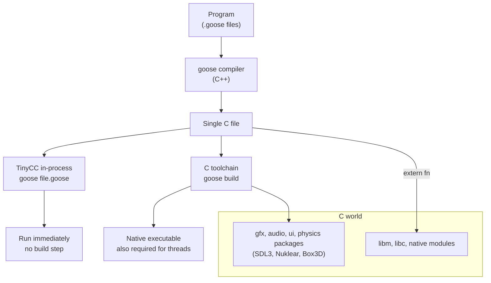

import Steps from '@site/src/components/Steps/Steps';
import Step from '@site/src/components/Steps/Step';

# Goose

Goose is a systems programming language by **Wouter van Oortmerssen** (author of Lobster and FlatBuffers) with a syntax familiar to C and Rust programmers. What makes it different is the memory model: **there is no heap**. Every dynamic value lives inline on data stacks the compiler manages, growth just advances a pointer, and memory is freed when its scope ends. No allocator, no garbage collector, no reference counting, no destructors, no lifetime annotations.

In the project's own benchmark suite it runs faster than C++ and safe Rust while using less memory. This article covers the memory model, the features that follow from it, the numbers (including where Goose loses), and how to run it. It is not Block's Goose AI agent, which shares only the name.

## The memory model: data stacks freed at scope exit

A Goose program has the native call stack, static data, and N data stacks, where the compiler works out N. A data stack is a large reservation of address space with a bump pointer, and there is no other memory. At most one resizable value is live per stack and it is always on top, so growth never moves anything and never checks a capacity.

```goose
for round in 3 {
    var scratch: u8[>..] = [];                        // grow-only: growth is a pointer bump
    for i in 100000 { scratch.push((i % 256) as! u8); }
    print("round ", round, ": ", scratch.len, " bytes");
}                                                     // the free: one store to the stack top
```

Freeing a structure with a million elements is a single store, no matter how deeply it is nested. All of this is proved at compile time; the runtime tracks only the bump pointers.

## References survive growth

Because memory never moves, a reference into a growing array stays valid for as long as the array does.

```goose
struct Item { id: i32, weight: f32 }

var items: Item[>..] = [];
let first .= items.push(Item { 1, 0.5 });             // a reference to element 0
for i: i32 in 2..1000001 { items.push(Item { i, 0.0 }); }
first.weight = 99.5;                                  // still valid, a million pushes later
```

`push` returns a reference to the new element, so a program can link elements while building the array. A C++ `std::vector` or Rust `Vec` may reallocate and cannot offer this guarantee, which is why those languages fall back to `reserve` calls or `u32` indices where Goose keeps typed references.

## Memory safety with zero annotations

Every reference and slice has a static **root**: the variable that bounds its target's lifetime. A reference must not outlive the variable that owns its target, and it cannot reach the target through an incompatible type. The compiler infers roots and specializes functions for them, so there is no lifetime syntax, no aliasing or exclusivity rules, and no `unsafe`.

```goose
fn longest(a: u8[:], b: u8[:]) -> u8[:] { if a.len >= b.len { a } else { b } }

var outer: u8[>..] = [];
var w = outer[..];
{
    var inner: u8[>..] = [];
    format(inner, "inner text");
    w = longest(outer, inner);     // error: storing a reference rooted at inner,
}                                  //        which does not outlive the destination
```

A slice `T[:]` accepts a range from any array kind without copying its elements, so `split` returns slices into its input and a dictionary keyed by `u8[:]` stores views of strings rather than copies.

## Nested data stays inline

Goose has no single array type. There is a family of array types that differ only in how their size can change, and each is laid out as `[metadata][elements...]`, packed inline, never as a pointer to a separate block:

| Type | What it is |
| --- | --- |
| `T[k]` | fixed size, known at compile time |
| `T[]`, `T[varint]` | sized at construction, frozen after; fixed or variable-width length |
| `T[..k]`, `T[..]` | capacity inline; grows and shrinks within it |
| `T[>..]` | grow-only, the most common kind; references into it stay valid |
| `T[>..<]` | grow-shrink: stacks, queues, heaps |

Strings are `u8` arrays: `u8[>..]` is a builder, `u8[]` a finished string stored inline in whatever holds it, `u8[..16]` a small string inside a struct, and `u8[:]` a view. A struct may contain variable-size parts, stored inline in declaration order, so a record is a sequence of bytes with no indirection in it:

```goose
struct Item  { sku: u8[varint], qty: varint, cents: varint }
struct Order { id: varint, customer: u8[varint], items: Item[varint] }

var book: Order[>..] = [];
book.push(Order { id: 1001, customer: "alice",
                  items: [Item { sku: "SKU-441", qty: 2, cents: 1999 },
                          Item { sku: "SKU-7", qty: 1, cents: 500 }] });
```

That order is 29 bytes and zero allocations. The same data as C++ `std::string` plus `std::vector<Item>` is 160 bytes and one allocation; as Rust `String` plus `Vec<Item>` it is 153 bytes and four allocations.

The trade-off: an array of variable-size elements is sequential. You can iterate it but not index it, unless you keep a second array of references beside it as an index.

## Enums in two sizes

Algebraic data types are the only form of dynamic polymorphism. There is no inheritance and there are no vtables. Every ADT can be stored in two ways, chosen at the point of use:

- **Fixed mode** (`Shape`) stores a tag plus room for the largest payload, so values can be indexed and overwritten.
- **Variable mode** (`Shape..`) gives each value exactly the size of its own variant. An array of them becomes sequential and a value never changes variant, but you may take references into a payload.

```goose
enum Shape { Circle { r: f64 }, Rect { w: f64, h: f64 }, Dot }

var packed: Shape..[>..] = [];                 // 9, 17 and 1 bytes, not 17 each
packed.push(Shape.Circle { r: 1.0 });
packed.push(Shape.Rect { w: 2.0, h: 3.0 });
packed.push(Shape.Dot);
for s in packed {
    match s { Rect &r => { r.w += 1.0; }, _ => {} }   // edits the payload in place
}
```

**Case functions** dispatch on a variant by defining one overload per variant. Calls dispatch through a jump table, and the compiler checks that the overloads cover every variant. On the benchmark that exercises variable-mode enums, they use 4x less memory than a Rust `enum` and run at 2x its speed.

## Links narrower than pointers

A `T&` is a machine address: eight bytes that never dangle. A **relative reference** stores the same link as a narrow offset. `T&<u32>` is measured from the field itself to a target in the same array, so the structure is position independent. `T&<u32 in pool>` is measured from the base of a named pool, so other arrays can link into it. `T&<u32>?` uses offset 0 as null.

```goose
struct Node { key: i32, left: Node&<u32>?, right: Node&<u32>? }   // 12 bytes, links included

fn insert(pool: Node[>..]&, key: i32) {
    if pool.len == 0 { pool.push(Node { key: key }); return; }
    var cur .= pool[0];                             // .= binds a reference; = would copy
    loop {
        if key == cur.key { return; }
        let next = if key < cur.key { cur.left } else { cur.right };
        if next { cur .= next; continue; }          // narrowed by `if`: next is a Node&
        if key < cur.key { cur.left .= pool.push(Node { key: key }); }
        else             { cur.right .= pool.push(Node { key: key }); }
        return;
    }
}
```

References are transparent: there is no `*` or `->`. `.=` binds or retargets a reference, and `Node?` is a nullable reference that `if`, `guard` and `assert` narrow.

Because the links are self-relative, a data structure can be written to a file as is. Saving is a single write; loading is a single read followed by a verification pass that checks framing, tags, lengths and every link, so a corrupt or hostile file makes `from_bytes` return `false` instead of a wild reference. No serializer, no schema, no pointer fixups.

## Errors, generics, and higher-order code without overhead

`return E from f` returns `E` as the result of the innermost active call of `f`, however many frames up that call is. Every function in between keeps its plain signature: no `Result` type, no `?` on every call, no unwinder.

```goose
fn parse_user(line: u8[:]) -> User {
    let comma = find(line, ",");
    guard comma >= 0 else { return [], str("expected name,age: ", line) from load; }
    let age, ok = parse_int(line[comma + 1..]);
    guard ok else { return [], str("bad age: ", line) from load; }
    let name = trim(line[..comma]);
    return User { name: name, age: age as i32 };
}
```

It is checked statically: every call of `parse_user` must lie inside a `load` call, so nothing can go uncaught at runtime. It compiles to a hidden discriminant checked in each frame.

Generics and higher-order functions are equally cheap. An untyped parameter is a generic one, function values are compile-time entities that cannot escape, and everything is monomorphized:

```goose
fn twice(x) { x + x }                              // an untyped parameter is generic

fn each_pair<T, F>(xs: T[:]) {                     // F is a function value
    for i in 0..xs.len - 1 { F(xs[i], xs[i + 1]); }
}

let evens = xs.filter() { it % 2 == 0 };
sort(xs) { a, b => a > b };
```

A block may `return` from its lexically enclosing function, and nested functions can use the enclosing locals. Since there are no closure objects or function pointers, `xs.filter() { it > 0 }` compiles to what the handwritten loop would look like and builds its result directly in its destination.

## Threads without shared memory

A `thread_fn` and everything it calls is compiled as a separate program with its own data stacks and its own copies of the globals. There is no shared mutable memory, so data races, locks, atomics and memory orderings do not exist in the language. Values cross between threads through typed queues, one per type, and must be flat, with no references at any depth. Passing them is a single `memcpy` because a flat Goose value is contiguous.

A worker started with `thread_spawn_contained` can fail without killing the process: a failed check or `abort` ends only that worker, and the message goes to whoever waits for it, so a supervisor can log it and start another.

## Compiling to C

Goose emits one C file for the whole program, so it runs wherever a C compiler does and calls C directly through `extern fn`. The bundled TinyCC backend compiles and runs a program in-process with no build step.



Only types with supported C representations may cross the boundary, and unsupported signatures are rejected at the declaration.

## Benchmarks

The project's October 16, 2026 run reports geometric means over sixteen benchmarks at their large sizes:

| Geometric mean, 16 benchmarks | vs idiomatic C++ | vs hand-optimized C++ | vs best safe Rust |
| --- | --- | --- | --- |
| Speed, MSVC backend | 3.51x | 1.24x | 1.13x |
| Speed, clang backend | 3.54x | 1.26x | 1.19x |
| Peak memory | 1.95x less | 1.32x less | 1.25x less |

:::info
The gains come from the memory model, not from a smarter backend: no heap allocation or per-object teardown, contiguous data, 1 to 4-byte relative links, and enums sized for the variant they contain. Measurements are whole-process wall-clock time, including input generation, construction and teardown.
:::

The suite also documents losses, which is the honest way to read it:

- **`calc`** takes 481/491 ms (MSVC/clang) against a Rust arena at 436 ms.
- **`lru`** takes 2,760/2,068 ms against Rust at 2,249 ms, so it loses under MSVC and wins under clang.
- **`scene`** takes 460/371 ms against Rust at 379 ms, again a loss under MSVC and roughly level under clang.
- **The aggregate mixes implementations**: for each backend the fastest Goose implementation is used for speed, but memory is taken from whichever implementation uses the least.

These are self-reported numbers from the repository, measured on one machine without pinned cores. Small differences, especially in graph and LRU workloads, are not worth reading as a language verdict. The full results and methodology live in the project's benchmark docs.

## Install and run

Prebuilt compilers for Windows (x64), Linux (x64) and macOS (Apple silicon and Intel) are on the releases page, with the graphics, audio, ui and physics packages compiled in. Unpack one anywhere and put its directory on `PATH`.

<Steps>
  <Step title="Unpack a release">
    Download an archive from the [releases page](https://github.com/aardappel/goose/releases), unpack it, and add the directory to `PATH`. The compiler finds the standard library and TinyCC's runtime beside itself and keeps build output under `~/.goose` (override with `GOOSE_HOME`).
  </Step>
  <Step title="Run a program in-process">
    No C compiler and no build step, the bundled TinyCC backend compiles and runs the program inside the compiler process. On Linux this needs the C library headers (`libc6-dev`).
    ```bash
    goose samples/01_tour.goose
    ```
  </Step>
  <Step title="Build a native executable">
    `goose build` finds a C compiler on the machine (`goose toolchain` shows which one), links the generated C with the runtime and any native modules, and writes the binary beside the source. Programs that use threads must be built this way.
    ```bash
    goose build samples/01_tour.goose && samples/01_tour
    ```
  </Step>
  <Step title="Typecheck only">
    `goose check` only typechecks. `--debug` turns on overflow, range and tag checks that name their source line when they fail, and `--bce-lines` reports the bounds checks that remain per line.
    ```bash
    goose check samples/01_tour.goose
    ```
  </Step>
</Steps>

To build the compiler from source you need CMake 3.27 or later, a C++20 compiler, and Python 3 for the test and sample runners:

```bash
git clone https://github.com/aardappel/goose
cd goose
cmake -B build -DCMAKE_BUILD_TYPE=Release -DGOOSE_BUILTIN_LIBS=all
cmake --build build --config Release
```

The VS Code extension adds syntax highlighting, the compiler's language server (`goose lsp` with errors as you type, hover, go to definition, completion, rename, symbols) and one-key runs. Neovim, Helix and Emacs configurations are documented too.

## Where the limits are

- **You think about where data lives**: who owns it and how long its scope lasts. Usually the owner is the function that builds the data, which needs no extra work; when it is not, use the standard library's `slot_pool` or `slice_pool`.
- **Recursive functions cannot keep growable data across a recursive call**: scratch data must end before the call, and data that outlives the call is passed in as a pool.
- **No escaping closures, no function pointers, no dynamic dispatch beyond ADT tags**: only whole-program compilation is supported.
- **A slot returned to a pool but still referenced reads whatever its next owner put there**: a logic bug, never memory corruption.
- **The language is young**: about thirty thousand lines of C++ of compiler, a specification, a standard library, samples, and a CI test suite on Windows, macOS and Linux. Moves for resizable values, more than one resizable value per struct, labeled `break` and namespace privacy are deliberately out of scope for now.

Picking up Goose is cheap if you already know C or Rust: the memory model is the only genuinely new thing, and the syntax is deliberately familiar. Rust programmers will find the borrow checker's job done by inference instead of annotations, at the price of losing the heap.

## References

- [Official site](https://aardappel.github.io/goose/)
- [GitHub Repository](https://github.com/aardappel/goose)
- [Tutorial](https://aardappel.github.io/goose/docs/tutorial.html)
- [Language Reference](https://aardappel.github.io/goose/docs/reference.html)
- [Language Specification](https://aardappel.github.io/goose/docs/goose_spec.html)
- [Benchmark summary](https://aardappel.github.io/goose/bench/summary.html)
- [Benchmark results](https://aardappel.github.io/goose/bench/results.html)
- [Samples](https://aardappel.github.io/goose/samples/index.html)
- [Standard Library](https://aardappel.github.io/goose/docs/stdlib.html)
- [Intro video (YouTube)](https://www.youtube.com/watch?v=XxUbF2DXXGw)
- [Rust](rust.md), for comparison with another memory-safe systems language
