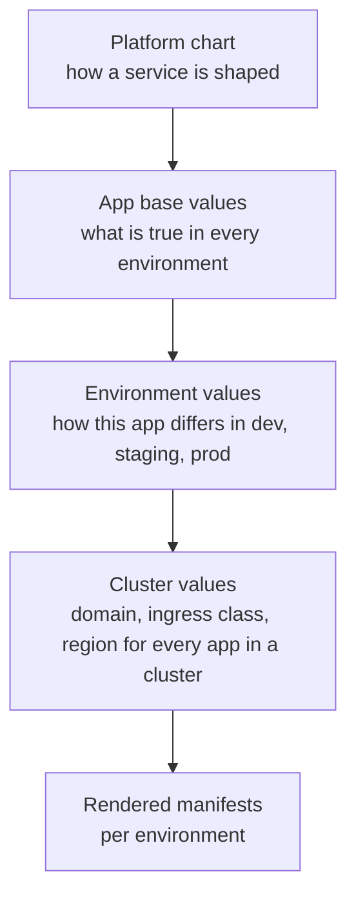

# How to Manage Dev, Staging, and Production in Kubernetes Without Duplicating YAML

Copying a working `deployment.yaml` into a `staging/` folder and then into a `production/` folder feels free on day one. Six months later the three files share most of their content, and nobody can tell which differences are deliberate and which are accidents.

The fix is not a better folder naming scheme. It is a layout where every value lives in exactly one layer, and every environment difference is a small, reviewable file. This article covers the repository structure, the Helm and Kustomize split, GitOps promotion, secrets, and the CI checks that keep the environments honest.

## The Real Cost of Copy-Pasted Manifests

Run a recursive diff on a repository that keeps one folder per environment:

```bash
diff -rq k8s/staging k8s/production
```

```text
Files k8s/staging/deployment.yaml and k8s/production/deployment.yaml differ
Files k8s/staging/configmap.yaml and k8s/production/configmap.yaml differ
Files k8s/staging/ingress.yaml and k8s/production/ingress.yaml differ
Only in k8s/staging: pdb.yaml
Only in k8s/staging: networkpolicy.yaml
```

Some of those differences are intentional: production runs more replicas and answers on a different hostname. Others are drift: a PodDisruptionBudget and a NetworkPolicy were added to staging and never promoted. The diff cannot tell the two apart, and neither can a reviewer looking at the next pull request.

That is the actual cost. Duplication is annoying, but ambiguity is dangerous: a change that passes in staging can fail in production because the two environments were never running the same thing.

## One Value, One Layer

The rule behind every layout in this article: if you are about to write the same value in two places, it belongs one layer up. Four layers are enough for most platforms:



| Layer | Owns | Owned by |
| :--- | :--- | :--- |
| Platform chart | Deployment, Service, probes, security context, labels | Platform team |
| App base values | Image repository, ports, log format, default resources | Application team |
| Environment values | Replicas, resource sizing, image tag, feature flags | Application team, reviewed by SRE for production |
| Cluster values | Domain, ingress class, region, secret store name | Platform team |

On disk, that produces a layout like this:

```text
platform-charts/
  charts/
    service/                        # versioned shared chart

platform-gitops/
  apps/
    checkout-api/
      base/values.yaml              # identical in every environment
      envs/
        dev/values.yaml             # only what differs in dev
        staging/values.yaml
        production/values.yaml
  clusters/
    eks-dev/cluster-values.yaml     # domain, ingress class, region
    eks-staging/cluster-values.yaml
    eks-production/cluster-values.yaml
  argocd/
    applicationsets/checkout-api.yaml
    projects/production.yaml
```

The test for the structure is scale: adding a service means adding one folder under `apps/`. Moving every staging service to a new ingress domain means editing one cluster file, not fifty application folders. If a change at that scale still touches every app, a value is living in the wrong layer.

## Environments Are Directories, Not Branches

Branch-per-environment (`dev`, `staging`, `main`) looks clean until it has to work. Promotion becomes a merge that drags unrelated commits along, hotfixes become cherry-picks, and the difference between staging and production hides in Git history instead of sitting in two files you can open side by side.

With directories, `diff envs/staging/values.yaml envs/production/values.yaml` answers the only question that matters during an incident: what is different, and was it on purpose?

## Helm vs Kustomize

Both tools solve the same problem from opposite directions. Helm generates YAML from templates and values. Kustomize starts from plain YAML and patches it.

| Situation | Use |
| :--- | :--- |
| Your own services, many of them sharing one shape | Helm with a shared platform chart |
| Third-party manifests you do not want to fork | Kustomize overlays |
| A vendor chart missing one value you need | Kustomize patch on top of the rendered chart |
| A templating feature that only exists because one environment needs it | Probably a missing value in your chart |

A Helm base for one service is small:

```yaml title="apps/checkout-api/base/values.yaml"
image:
  repository: registry.example.com/checkout-api
service:
  port: 8080
probes:
  readinessPath: /ready
  livenessPath: /healthz
config:
  LOG_FORMAT: json
  PAYMENT_TIMEOUT_MS: "3000"
replicaCount: 1
resources:
  requests:
    cpu: 100m
    memory: 128Mi
  limits:
    memory: 256Mi
autoscaling:
  enabled: false
podDisruptionBudget:
  enabled: false
externalSecret:
  enabled: true
  key: checkout-api/runtime
```

Production only declares what changes:

```yaml title="apps/checkout-api/envs/production/values.yaml"
image:
  tag: 4.12.3
resources:
  requests:
    cpu: 500m
    memory: 512Mi
  limits:
    memory: 1Gi
autoscaling:
  enabled: true
  minReplicas: 3
  maxReplicas: 12
  targetCPUUtilizationPercentage: 65
podDisruptionBudget:
  enabled: true
  minAvailable: 2
config:
  FEATURE_SPLIT_PAYMENTS: "false"
```

The dev file can be an image tag and nothing else, because the base already holds dev's values.

The Kustomize equivalent for the same service keeps the base as plain YAML and patches it:

```yaml title="overlays/production/kustomization.yaml"
apiVersion: kustomize.config.k8s.io/v1beta1
kind: Kustomization
namespace: checkout
resources:
  - ../../base
  - pdb.yaml
images:
  - name: checkout-api
    newName: registry.example.com/checkout-api
    newTag: 4.12.3
patches:
  - path: resources-patch.yaml
```

Use Helm for your own services, because a shared chart is how fifty teams stop writing fifty Deployments. Use Kustomize for vendor manifests and as a last-mile layer on top of Helm. If you combine the two often, the chart is missing a value.

## Environment-Specific Configuration

Resource sizing and replica counts map straight onto values. A few cases hide sharper edges.

### Replicas Versus the Autoscaler

Production has `replicaCount: 3` and a HorizontalPodAutoscaler. If the chart always renders `spec.replicas`, Argo CD and the HPA fight: the HPA scales to 8 under load, Argo CD sees drift against the `3` in Git, `selfHeal` scales it back down, and five Pods disappear at peak traffic because of the deployment tool.

When autoscaling is enabled, the replica count belongs to the HPA. `minReplicas: 3` is how production says "three replicas".

```yaml title="templates/deployment.yaml"
spec:
{{- if not .Values.autoscaling.enabled }}
  replicas: {{ .Values.replicaCount }}
{{- end }}
```

### Charts Ask About Capabilities, Not Environments

This is the wrong kind of conditional, because every new environment forces a template edit and nobody can tell what production gets without reading Go templates:

```yaml
spec:
{{- if eq .Values.environment "production" }}
  replicas: 3
{{- else if eq .Values.environment "staging" }}
  replicas: 2
{{- else }}
  replicas: 1
{{- end }}
```

The chart should ask which capabilities are enabled, never which environment it is running in. The values files decide which capabilities each environment turns on.

### Config Changes Must Trigger a Rollout

Editing a ConfigMap does not restart Pods on its own. Without a checksum annotation, a config change lands in Git and reaches production, while the running Pods keep the old values. Helm handles it with an annotation on the Pod template:

```yaml
metadata:
  annotations:
    checksum/config: {{ include (print $.Template.BasePath "/configmap.yaml") . | sha256sum }}
```

Kustomize handles the same problem with `configMapGenerator`, which puts a content hash in the generated ConfigMap name.

### Hostnames Belong to the Cluster Layer

```yaml title="clusters/eks-production/cluster-values.yaml"
ingress:
  className: alb
  domain: payflow.io
region: ap-south-1
```

The chart builds `checkout.payflow.io` from the service name and the cluster domain, so no application file ever hardcodes a hostname.

## GitOps for Three Environments

One ApplicationSet deploys all three environments, layering values files from least to most specific. Later files win.

```yaml title="argocd/applicationsets/checkout-api.yaml"
apiVersion: argoproj.io/v1alpha1
kind: ApplicationSet
metadata:
  name: checkout-api
  namespace: argocd
spec:
  goTemplate: true
  goTemplateOptions: ["missingkey=error"]
  generators:
    - list:
        elements:
          - env: dev
            cluster: eks-dev
            chartVersion: service-chart-2.5.0
            autoSync: "true"
          - env: staging
            cluster: eks-staging
            chartVersion: service-chart-2.4.1
            autoSync: "true"
          - env: production
            cluster: eks-production
            chartVersion: service-chart-2.4.1
            autoSync: "false"
  template:
    spec:
      sources:
        - repoURL: https://github.com/example/platform-charts.git
          targetRevision: '{{.chartVersion}}'
          path: charts/service
          helm:
            valueFiles:
              - $values/apps/checkout-api/base/values.yaml
              - $values/clusters/{{.cluster}}/cluster-values.yaml
              - $values/apps/checkout-api/envs/{{.env}}/values.yaml
        - repoURL: https://github.com/example/platform-gitops.git
          targetRevision: main
          ref: values
      destination:
        name: '{{.cluster}}'
        namespace: checkout
```

Dev and staging sync automatically. Production shows `OutOfSync` after a merge and waits for a human to press Sync. The chart version is pinned per environment, so a new chart release walks through dev first, exactly like an application release.

Promotion moves an artifact, it does not rebuild one. CI builds the image once, tags it with an immutable version, and commits that tag to `envs/dev/values.yaml`. Promoting is a pull request that copies the tag forward:

```bash
TAG=$(yq '.image.tag' apps/checkout-api/envs/staging/values.yaml)
yq -i ".image.tag = \"${TAG}\"" apps/checkout-api/envs/production/values.yaml
git switch -c "promote/checkout-api-${TAG}"
git commit -am "Promote checkout-api ${TAG} to production"
```

Rollback uses the same mechanism in reverse: revert the promotion pull request and production is `OutOfSync` against the previous tag. There is no separate rollback procedure to remember during an incident.

Guards on the production layer:

- `CODEOWNERS` with branch protection requires SRE approval for `apps/*/envs/production/` and `clusters/eks-production/`.
- A dedicated Argo CD `AppProject` for production only allows destinations in the production cluster, so a mistyped cluster name in a dev entry cannot land there.
- A `syncWindow` blocks production syncs over the weekend.

:::warning
Changes to `base/values.yaml` reach every environment in the same merge. Someone bumping a timeout "for dev" also changes production on the next sync. Put base files under the same `CODEOWNERS` rule as production, and stage a change in the environment files first, moving it into base only once every environment agrees.
:::

## Secrets Across Environments

No secret values belong in Git, encrypted or otherwise. The chart renders an `ExternalSecret` and the External Secrets Operator pulls the value at runtime:

```yaml
apiVersion: external-secrets.io/v1
kind: ExternalSecret
metadata:
  name: checkout-api
  namespace: checkout
spec:
  refreshInterval: 1h
  secretStoreRef:
    kind: ClusterSecretStore
    name: aws-secrets
  target:
    name: checkout-api-secrets
  dataFrom:
    - extract:
        key: checkout-api/runtime
```

Note that the store name and the key are identical in every environment. Each cluster has its own `ClusterSecretStore` with that name, authenticating through a workload identity to a different cloud account or project per environment. Isolation comes from IAM, not from naming conventions.

The common alternative, one shared account with keys like `staging/checkout-api/runtime` and `production/checkout-api/runtime`, means a one-word typo in a staging values file hands production database credentials to a staging Pod. With separate accounts, the staging cluster cannot read production secrets whatever the YAML says.

:::tip
Rotating a credential is the sharp edge here. External Secrets refreshes the Kubernetes Secret, but Pods that consume it as environment variables keep the old value until they restart. Mount secrets as files and re-read them, or use a controller such as Stakater Reloader to roll the Pods when the Secret changes. Test rotation in staging first.
:::

## Preventing Drift Before It Reaches a Cluster

Layered values have one real weakness: reviewers read the input, but the cluster runs the output. A five-line values diff can produce a 200-line manifest change, or silently produce nothing because of a typo in a key name.

CI renders every environment on every pull request and validates the output:

```bash
#!/usr/bin/env bash
set -euo pipefail

for env in dev staging production; do
  helm template checkout-api ./platform-charts/charts/service \
    -f apps/checkout-api/base/values.yaml \
    -f "clusters/eks-${env}/cluster-values.yaml" \
    -f "apps/checkout-api/envs/${env}/values.yaml" \
    > "rendered/${env}.yaml"

  kubeconform -strict -summary \
    -kubernetes-version 1.34.0 \
    -schema-location default \
    -schema-location 'https://raw.githubusercontent.com/datreeio/CRDs-catalog/main/{{.Group}}/{{.ResourceKind}}_{{.ResourceAPIVersion}}.json' \
    "rendered/${env}.yaml"

  kyverno apply ./policies --resource "rendered/${env}.yaml"
done
```

Three layers of protection sit around that script:

- **Rendered diff**: the same job renders the target branch and posts the manifest diff per environment as a pull request comment. That diff is what reviewers should actually read.
- **Values schema**: `values.schema.json` with `additionalProperties: false` makes a typo like `autoscalling.enabled: true` fail `helm template` instead of being silently ignored.
- **Policy as code**: Kyverno runs both in CI against rendered output and at admission time in the cluster, so a `kubectl apply` from a laptop gets the same rules as a pull request.

Drift detection closes the loop. In dev and staging, `selfHeal` reverts manual changes within minutes. In production, where sync is manual, drift shows up as `OutOfSync`, so alert on it before it becomes normal.

```yaml
- alert: ProductionAppOutOfSync
  expr: argocd_app_info{project="production", sync_status="OutOfSync"} == 1
  for: 2h
  labels:
    severity: warning
  annotations:
    summary: "{{ $labels.name }} has been out of sync for 2h"
```

## Multi-Environment Checklist

- One base values file per service; environment files contain only the differences.
- Environments are directories, not branches.
- Hostnames, domains, and regions live in cluster-level values.
- Charts check capabilities such as `autoscaling.enabled`, never environment names.
- `spec.replicas` is omitted whenever an HPA is enabled.
- Config changes trigger rollouts through a checksum annotation or `configMapGenerator`.
- Images are built once and promoted by tag.
- Chart versions are pinned per environment.
- `CODEOWNERS` covers production environment files and base files.
- Production syncs manually, inside allowed sync windows.
- Each environment reads secrets from its own account or store.
- CI renders, validates, and diffs every environment on every pull request.
- Production `OutOfSync` state alerts after a set time.

Fewer files is a side effect. The real outcome is that every difference between environments becomes a decision someone made on purpose, in a file small enough to read in ten seconds. When production breaks and staging did not, the investigation should start and mostly end with `diff envs/staging/values.yaml envs/production/values.yaml`.

## References

- [How to Manage Dev, Staging, and Production in Kubernetes Without Duplicating YAML (Tom Jose, kotaiCode)](https://medium.com/kotaicode/how-to-manage-dev-staging-and-production-in-kubernetes-without-duplicating-yaml-141ce1b499d9)
- [Helm Documentation](https://helm.sh/docs/)
- [Kustomize Documentation](https://kubectl.docs.kubernetes.io/references/kustomize/)
- [Argo CD ApplicationSet Controller](https://argo-cd.readthedocs.io/en/stable/operator-manual/applicationset/)
- [External Secrets Operator](https://external-secrets.io/)
- [Kyverno Documentation](https://kyverno.io/docs/)
- [kubeconform](https://github.com/yannh/kubeconform)
- [Kubernetes patterns](k8s-patterns.md)
- [Kubernetes tools](k8s-tools.md)
