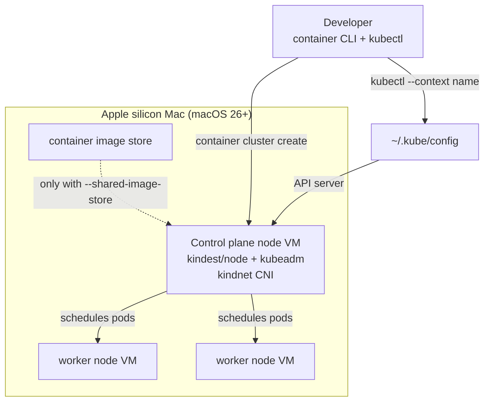

import Steps from '@site/src/components/Steps/Steps';
import Step from '@site/src/components/Steps/Step';

# Apple Container Clusters

[`apple/container`](https://github.com/apple/container) runs Linux containers as lightweight virtual machines on Apple silicon Macs, using the [Containerization](https://github.com/apple/containerization) Swift package instead of a single shared Docker-style VM. Since the Kubernetes plugin landed, the same tool can also run local Kubernetes clusters through the `container cluster` command.

Each cluster is a set of container VMs running a `kindest/node` image bootstrapped with `kubeadm`. A single-node cluster acts as both control plane and worker, and `--workers` adds dedicated worker nodes. The cluster writes its context into `~/.kube/config`, so `kubectl` works without extra configuration, and it is meant for development and testing rather than production.

:::warning Experimental feature
Apple marks the `cluster` subcommand as experimental. Its subcommands and options are explicitly subject to change between releases, unlike the rest of the `container` CLI.
:::

## When the cluster feature arrived

The Kubernetes support did not ship with the first `container` release. It arrived as a `k8s` plugin and was later renamed.

| Release | Date | Change |
| :--- | :--- | :--- |
| 1.2.1 | 2026-08-07 | `k8s` plugin added, giving turnkey local Kubernetes clusters (`container k8s`) |
| 1.2.2 | 2026-08-08 | Fixed `container k8s` failing when installed from the release package |
| 1.5.0 | 2026-09-29 | `--cni` option for a custom CNI manifest; `container k8s start` removed |
| 1.6.0 | 2026-10-20 | Multi-worker clusters (`--workers`) |
| 1.6.1 | 2026-10-23 | Renamed `container k8s` to `container cluster`; concurrency fixes |
| 1.7.1 | 2026-11-06 | `--shared-image-store`, per-cluster listing with `--nodes`, per-worker CPU and memory |

So the modern `container cluster` command exists from **1.6.1**, while the underlying feature has been available since **1.2.1** under the old `k8s` name. Guides written before October 2026 use `container k8s create` and equivalent subcommands.

## Requirements

- **Apple silicon Mac.** `container` only runs on Apple silicon; there is no Intel build.
- **macOS 26 or later.** The 1.7.1 README states that `container` is supported on macOS 26 and that older versions are not supported. The technical overview still documents a macOS 15 mode with severe container networking limits (containers cannot communicate with each other), which is exactly what multi-node clusters rely on, so macOS 26 is the practical floor for clusters.
- **A running container system.** `container system start` must have installed and started the helper services and the default kernel.
- **`kubectl`**, installed separately, to drive the cluster once it exists.
- **Disk space for the node image.** The default node image is `docker.io/kindest/node:v1.35.5`, pulled on first cluster creation.

Apple publishes no minimum chip or RAM figure beyond "a Mac with Apple silicon" for the tool itself. The values that matter in practice come from the cluster defaults: 1/4 of the host CPUs (minimum 2) and 1/4 of the host memory (minimum 2GB) per node. A multi-node cluster multiplies that across nodes.

:::info macOS 15
The build instructions list macOS 15 as the build minimum with macOS 26 recommended, which is a different statement from the runtime support window. Do not treat a macOS 15 machine as a supported cluster host.
:::

## How a cluster is built



The control plane runs `kubeadm init`, installs a CNI (bundled kindnet by default) and publishes the API server to the host. With `--workers 0`, which is the default, the control-plane node also runs workloads. With one or more workers, the control plane is tainted so pods land only on workers, matching normal multi-node behaviour.

## Create and use a cluster

<Steps>
  <Step title="Start the container system">
    ```bash
    container system start
    ```
    On first run this installs the default kernel if none is configured.
  </Step>
  <Step title="Create a cluster">
    ```bash
    container cluster create --name dev
    ```
    The default name is `cluster-dev`. The command pulls the node image, bootstraps Kubernetes and merges the new context into `~/.kube/config`.
  </Step>
  <Step title="Verify the cluster">
    ```bash
    container cluster list
    kubectl --context dev cluster-info
    kubectl --context dev get nodes
    ```
    Switch between clusters with `kubectl config use-context <name>`, or pass `--context` on each command.
  </Step>
  <Step title="Delete the cluster">
    ```bash
    container cluster delete --name dev
    ```
    This stops and removes the node containers and removes the context from `~/.kube/config`.
  </Step>
</Steps>

`container cluster list` shows one row per cluster with status, node count and Kubernetes version. Add `--nodes` for one row per node, `-q` for names only, or `--format json` for machine-readable output. Clusters created by an earlier version have no stored configuration and do not appear in the list.

## Sizing and multi-node clusters

`--cpus` and `--memory` size the control-plane node, or the single node when no workers are requested. Without them, each node gets 1/4 of the host CPUs and memory, with minimums of 2 CPUs and 2GB.

```bash
# Default single node (control plane doubles as worker)
container cluster create --name dev --cpus 4 --memory 8g

# Control plane plus three workers, all with defaults
container cluster create --name dev --workers 3

# Differently sized worker groups
container cluster create --name dev --cpus 2 --memory 4g \
  --workers count=2,cpus=4,memory=8g \
  --workers count=1,cpus=2,memory=4g
```

Worker nodes share the control plane's `--node-image` and are named `dev-worker-1`, `dev-worker-2` and so on. A worker group's `count` defaults to `1`; any omitted `cpus` or `memory` falls back to the single-node defaults.

## Custom node images and CNI

Pin a different Kubernetes version with `--node-image`, using any `kindest/node` tag:

```bash
container cluster create --name dev --node-image docker.io/kindest/node:v1.34.11
```

`--cni` replaces the bundled kindnet with a plain Kubernetes manifest. Helm charts must be rendered first, and `--cni NONE` skips CNI installation entirely, in which case the command returns without waiting for nodes to become `Ready` and you apply your own CNI afterwards.

For Cilium, set `ipam.mode=kubernetes` when rendering, because the chart's default `cluster-pool` CIDR overlaps the pod and service subnets used by these clusters:

```bash
helm repo add cilium https://helm.cilium.io/
helm repo update
helm template cilium cilium/cilium --version 1.20.1 --namespace kube-system \
  --set ipam.mode=kubernetes > cilium.yaml

container cluster create --name cilium-demo --cni ./cilium.yaml
```

## Use local images in a cluster

Normally every node pulls images from a registry. `--shared-image-store` lets nodes read the local `container` image store instead, so an image built with `container build` runs in the cluster without a registry round trip:

```bash
container cluster create --shared-image-store
container build -t my-app:dev .
kubectl run my-app --image=my-app:dev
```

:::warning Shared image store security
With sharing enabled, anything with root on a node, including privileged pods and pods with a `hostPath` mount, can read every image in your local image store, including private images pulled with your registry credentials. A local image also wins over a registry image with the same name, for every pull policy and without the pod's pull secrets. Sharing is off by default and can only be set at creation time; to change it, delete and re-create the cluster.
:::

Every pull policy works, including `imagePullPolicy: Never`. After rebuilding a tag, use `imagePullPolicy: Always` or a new tag, because `IfNotPresent` keeps the copy the node already has.

## Operational notes

- **Cluster nodes are hidden from `container list`**, even with `--all`. Use `container cluster list` to see them.
- **Lifecycle commands refuse cluster nodes.** `container start`, `stop`, `kill` and `delete` report a named node as not found. Read-only commands such as `inspect`, `logs`, `exec` and `stats` still work on a node.
- **Stopped clusters are not restartable in place.** If the control plane stops, for example after `container system stop`, delete and re-create the cluster.
- **`--rm` leaves stale configuration.** Node containers are removed when they stop, but the cluster record remains and shows as `stopped` until you delete it or create a cluster with the same name.

## References

- [Container cluster documentation (1.7.1)](https://github.com/apple/container/blob/1.7.1/docs/cluster.md)
- [Command reference: cluster management](https://github.com/apple/container/blob/1.7.1/docs/command-reference.md#container-cluster-management)
- [apple/container repository](https://github.com/apple/container)
- [Release 1.2.1, first k8s plugin](https://github.com/apple/container/releases/tag/1.2.1)
- [Release 1.6.1, renamed to container cluster](https://github.com/apple/container/releases/tag/1.6.1)
- [Release 1.7.1](https://github.com/apple/container/releases/tag/1.7.1)
- [Containerization Swift package](https://github.com/apple/containerization)
- [Cluster gateway example](https://github.com/apple/container-examples/tree/main/container-cluster-gateway)
- [Goodbye Docker Desktop](Docker/docker-desktop-goodbye.md)
