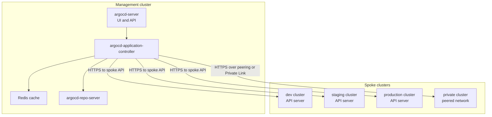
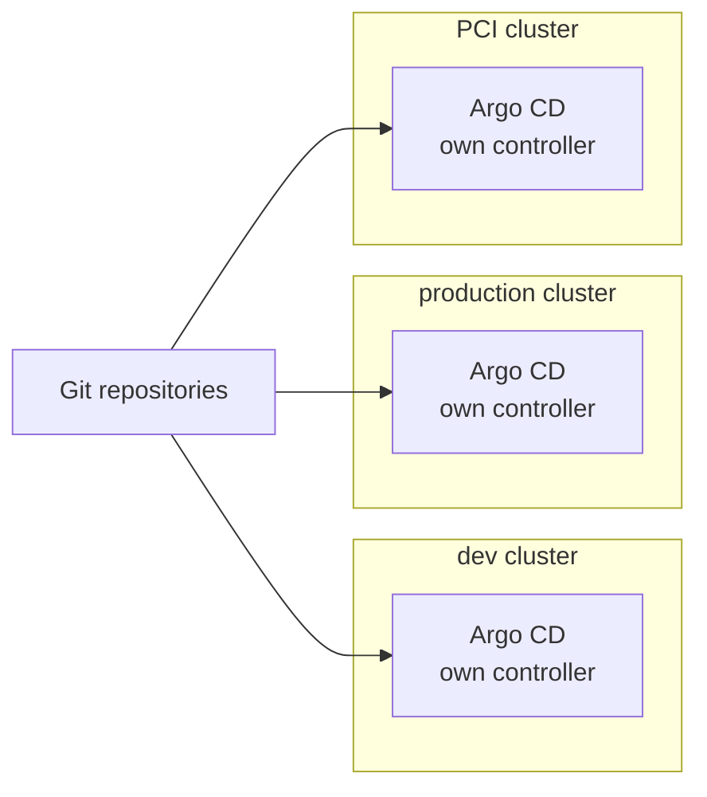
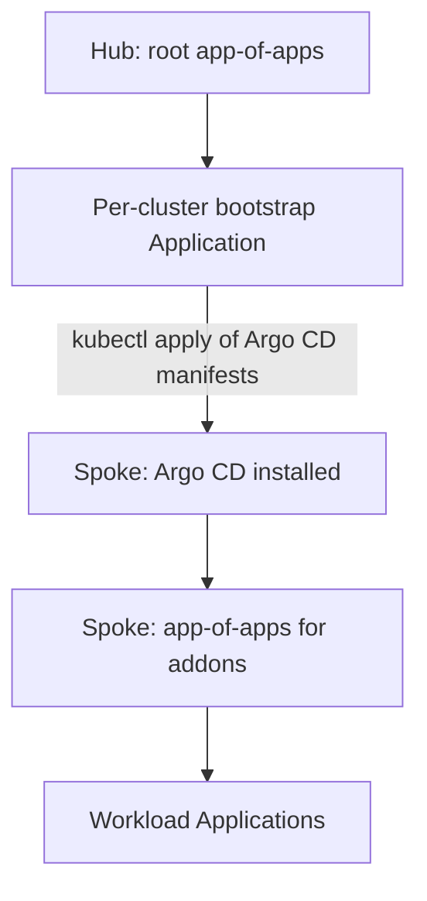

# Multi-Cluster Argo CD Architecture

Every Argo CD tutorial ends on one cluster, with one Argo CD instance and `kubectl config current-context` pointing at the same place. That teaches the sync loop, not the thing that decides whether the platform survives: where does Argo CD live once there is more than one cluster to manage?

Two clusters, dev and prod, already force the decision. At ten clusters across two clouds and several teams, the choice made on day one either pays for itself or costs an incident a quarter. This article compares the four patterns teams actually run, states when each one wins and when it does not, and covers the mechanics that make a hub work: cluster registration on EKS and AKS, controller sharding, and the failure modes that only appear at scale.

## The Two Defaults Teams Fall Into

Most multi-cluster setups are not chosen, they are inherited from whichever getting-started guide was open at the time. Both defaults below are correct at one size and wrong at another.

- **Argo CD per cluster sprawl.** Every cluster gets its own instance because the guide installed it in-cluster. Nobody has one view of what runs where, and upgrading Argo CD itself becomes N change requests.
- **One hub that becomes a bottleneck.** One team registers every cluster against a single instance and never revisits it, until the application controller falls behind on reconciliation or a hub outage stops deployments for every team at once.

The rest of this article is a framework for choosing deliberately, plus the operational work each choice implies.

## Push Versus Pull: The Axis Under Every Pattern

"Multi-cluster Argo CD" hides a second decision. Argo CD always pulls manifests from Git, but for cluster targeting there are two directions of connection:

- **Push.** The hub's `argocd-application-controller` holds credentials for every spoke and opens a connection to each spoke's Kubernetes API server. Hub-and-spoke works this way.
- **Pull.** A lightweight agent inside each workload cluster dials out to a central control plane. The control plane never initiates a connection inward. This is what [argocd-agent](https://argocd-agent.readthedocs.io/) implements by inverting the traditional model.

| Model | Who opens the connection | Reaches private or NATed clusters | Reconciliation runs | Maturity | Typical use case |
| --- | --- | --- | --- | --- | --- |
| Push (hub controller) | Hub, outbound to every spoke API server | Only with peering, Private Link or a VPN path | On the hub | Stable, the default Argo CD design | Fleet of clusters on a shared network you control |
| Pull (argocd-agent) | Agent in the spoke, inbound to the hub | Yes, no inbound path needed | Locally, in the spoke | Active development, not a GA replacement | Clusters behind NAT, edge sites, strict isolation boundaries |

The push model is the one every tutorial shows and the one the rest of this article assumes unless stated otherwise. The pull model removes the network reachability problem at the cost of a younger project: treat it as something to evaluate per environment, not as a drop-in default.

:::info
Reachability is the hidden cost of push. A private EKS or AKS API server endpoint is the right default for a spoke, and every private endpoint adds a network path the hub must be deliberately connected to. That is a deliberate tradeoff, not a cost you can architect away.
:::

## Pattern 1: Hub-and-Spoke

One management cluster runs Argo CD. Every other cluster is registered as a remote destination through a `Secret` holding its API server address and credentials, and the hub's application controller reconciles Applications across all of them.



**Strengths.** One UI and one sync status view for every environment. One set of AppProjects, RBAC policies and SSO groups instead of N copies drifting apart. One audit trail for who synced what, where.

**Costs.** The hub is a scaling bottleneck, since its controller reconciles every Application on every spoke. Blast radius is fleet-wide: a hub outage or misconfiguration affects every team's pipeline. And the hub needs a routable, authorized path to every spoke API server, which is a network design problem rather than an Argo CD setting.

**Use it when** the fleet is small to moderate, all clusters sit on networks you can connect, and a single platform team owns deployment for the whole fleet.

**Do not use it when** a cluster has no viable path back to a hub, when compliance requires a hard control-plane boundary around a workload, or when a single controller is already behind on reconciliation and splitting it has not kept up.

## Pattern 2: Argo CD Per Cluster

Each cluster runs its own Argo CD and manages only itself. Nothing crosses a cluster boundary.



**Strengths.** Fault isolation matches the failure boundary exactly. No cross-cluster network dependency, since Argo CD only talks to the API server it runs against. A clean mental model: a cluster is the unit of failure.

**Costs.** N places to upgrade and patch, and Argo CD security releases are frequent enough that this becomes a fleet-wide rollout each time. Visibility fragments, so answering "what is the sync status of the payments service across the fleet" needs something other than the UI. RBAC, projects and repository credentials are duplicated unless Argo CD's own configuration is managed as code, which it should be either way.

**Use it when** a cluster's isolation boundary is a compliance requirement rather than a preference, when a cluster is air-gapped with no path to a hub, or when edge sites must keep operating while the central control plane is unreachable.

**Do not use it when** the only reason is "that is how the install command works". Two or three clusters with a shared owner do not justify the upgrade overhead.

### The Central UI Variant

Teams often want per-cluster controllers with one pane of glass. Argo CD has no native federation that aggregates independent instances into a single UI, so the options are limited and should be chosen knowingly:

- **argocd-agent**, which keeps a central API and UI while the application controllers run inside each cluster.
- **Metrics aggregation** through Prometheus, using `argocd_app_info` to build a fleet-wide dashboard of sync and health status. Read-only, no sync control.
- **A links dashboard** plus per-instance SSO, which is the cheapest option and the most honest about its limits.

Do not describe a per-cluster fleet as "one UI" unless one of the above is actually deployed. A runbook that claims central visibility and then lists ten URLs is a documentation bug waiting to become an incident.

## Pattern 3: Argo CD Per Cluster Driven by ApplicationSets

This is pattern 2 with the duplication removed. Each cluster runs its own Argo CD, and an `ApplicationSet` generates that instance's Applications from a cluster-scoped path in Git. The ApplicationSet controller has shipped with Argo CD since v2.3, so nothing extra is installed.

The cluster generator reads the cluster secrets registered with that instance. Since each instance only knows itself, the practical shape is one `ApplicationSet` per instance, whose cluster selector or Git generator path resolves to that cluster's values:

```yaml title="argocd/applicationsets/cluster-addons.yaml"
apiVersion: argoproj.io/v1alpha1
kind: ApplicationSet
metadata:
  name: cluster-addons
  namespace: argocd
spec:
  goTemplate: true
  goTemplateOptions: ["missingkey=error"]
  generators:
    - clusters:
        selector:
          matchLabels:
            argocd.argoproj.io/secret-type: cluster
  template:
    metadata:
      name: '{{.name}}-addons'
    spec:
      project: platform
      source:
        repoURL: https://github.com/example/platform-gitops.git
        targetRevision: main
        path: 'clusters/{{.name}}/addons'
      destination:
        name: '{{.name}}'
        namespace: kube-system
```

The selector matches cluster secrets only, so the local `in-cluster` destination is excluded unless it has a secret of its own. Add one entry to Git under `clusters/<name>/addons` when a cluster joins, and its own Argo CD picks it up.

**Use it when** you already run one instance per cluster and the per-cluster Application lists have become copy-paste. It also fits fleets where each cluster owns a slightly different set of addons.

**Do not use it when** the real problem is that you have too many Argo CD instances. ApplicationSets remove duplication, not upgrade overhead or fragmented visibility. ApplicationSets are also a shared, privileged resource: a single template change can reach every Application the instance manages, so protect the repository path with review and let AppProjects bound what the generated Applications may deploy.

## Pattern 4: Hub-and-Spoke With App-of-Apps

A hub can own more than workloads. In the app-of-apps pattern, one Application deploys a set of other Applications, which can in turn deploy more. Applied to a fleet, the hub deploys a per-cluster bootstrap Application that installs Argo CD itself into the spoke, then hands that spoke's own addons to the newly installed instance.

That gives a staged topology: central control for the fleet, local control for cluster addons, and the migration path between patterns 1 and 2 that most teams end up wanting.



**Use it when** you need a repeatable cluster bootstrap, or when you are deliberately mixing patterns and want one control point for "which clusters exist and what they run". Argo CD documents the mechanism as [cluster bootstrapping](https://argo-cd.readthedocs.io/en/stable/operator-manual/cluster-bootstrapping/).

**Do not use it when** the fleet is small. An app-of-apps chain adds a layer of indirection to every debugging session, and a broken root Application can block the bootstrap of clusters you have not touched. Keep the root application shallow and its source path tightly reviewed.

## Comparing the Patterns

| Pattern | Use case | Use when | Avoid when | Main cost |
| --- | --- | --- | --- | --- |
| Hub-and-spoke | A platform team operating a connected fleet of 2 to 15 clusters | You want one UI, one RBAC model and one audit trail | Clusters are air-gapped, or one controller already lags | Hub is a bottleneck and a fleet-wide blast radius |
| Argo CD per cluster | Regulated, air-gapped or edge clusters that must operate independently | Isolation is a compliance requirement | You only want to avoid learning the hub setup | N upgrades, fragmented visibility, duplicated config |
| Per cluster with ApplicationSets | Many similar clusters, each with a per-cluster addon set | Duplicated Application manifests have become the problem | The pain is instance count, not manifest duplication | Shared templates widen the blast radius of one commit |
| Hub with app-of-apps | Repeatable bootstrap and a controlled mix of the above | Clusters are created regularly and must self-install | Fleet is small and stable | Extra indirection in every debugging path |
| Pull-based agents | Clusters behind NAT, edge sites, strict inbound isolation | No inbound path to the cluster can exist | The project maturity bar for production is not met | Younger tooling and a different operational model |

The patterns are not mutually exclusive across a fleet. Running a hub for most clusters and carving out per-cluster instances for the few with a hard isolation requirement is a common and defensible end state.

## Registering a Spoke Cluster

A spoke is just a secret in the hub's `argocd` namespace with the label `argocd.argoproj.io/secret-type: cluster`, holding a `name`, a `server` URL and a `config` JSON block. The CLI equivalent is `argocd cluster add <context-name>`, which requires privileged access to the target cluster.

Two optional fields matter for blast radius: `namespaces` limits the cluster to a comma-separated namespace list, and `project` makes the cluster visible only to one AppProject.

<Steps>
  <Step title="Create the role the hub will assume">
    On the spoke's cloud account, create a role whose trust policy names the hub's identity, not the whole account. On EKS the hub side is its IRSA role or Pod Identity role; on AKS it is the federated managed identity.
  </Step>
  <Step title="Grant that role access inside the spoke">
    On EKS, create an access entry for the role and either associate an access policy or map it to a Kubernetes group bound to a scoped ClusterRole. On AKS, assign an Azure Kubernetes Service RBAC role scoped to the cluster.
  </Step>
  <Step title="Apply the cluster secret on the hub">
    Point `server` at the spoke's API endpoint and let the exec or cloud auth block supply short-lived credentials instead of a long-lived token.
  </Step>
  <Step title="Verify">
    Run `argocd cluster list` and confirm the status is `Successful` before creating any Application against the cluster.
  </Step>
</Steps>

### EKS

Argo CD documents an `awsAuthConfig` block, which uses `argocd-k8s-auth` inside the Argo CD image and needs IRSA or the Pod Identity agent on the hub:

```yaml title="spoke-eks-prod cluster secret"
apiVersion: v1
kind: Secret
metadata:
  name: spoke-eks-prod
  namespace: argocd
  labels:
    argocd.argoproj.io/secret-type: cluster
type: Opaque
stringData:
  name: spoke-eks-prod
  server: https://EXAMPLE1234567890.gr7.us-east-1.eks.amazonaws.com
  config: |
    {
      "awsAuthConfig": {
        "clusterName": "spoke-eks-prod",
        "roleARN": "arn:aws:iam::111122223333:role/argocd-hub-spoke-access"
      },
      "tlsClientConfig": {
        "insecure": false,
        "caData": "BASE64_CLUSTER_CA"
      }
    }
```

The role named in `roleARN` must exist in the spoke's account, be assumable by the hub's role, and be mapped to RBAC that covers the resource kinds your Applications deploy. Scoped permissions beat cluster admin here: an access entry that maps the role to a group bound to a narrow ClusterRole keeps a compromised hub from owning the spoke.

Where `awsAuthConfig` is not usable, the alternative is an `execProviderConfig` that calls `aws eks get-token` with a role ARN. That path needs the AWS CLI in the Argo CD image, so the documented cloud-native block is the better default.

### AKS

On AKS the equivalent is Azure AD workload identity plus `kubelogin`, which exchanges a federated token at connection time:

```yaml title="spoke-aks-prod cluster secret"
apiVersion: v1
kind: Secret
metadata:
  name: spoke-aks-prod-westeurope
  namespace: argocd
  labels:
    argocd.argoproj.io/secret-type: cluster
type: Opaque
stringData:
  name: spoke-aks-prod-westeurope
  server: https://spoke-aks-prod-dns-a1b2c3d4.hcp.westeurope.azmk8s.io
  config: |
    {
      "execProviderConfig": {
        "command": "kubelogin",
        "args": [
          "get-token",
          "--login", "workloadidentity",
          "--server-id", "6dae42f8-4368-4678-94ff-3960e28e3630"
        ],
        "apiVersion": "client.authentication.k8s.io/v1beta1"
      },
      "tlsClientConfig": {
        "insecure": false,
        "caData": "BASE64_CLUSTER_CA"
      }
    }
```

The `--server-id` value is the well-known AKS Azure AD server application ID, constant across tenants. What changes per environment is the federated identity credential binding the hub's `argocd-application-controller` service account to an Azure AD application, the scoped Azure Kubernetes Service RBAC role assignment on the spoke, and the `azure.workload.identity/use=true` label on that service account. If the exec chain fails, check the federated credential subject against the exact namespace and service account name before touching RBAC.

## Scaling the Hub

A hub that is fine at five clusters is not fine at fifteen. The signs are reconciliation lag, stale sync status against live cluster state, and a Redis instance that everyone forgot was load-bearing.

- **Shard the application controller.** Raise the `argocd-application-controller` StatefulSet replicas and repeat the number in the `ARGOCD_CONTROLLER_REPLICAS` environment variable. Each replica then handles a subset of clusters instead of all of them.
- **Pin clusters to shards where it matters.** The cluster secret accepts a `shard` field; without it the controller assigns shards at runtime. The `--sharding-method` flag selects `legacy`, `round-robin` or `consistent-hashing`, and the last two are still marked experimental in the Argo CD docs.
- **Give Redis headroom.** Once several controller replicas hit one Redis instance concurrently, Redis becomes the new bottleneck. The HA manifests run Redis in HA mode; an HA install also needs at least three nodes because of pod anti-affinity.
- **Tune the work queues.** `--status-processors` defaults to 20 and `--operation-processors` to 10. The Argo CD docs cite 50 and 25 for roughly 1000 Applications, which is the ratio to reason from rather than a value to copy blindly.
- **Watch repo-server too.** `--parallelismlimit` caps concurrent manifest generation, and monorepos with many Applications per repository slow it down more than the controller.

:::warning
Raising controller replicas without raising Redis capacity moves the bottleneck rather than removing it. Change both in the same window, and watch `argocd_app_reconcile` afterwards instead of assuming the fix landed.
:::

## Failure Modes Worth Designing For

- **Redis memory pressure.** The controller leans on Redis for the live-versus-desired cache. Push Application count up without resizing it and an eviction storm stalls reconciliation for every cluster at once, which looks like "Argo CD is stuck" everywhere simultaneously.
- **A quietly broken peering path.** A tightened security group rule or a dropped route table entry does not fail loudly. It shows up as one spoke going `Unknown` while the rest stay green, and nobody notices until a fix has to ship to that cluster. Alert on cluster connection status per spoke, not just on Application health.
- **Static credentials that never expire.** A cluster secret built from a long-lived kubeconfig token keeps working until it does not. Prefer the short-lived paths above, and treat a token that is still valid after a year as a finding.
- **A shared template reaching everything.** Hub-hosted ApplicationSets, shared Helm charts and app-of-apps roots all turn one reviewed commit into fleet-wide change. Bound the damage with AppProject destinations and protected paths rather than relying on review discipline alone.
- **A hub that is also a workload cluster.** Co-locating Argo CD with production workloads means a noisy neighbour competes with the controller that reconciles the fleet. Keep the management cluster small and dedicated when the fleet grows.

## Decision Framework

Cluster count, compliance boundary and team topology tend to point at the same answer. The table is a starting point, not a law: it is the tradeoff, applied deliberately.

| Cluster count | Compliance boundary | Team topology | Recommended pattern |
| --- | --- | --- | --- |
| 2 | None, shared ownership | Single platform team | Hub-and-spoke; per-cluster overhead is not justified yet |
| 3 to 5 | None | Single or lightly federated teams | Hub-and-spoke with AppProjects per team for isolation |
| 5 to 10 | Some, for example staging versus production separation | Multiple product teams | Hub-and-spoke, and start planning sharding as you approach the top of the range |
| 10 to 15 | Regulatory or contractual isolation on specific clusters | Multiple teams, some regulated workloads | Hybrid: hub for the general fleet, per-cluster instances for the isolated ones |
| Any | Air-gapped, or no viable path to a hub | Any | Per-cluster, or pull-based agents; there is no real alternative |

A concrete hybrid: ten standard product-cluster clusters on a hub with one UI and one RBAC model, plus three PCI-scoped clusters running their own Argo CD with no network path back to the hub and a separate access-restricted Git repository. The platform team accepts fragmented visibility for those three, and in exchange never has to argue in an audit that the hub's blast radius stays outside the PCI boundary.

## References

- [Argo CD documentation](https://argo-cd.readthedocs.io/en/stable/)
- [Declarative setup: clusters](https://argo-cd.readthedocs.io/en/stable/operator-manual/declarative-setup/#clusters)
- [Cluster management](https://argo-cd.readthedocs.io/en/stable/operator-manual/cluster-management/)
- [High availability and controller sharding](https://argo-cd.readthedocs.io/en/stable/operator-manual/high_availability/)
- [ApplicationSet controller](https://argo-cd.readthedocs.io/en/stable/operator-manual/applicationset/)
- [ApplicationSet cluster generator](https://argo-cd.readthedocs.io/en/stable/operator-manual/applicationset/Generators-Cluster/)
- [Cluster bootstrapping and app-of-apps](https://argo-cd.readthedocs.io/en/stable/operator-manual/cluster-bootstrapping/)
- [argocd-agent documentation](https://argocd-agent.readthedocs.io/)
- [Multi-Cluster ArgoCD Architecture: Hub-and-Spoke vs. Per-Cluster, Done Right](https://aloknecessary.in/blogs/multi-cluster-argocd-architecture/)
- [Argo CD](argo-cd.md) on this site
