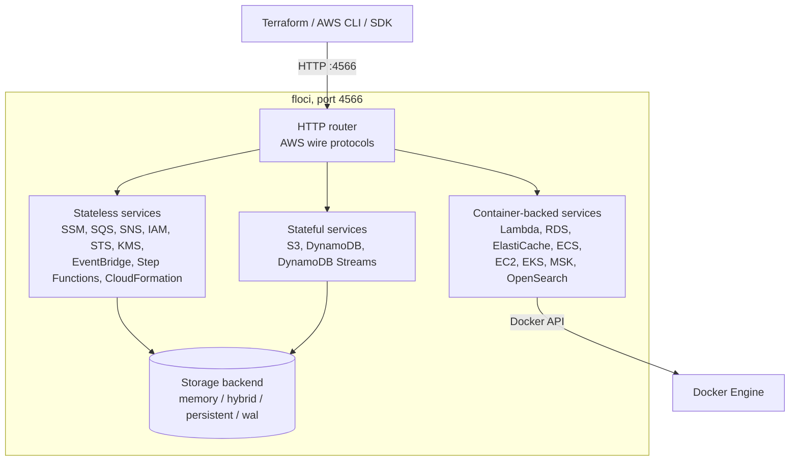

import Steps from '@site/src/components/Steps/Steps';
import Step from '@site/src/components/Steps/Step';

# Floci

Floci is an MIT-licensed local cloud emulator. You start one container, point your existing AWS CLI, SDK, Terraform or OpenTofu at `http://localhost:4566`, and the resources are created on your machine instead of in an account you have to pay for. No account, no auth token, no feature gates: any non-empty credentials work.

It began as an AWS emulator and is now a family, one cloud per port:

| Emulator | Cloud | Port | Repository |
| --- | --- | --- | --- |
| `floci` | AWS | 4566 | [floci-io/floci](https://github.com/floci-io/floci) |
| `floci-az` | Azure | 4577 | [floci-io/floci-az](https://github.com/floci-io/floci-az) |
| `floci-gcp` | GCP | 4588 | [floci-io/floci-gcp](https://github.com/floci-io/floci-gcp) |
| `floci-oci` | OCI | 4599 | [floci-io/floci-oci](https://github.com/floci-io/floci-oci) |

This article focuses on the AWS emulator, which is the one with the most Terraform coverage, and flags what the siblings do and do not cover.

## Why a local endpoint

- **`terraform plan` and `apply` in seconds.** No cloud round trip, no credentials, no waiting for a real bucket to be deleted.
- **Deterministic tests.** Every run starts from an empty account, and `memory` storage mode throws the state away when the container stops.
- **CI without secrets.** No AWS keys in the pipeline and nothing to clean up afterwards.
- **Agents can run it.** A coding agent can verify an infrastructure change end to end in a sandbox with no cloud account and no risk of touching production.

:::info
The project reports a startup time of about 24 ms, roughly 13 MiB idle memory and a 90 MB image, against a multi-second start and a 1 GB image for LocalStack Community. Those figures come from the project README, not from an independent benchmark.
:::

## Architecture

Everything arrives on one HTTP port speaking the real AWS wire protocols. State lives in a storage backend, and services that need a real engine (Lambda runtimes, RDS engines, Kafka, Kubernetes) are started as Docker containers.



## Run it

<Steps>
  <Step title="Start the container">
    Create a `docker-compose.yml`:

    ```yaml
    services:
      floci:
        image: floci/floci:latest
        ports:
          - "4566:4566"
        volumes:
          - ./data:/app/data
    ```

    ```bash
    docker compose up -d
    ```
  </Step>
  <Step title="Export the AWS environment">
    Point every AWS client at the emulator. Any non-empty credentials are accepted.

    ```bash
    export AWS_ENDPOINT_URL=http://localhost:4566
    export AWS_DEFAULT_REGION=us-east-1
    export AWS_ACCESS_KEY_ID=test
    export AWS_SECRET_ACCESS_KEY=test
    ```

    The official [Floci CLI](https://github.com/floci-io/floci-cli) does this for you with `floci start` and `eval $(floci env)`.
  </Step>
  <Step title="Verify it answers">
    ```bash
    curl -sf http://localhost:4566/_floci/health

    aws s3 mb s3://smoke-test
    aws s3 ls
    ```
  </Step>
</Steps>

Container-backed services (Lambda, RDS, ElastiCache, ECS, EC2, EKS, MSK, OpenSearch, CodeBuild and others) need the Docker socket:

```yaml
services:
  floci:
    image: floci/floci:latest
    ports:
      - "4566:4566"
    volumes:
      - /var/run/docker.sock:/var/run/docker.sock
      - ./data:/app/data
```

Image tags combine a variant and a channel: `latest` (standard), `latest-compat` (adds the AWS CLI and boto3 inside the container, needed if init scripts call `aws`), `latest-baseline` (ARM64 boards without LSE), plus pinned `x.y.z` and `nightly` tags. Pin a version in CI.

## Point Terraform at the local endpoint

Terraform talks to Floci through the normal `hashicorp/aws` provider. Three settings make that work: dummy credentials, the `skip_*` flags that stop the provider from calling real AWS metadata and STS endpoints, and one endpoint entry per service the configuration uses.

```hcl title="provider.tf"
terraform {
  required_providers {
    aws = {
      source  = "hashicorp/aws"
      version = "~> 6.0"
    }
  }
}

provider "aws" {
  region     = "us-east-1"
  access_key = "test"
  secret_key = "test"

  skip_credentials_validation = true
  skip_metadata_api_check     = true
  skip_requesting_account_id  = true
  s3_use_path_style           = true

  endpoints {
    dynamodb       = "http://localhost:4566"
    secretsmanager = "http://localhost:4566"
    s3             = "http://localhost:4566"
    sns            = "http://localhost:4566"
    sqs            = "http://localhost:4566"
    ssm            = "http://localhost:4566"
  }
}
```

The provider has no global endpoint switch in its `endpoints` block, so every service your configuration touches needs its own line. Missing one silently sends that resource to real AWS, which is the most common mistake with this setup.

```hcl title="main.tf"
resource "aws_s3_bucket" "app" {
  bucket = "floci-terraform-example"
}

resource "aws_sqs_queue" "jobs" {
  name = "floci-terraform-jobs"
}

resource "aws_dynamodb_table" "items" {
  name         = "floci-terraform-items"
  billing_mode = "PAY_PER_REQUEST"
  hash_key     = "id"

  attribute {
    name = "id"
    type = "S"
  }
}

resource "aws_ssm_parameter" "environment" {
  name  = "/floci/environment"
  type  = "String"
  value = "local"
}
```

```bash
terraform init
terraform validate
terraform plan
terraform apply

aws --endpoint-url http://localhost:4566 \
  s3api head-bucket --bucket floci-terraform-example

terraform destroy
```

### State, locking included

Floci also implements the S3 backend and DynamoDB locking, so the whole Terraform workflow stays local. Create the backend resources first, because `terraform init` needs them:

```bash
aws --endpoint-url http://localhost:4566 s3api create-bucket --bucket tfstate

aws --endpoint-url http://localhost:4566 dynamodb create-table \
  --table-name tflock \
  --attribute-definitions AttributeName=LockID,AttributeType=S \
  --key-schema AttributeName=LockID,KeyType=HASH \
  --billing-mode PAY_PER_REQUEST
```

```hcl title="backend.tf"
terraform {
  backend "s3" {
    bucket                      = "tfstate"
    key                         = "terraform.tfstate"
    region                      = "us-east-1"
    endpoint                    = "http://localhost:4566"
    dynamodb_endpoint           = "http://localhost:4566"
    dynamodb_table              = "tflock"
    access_key                  = "test"
    secret_key                  = "test"
    skip_credentials_validation = true
    skip_region_validation      = true
    use_path_style              = true
  }
}
```

:::tip
The provider also reads `AWS_ENDPOINT_URL` (all services at once) and `AWS_ENDPOINT_URL_<SERVICE>` (one service), the same variables the AWS CLI and SDKs use. Values set inside the `endpoints` block win over environment variables, so pick one approach per project. The `skip_*` flags still belong in the provider either way.
:::

## AWS CLI and SDKs

The environment variables above are enough for the CLI. For a dedicated profile:

```ini title="~/.aws/config"
[profile floci]
region = us-east-1
output = json
```

```ini title="~/.aws/credentials"
[floci]
aws_access_key_id = test
aws_secret_access_key = test
```

```bash
export AWS_PROFILE=floci
export AWS_ENDPOINT_URL=http://localhost:4566
aws s3 ls
```

From application code, override the endpoint on the client. With boto3:

```python
import boto3

def floci_client(service):
    return boto3.client(
        service,
        endpoint_url="http://localhost:4566",
        region_name="us-east-1",
        aws_access_key_id="test",
        aws_secret_access_key="test",
    )

s3 = floci_client("s3")
sqs = floci_client("sqs")
```

S3 is served in path-style mode, so SDKs that default to virtual-hosted buckets need path style forced. In Node.js that is `forcePathStyle: true`; in Terraform it is `s3_use_path_style`.

## What is emulated

The project publishes an exact operation count per service on its [services overview](https://floci.io/floci/services/). Three tiers matter in practice:

| Tier | Examples | What runs |
| --- | --- | --- |
| Stateless API | SSM, SQS, SNS, IAM, STS, KMS, Secrets Manager, EventBridge, Step Functions, CloudFormation, API Gateway, Cognito, Route53, CloudWatch | In-process, answers the real wire protocol |
| Stateful | S3, DynamoDB, DynamoDB Streams | In-process, persisted through the storage backend |
| Container-backed | Lambda, RDS, ElastiCache, ECS, EC2, EKS, MSK, OpenSearch, DocumentDB, Neptune, Amazon MQ, CodeBuild | Real Docker containers, real engines where it matters |

The container-backed tier is why Floci is more than a mock: an RDS PostgreSQL instance is a `postgres:16-alpine` container, an ElastiCache cluster is Valkey, MSK is Redpanda, EKS is k3s, and Lambda runs the real AWS runtime images.

For infrastructure code specifically, the repository's compatibility suite runs 67 Terraform tests (Terraform 1.10+), 41 OpenTofu tests (1.9+) and 20 AWS CDK tests, plus SDK suites in Java, Node, Python, Go and the AWS CLI. Those suites are the project's own; run your own `plan` and `apply` before trusting a new resource type.

## Persistence and accounts

State is in memory by default. Pick a storage mode with `FLOCI_STORAGE_MODE`:

| Mode | Behavior | Use it for |
| --- | --- | --- |
| `memory` | RAM only, lost when the container stops | CI, ephemeral tests |
| `persistent` | Flushed to disk on every write | Simple local state |
| `hybrid` | In memory, flushed asynchronously every 5 seconds | Everyday development |
| `wal` | Write-ahead log before every response | Maximum durability |

Data goes to `/app/data` in the container, which the compose examples bind mount to `./data`.

Resources are created under account `000000000000` by default. Change it with `FLOCI_DEFAULT_ACCOUNT_ID`, or get real isolation for free: when `AWS_ACCESS_KEY_ID` is exactly 12 digits, Floci uses it as the account ID, and resources from one account are invisible to another.

```bash
AWS_ACCESS_KEY_ID=111111111111 aws sqs create-queue --queue-name orders
AWS_ACCESS_KEY_ID=222222222222 aws sqs create-queue --queue-name orders
```

## Drop-in LocalStack replacement

Floci impersonates LocalStack Community closely: same port, same `test`/`test` credentials, same SDK configuration. The migration is mostly an image swap.

```yaml
services:
  floci:
    image: floci/floci:latest   # or latest-compat if init scripts call aws or boto3
    ports:
      - "4566:4566"
    volumes:
      - /var/run/docker.sock:/var/run/docker.sock
      - ./data:/app/data        # LocalStack used /var/lib/localstack
      - ./init/ready.d:/etc/localstack/init/ready.d:ro
```

Common LocalStack variables are translated automatically, and explicit Floci variables win:

| LocalStack | Floci |
| --- | --- |
| `LOCALSTACK_HOST` | `FLOCI_HOSTNAME` |
| `PERSISTENCE=1` | `FLOCI_STORAGE_MODE=persistent` |
| `LAMBDA_DOCKER_NETWORK` | `FLOCI_SERVICES_LAMBDA_DOCKER_NETWORK` |
| `DEBUG=1` | `QUARKUS_LOG_LEVEL=DEBUG` |

The `/_localstack/init` and `/_localstack/health` endpoints are still served, the log still ends with a `Ready.` line, and init scripts under `/etc/localstack/init/` run unchanged. Known differences: Lambda always runs in Docker containers (`LAMBDA_REMOTE_DOCKER` is not supported), all services start automatically instead of a `SERVICES` selection, and the data directory moved.

## Where it stops

Be honest with yourself about the limits before moving a pipeline onto it:

- **Per-service fidelity varies.** Operation counts range from a handful (Bedrock Runtime has 2, QuickSight is metadata only) to hundreds (S3 58, DynamoDB 28, EC2 224, IAM 180). A resource type can exist while a specific argument or API call does not.
- **EC2 is not virtualized.** Instances are Linux containers built from AMI-mapped images, with SSH key injection, user data and IMDS. Networking, placement and hypervisor behaviour are not what production does.
- **Container-backed services need the Docker socket.** Without it they keep their control plane but start no containers, or fail the request that needs one.
- **Auth is permissive by default.** Any non-empty key is accepted. S3 can enforce signed access with `FLOCI_SERVICES_S3_ENFORCE_AUTH`, but do not treat local IAM behaviour as a security test.
- **It is a single node.** No high availability, no multi-region behaviour, no production storage semantics.
- **One port per emulator.** AWS, Azure, GCP and OCI run as separate containers on separate ports, so a multi-cloud plan needs all four and a per-cloud provider configuration.

Run it in CI with `memory` storage, a pinned image tag and a health check on `/_floci/health`. Use `hybrid` or `persistent` on a laptop when you want the state to survive a restart.

## CI and agents

For test suites, Testcontainers modules start an isolated emulator per run and avoid shared state and port clashes: `io.floci:testcontainers-floci` (Java), `@floci/testcontainers` (Node.js), `testcontainers-floci` (Python) and `Testcontainers.Floci` (.NET). The Go module is in progress.

For setups that seed data, init hooks run in four phases (`boot`, `start`, `ready`, `stop`) from `/etc/floci/init/` (or the LocalStack path), with `.sh` and `.py` scripts. The compat image preconfigures the AWS CLI for `localhost:4566`, so a hook is usually one line:

```bash
#!/bin/sh
aws sqs create-queue --queue-name orders
aws s3 mb s3://assets
```

A browser console at `http://localhost:4566/_floci/ui` lists the resources, useful when an agent or a test leaves something behind. It starts a sidecar container on first request, so it needs the Docker socket.

## References

- [Floci documentation](https://floci.io/floci/)
- [GitHub repository](https://github.com/floci-io/floci)
- [Services overview and operation counts](https://floci.io/floci/services/)
- [Terraform setup](https://floci.io/floci/getting-started/terraform/)
- [Migrating from LocalStack](https://floci.io/floci/getting-started/migrate-from-localstack/)
- [Terraform provider: custom service endpoints](https://registry.terraform.io/providers/hashicorp/aws/latest/docs/guides/custom-service-endpoints)
- [Video: Floci, real AWS services running on my laptop for free](https://youtu.be/BhzwtJgxYMo)
- [Terraform](terraform.md)
