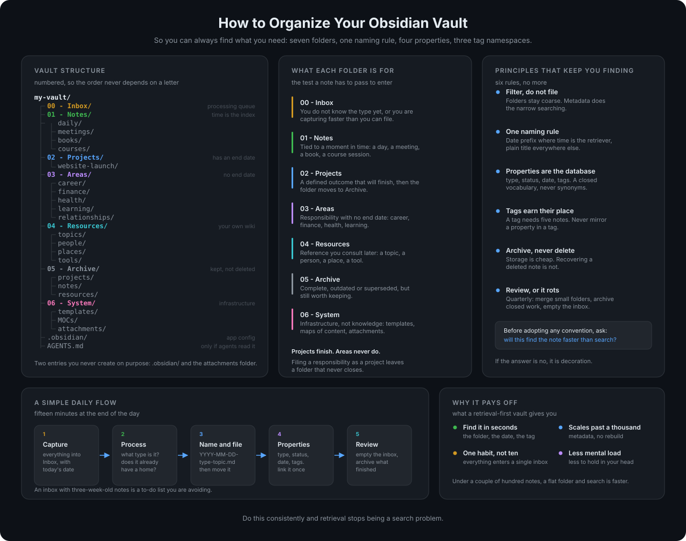

# How to Organize Your Obsidian Vault So You Can Always Find What You Need

Six months after you start using Obsidian, the vault usually stops being an advantage. You have hundreds of notes, you know the answer is in there, and the search returns forty results. The folder tree you designed in week one no longer fits the notes you write now. The tags you applied inconsistently are worse than no tags, because you cannot trust them.

The problem is rarely the app. It is that most vaults are organized like a filing cabinet, where each note is stored by what it was when you wrote it. Retrieval does not work that way. When you come looking, you rarely remember the folder. You remember the kind of note it was, roughly when you touched it, what it was about, and whether it is still relevant.

This article builds a vault around those four retrieval dimensions: a seven-folder structure, a file naming convention, structured properties, namespaced tags, maps of content, an inbox loop and a maintenance review. It is the human side of the vault. If agents also read or write it, the companion articles [Obsidian as a Backend, Not a Second Brain](../Develop-Code/AI-Development/Skills/obsidian-as-a-backend.md) and [Obsidian Skills & LLM Wiki Setup](../Develop-Code/AI-Development/Skills/obsidian-skills-setup.md) cover the machine side.



The rest of this article is the reasoning behind each panel of that diagram.

## 🧠 Organize for Retrieval, not for Storage

Two goals produce two different architectures:

| Goal | Design pressure | Result |
|---|---|---|
| Storage | Where does this note belong today? | Many narrow folders, each obvious at the moment of capture |
| Retrieval | What will I know about this note when I need it again? | Few broad folders plus filterable metadata |

A folder called `Ideas` makes sense on the day you create it. A year later you are looking for a business idea and cannot remember whether you filed it under Ideas, Projects, Business, or the daily note where the thought appeared. The folder name described the note at capture time; it tells you nothing at retrieval time.

So before creating any structure, list what you reliably know about a note you cannot find. Four things survive:

| You remember | Cheapest reliable mechanism |
|---|---|
| The type of content (daily note, meeting, book, project, reference) | Top-level folder and a `type` property |
| Roughly when it happened | Date prefix in the file name, or a `date` property |
| The topic, person, project or tool it concerns | Tags and `[[wikilinks]]` |
| Its status (active, waiting, complete, archived) | A `status` property |

Every structure decision below exists to make one of those four columns filterable in seconds. If a new folder, tag or field does not serve retrieval, skip it.

:::info The test for any new convention
Ask one question before you adopt it: when I need this note again, will this help me find it faster than a full text search? If the answer is no, it is decoration.
:::

## 🗂️ The Folder Structure

Folders are the coarsest layer, so they should map to content types, not to subjects. Five to eight top-level folders is the working range. One folder per topic looks tidy at ten folders and becomes a second search problem at forty.

```text
my-vault/
├── 00 - Inbox/                    processing queue, nothing lives here permanently
├── 01 - Notes/                    time-stamped captures
│   ├── daily/
│   ├── meetings/
│   ├── books/
│   └── courses/
├── 02 - Projects/                 one folder per project with an end date
│   └── website-launch/
│       ├── brief.md
│       ├── tasks.md
│       └── decisions.md
├── 03 - Areas/                    ongoing responsibilities, no end date
│   ├── career/
│   ├── finance/
│   ├── health/
│   ├── learning/
│   └── relationships/
├── 04 - Resources/                reference material, your personal wiki
│   ├── topics/
│   ├── people/
│   ├── places/
│   └── tools/
├── 05 - Archive/                  inactive notes, kept not deleted
│   ├── projects/
│   ├── notes/
│   └── resources/
├── 06 - System/                   infrastructure, not content
│   ├── templates/
│   ├── MOCs/
│   └── attachments/
├── .obsidian/                     app config: plugins, themes, workspace state
└── AGENTS.md                      optional, only if agents read this vault
```

Two entries are easy to forget because you never create them on purpose. `.obsidian/` appears the first time Obsidian opens the folder and holds plugin settings, the active theme and `workspace.json`. Include it in your backups, and exclude it from any file-sync tool that cannot merge JSON safely, because a half-merged `workspace.json` costs you your layout rather than one note. The attachments folder is wherever you point **Settings → Files and links → Attachment folder path**; put it under `06 - System/` so pasted images and PDFs never pollute your note folders.

The numeric prefixes are not cosmetic. They pin the order of the top-level folders in the file explorer and in any alphabetical file list, so the vault reads the same way every time instead of sorting by whatever letter a folder happens to start with.

## 📄 What Belongs in Each Folder

Folders only help if the boundary between them is testable. These are the tests:

| Folder | Accepts a note when | You find things here by |
|---|---|---|
| `00 - Inbox` | You do not yet know the type, or you are capturing faster than you can file | Opening it and processing it; it should stay near empty |
| `01 - Notes` | The note is tied to a moment in time: a day, a meeting, a book you finished, a course session | Remembering roughly when it happened |
| `02 - Projects` | The work has a defined outcome and will finish; when it does, the folder moves to Archive | The project name |
| `03 - Areas` | You are responsible for it indefinitely and it never completes: health, finances, career, learning | The area you are responsible for |
| `04 - Resources` | It is reference material you consult later: a topic summary, a person, a place, a tool | The subject it is about |
| `05 - Archive` | It is complete, outdated or superseded, but still worth keeping | A deliberate look back |
| `06 - System` | It makes the vault work rather than holding knowledge: templates, maps of content, attachments | Rarely; it is infrastructure |

The distinction that trips people up is **Projects versus Areas**. `Ship the new pricing page` is a project: it has an end date and a definition of done. `Pricing strategy` is an area: you keep thinking about it. Filing an ongoing responsibility as a project leaves a stale folder that never closes. Filing a project as an area leaves an active folder that nobody archives.

Archive instead of deleting. Storage is cheap and the cost of recovering a deleted note is not. Archive at the coarse level: completed project folders, superseded references, daily notes older than a year.

## 🕒 File Naming That Survives Search

Folder structure handles the top level. The file name handles everything below it, and it is the text every search box matches first.

The default pattern for time-stamped captures:

```text
YYYY-MM-DD-[type]-[topic].md
```

```text
2026-05-20-daily-wednesday.md
2026-05-18-project-website-launch.md
2026-05-15-meeting-client-quarterly-review.md
2026-05-10-book-thinking-fast-and-slow.md
2026-04-28-resource-claude-prompting-techniques.md
2026-04-20-area-finance-q2-review.md
```

The date prefix does three jobs: it sorts chronologically with no extra column, it lets you find a note when you only remember the week, and it prevents collisions between two notes on the same subject written months apart.

Use it only where time is the retriever. For evergreen notes, a stable descriptive title is better, because the file name is the address: it appears in `[[wikilinks]]`, in Dataview results, in shell scripts and in any agent instructions that reference a path. A date prefix you later want to correct means touching every link and script that points at the file. The rule of thumb:

- **Time-stamped capture** (daily, meeting, book, course): date prefix, so the timeline is the index.
- **Evergreen note** (concept, resource, area, MOC): plain descriptive title, so the link target stays stable.
- **Project folder**: the project name, with the documents inside named for their role (`brief.md`, `decisions.md`).

Whatever you pick, apply it to every new note from day one. A convention applied to 80 percent of the vault is a search filter with a silent 20 percent failure rate.

## 🧾 Properties: The Filter Layer

The vault uses YAML properties as the columns of a small database. Four fields are enough for every note:

```yaml
---
type: project        # daily | meeting | book | course | project | area | resource | idea | task
status: active       # active | waiting | complete | reference | archived
date: 2026-05-18
tags: [pricing, launch]
---
```

Then add the fields that only make sense for one type:

```yaml
---
# project
deadline: 2026-06-15
priority: high
next_action: Write the project brief
completion: 35

# book
author: Daniel Kahneman
finished: 2026-05-10
rating: 4
key_insight: System 1 answers fast and is usually confident, not usually right.

# meeting
attendees: [Ana, Miguel]
decisions: [Ship the pricing page behind a flag]
actions: [Miguel drafts the copy by Friday]

# resource
topic: query optimization
source: https://example.com/postgres-plans
reliability: high
---
```

Two rules keep this usable. First, the vocabulary is closed: `status` is always one of the five values above, never `done` in one note and `finished` in another. Second, `status` is the property that earns its keep. It answers the retrieval question no folder can: `type` says what the note is, `status` says whether it still matters.

Because the fields are structured, they can be queried. A project dashboard is a single query over `02 - Projects`; a reading list is `type: book` sorted by `rating`. None of it needs a plugin until you actually want the table.

## 🔖 Tags With Three Namespaces

Tags are where most vaults die, for one of two opposite reasons: no system, or a thousand near-duplicates. A workable middle ground is three namespaces with a fixed prefix per namespace.

| Namespace | Purpose | Examples |
|---|---|---|
| `#topic` (no prefix) | What the note is about | `#productivity`, `#observability`, `#postgres` |
| `#status/...` | Where the note is in a workflow, when you prefer a tag to the property | `#status/active`, `#status/waiting` |
| `#project/...` | Ties any note, of any type, to one project | `#project/website-launch`, `#project/acme-migration` |

The prefixes are what make a tag search readable: `#status/active` clearly selects a workflow state, `#project/acme-migration` clearly selects a project, and a bare tag is always a topic.

Two guardrails:

- **Create a tag only if it will appear on at least five notes.** A tag on one or two notes is not a pattern, it is noise in the autocomplete list.
- **Do not mirror a property in a tag.** If `status` is already a property, do not also maintain `#status/active` on the same note; two sources of truth drift, and the day they disagree you will trust the wrong one. Pick one per vault.

## 🧭 Maps of Content: Navigation Above the Folders

Folders and search both assume you know what you are looking for. Sometimes you do not: you want to see the shape of a topic you have been thinking about for a year. That is the job of a **Map of Content** (MOC): a note whose content is links, not prose.

```markdown
# Observability MOC

## Foundations
[[Three pillars of observability]]
[[Why sampling breaks your dashboards]]

## Tooling
[[OpenTelemetry collector pipeline]]
[[Prometheus cardinality limits]]

## Project applications
[[project/acme-migration]] - what we changed and what it cost

## Open questions
Which metric actually predicts an incident?
```

A MOC is not a folder: nothing moves into it, notes stay where they are and the MOC points at them. Create one when a topic passes roughly twenty notes and backlink browsing stops being enough. MOCs live in `06 - System/MOCs/` so they never compete with content folders for attention, and they double as a ready-made index when an agent needs to load one topic instead of the whole vault.

## 📥 The Inbox Loop

Any structure collapses at the capture step, so the vault needs one place that is allowed to be messy. `00 - Inbox` is that place, and its only property is that nothing stays there.

Process it on a fixed schedule, fifteen minutes at the end of the workday is enough for most people. For each note, answer three questions:

1. **What type is it?** That decides the top-level folder.
2. **Does it already have a home?** If a project or topic note exists, link it or file it next to it.
3. **Does it need its own file?** A single thought that extends an existing note belongs inside that note. Splitting it creates an orphan.

Then apply the name, fill the four properties, and move it. A processed inbox is empty; an inbox with three-week-old notes is a to-do list you are avoiding.

## 🔍 Five Search Moves That Cover Almost Everything

Even a well-organized vault has notes you cannot place. Obsidian's search has five moves worth knowing, and they combine with spaces, which means AND:

| You remember | Search |
|---|---|
| A distinctive phrase | `"exact words you wrote"` |
| The type and the state | `[type:project] [status:active]` |
| The project or topic | `tag:#project/website-launch` |
| Roughly where it lives | `path:"02 - Projects"` |
| Roughly when you wrote it | Sort the results by modified or created date |

A typical rescue looks like this: you recall a decision about pricing made during a client meeting last quarter. `[type:meeting] path:"01 - Notes"` narrows to meetings, `tag:#project/website-launch` narrows to that project, and the timeline finishes the job.

Search is the fallback, not the strategy. If you need it for the same kind of note every week, that note type is missing a folder, a property or a MOC.

## 🧹 The Quarterly Review

Structure degrades quietly. Tags accumulate that no longer match how you think, folders that made sense in January do not match the projects you run in October, and closed projects sit in `02 - Projects` pretending to be active. One review per quarter, thirty minutes to two hours, keeps the system honest:

- **Folder audit:** does every folder still hold a category you use? Merge any folder with fewer than five notes.
- **Tag audit:** remove tags used once or twice; promote any topic that passed twenty notes into a MOC.
- **Archive sweep:** move completed projects and superseded references to `05 - Archive`. Empty `00 - Inbox`.
- **Naming check:** batch-rename the outliers. Obsidian rewrites `[[wikilinks]]` on rename, so this is fast and safe inside the app. Fix scripts and agent instructions by hand.

## 🤖 When an Agent Reads the Vault Too

This layout optimizes for a human doing the retrieving. The moment an agent also writes into the vault, add one constraint: an `AGENTS.md` (or `CLAUDE.md`) at the root of every folder an agent may enter, stating what lives there, what it may write, and how to run the work that belongs to the folder. Without it, the agent loads the whole tree, and more context does not mean better answers.

The two companion articles split the work:

- [Obsidian as a Backend, Not a Second Brain](../Develop-Code/AI-Development/Skills/obsidian-as-a-backend.md) - the human side versus machine side split, agent files per folder, collector scripts that fill properties, and `findings.md` files that accumulate across runs.
- [Obsidian Skills & LLM Wiki Setup](../Develop-Code/AI-Development/Skills/obsidian-skills-setup.md) - the `raw/` to `wiki/` knowledge layer, hooks and the ingest, query and lint loop.
- [Karpathy's LLM Wiki](../Develop-Code/AI-Development/Tools/karpathy-llm-wiki.md) - the original pattern and its trade-offs.

The rule that keeps both worlds compatible: properties and file names are the interface. If the fields in this article stay consistent, an agent can query the vault the same way Dataview does, and you can keep organizing by hand.

## ✅ When to Use This System

- **Search has become useless.** You get dozens of results and open three wrong notes before the right one.
- **You run several projects at once.** The project and area split is what stops active work from mixing with ongoing responsibility.
- **You already write daily or meeting notes.** The date prefix costs nothing when the note is already time-stamped.
- **You plan to query the vault.** Properties are worth the discipline as soon as you want a dashboard, a reading list or an agent.
- **You are past a few hundred notes.** Below that, the structure is overhead; above it, it pays back weekly.

## 🚫 When Not to Use It

- **Your vault is small and stays small.** Under a couple of hundred notes, a flat folder plus search is genuinely faster than filing.
- **You work in a Zettelkasten or link-first style.** There, atomic notes with stable IDs and dense `[[wikilinks]]` are the index; a type-based folder tree fights the graph you are building.
- **Your vault is agent-owned.** If agents write most of it, use the human and machine split from [Obsidian as a Backend](../Develop-Code/AI-Development/Skills/obsidian-as-a-backend.md) instead; the folder taxonomy here assumes a human decides where things go.
- **The vault is shared with a team.** Numbered folders and personal status values collide with an existing org convention, and renaming files churns everyone's links at once. Agree on the convention before applying it, or keep a personal vault for the personal layer.
- **You imported an archive with unknown dates.** Forcing a `YYYY-MM-DD` prefix on notes whose date you are guessing produces confident-looking filenames that are wrong. Use the import date, or leave those notes unrenamed in Archive.
- **Your capture volume is low.** If you write two notes a week, the inbox loop and the quarterly review are process for its own sake.

The system is a tool for retrieval, not a measure of seriousness. A vault of 150 notes with good titles and no folders can be perfectly healthy.

## 🚀 Migrating an Existing Vault

Do not rebuild from scratch. Convert in stages while you keep working.

<Steps>
  <Step title="Create the skeleton">
    Create the seven folders and check that they appear in the order you expect. Do not move a single existing note yet.
  </Step>
  <Step title="File only new notes">
    From now on, every new note goes through Inbox, gets the naming convention and the four properties. Old notes stay where they are.
  </Step>
  <Step title="Process the backlog">
    Dedicate a few sessions to Inbox and the old top-level clutter. Name, property and file. When a note has no obvious home, Archive is a valid answer.
  </Step>
  <Step title="Backfill tags on important notes">
    Tag the notes you actually revisit. Leave the long tail; a tag that only exists to be complete is exactly the noise the rule of five warns about.
  </Step>
  <Step title="Add the first MOC">
    Pick the topic you write about most and build one map of content. This is the point where the vault starts feeling navigable rather than merely stored.
  </Step>
  <Step title="Schedule the review">
    Put the quarterly review on the calendar. Structure without maintenance is a snapshot, not a system.
  </Step>
</Steps>

## References

- [How to Organize Your Obsidian Vault So You Can Always Find What You Need (CyrilXBT, X)](https://x.com/cyrilxbt/status/2058373087330959829)
- [Obsidian Help: Files and folders](https://help.obsidian.md/files-and-folders)
- [Obsidian Help: Properties](https://help.obsidian.md/properties)
- [Obsidian Help: Tags](https://help.obsidian.md/tags)
- [Obsidian Help: Search](https://help.obsidian.md/plugins/search)
- [Obsidian as a Backend, Not a Second Brain](../Develop-Code/AI-Development/Skills/obsidian-as-a-backend.md)
- [Obsidian Skills & LLM Wiki Setup](../Develop-Code/AI-Development/Skills/obsidian-skills-setup.md)
