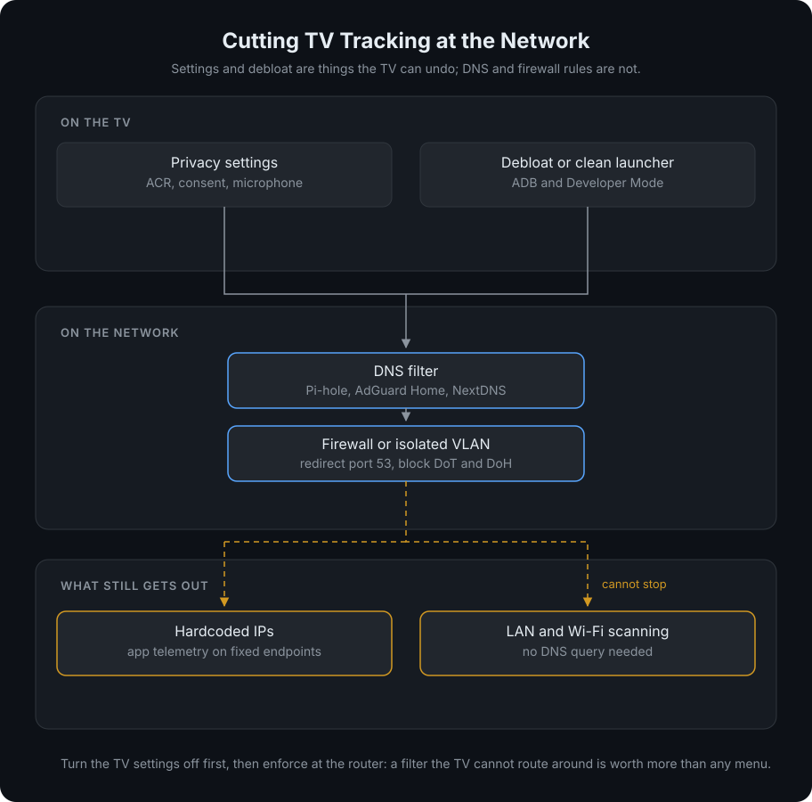
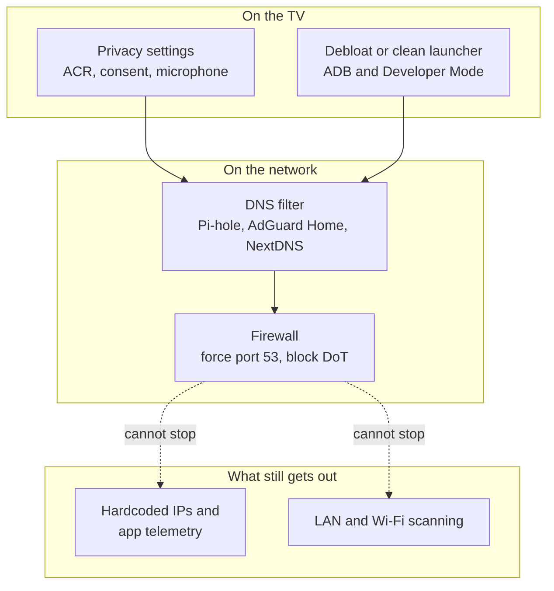

# Clean Your TV from Ads and Tracking

A smart TV is a computer that watches what you watch. In September 2026 an independent investigation of retail LG OLEDs showed the sets scanning the local network for nearby phones and watches, logging nearby Wi-Fi networks and location, and using Automatic Content Recognition (ACR) on audio and video to identify content, including what comes in over HDMI. Microphone audio was captured in standby and kept on the TV until a connection came back, then uploaded.

Most of this is legal and buried in the setup screens you accepted with one click. It is also not unique to LG: every major TV brand runs some form of ACR and ad telemetry. The good news is that you can cut most of it with three layers, and each one is independent of the others.

## What the TV actually collects

- **ACR (Automatic Content Recognition)**: fingerprints the audio and video on screen to identify the title, then reports it. On LG this is the **Live Plus** feature, backed by the **Viewing Information** agreement. It works on apps, live TV and HDMI inputs.
- **Microphone capture**: voice features and always-listening standby modes record audio. Some sets store clips locally when offline.
- **Network and device scanning**: the TV enumerates nearby Wi-Fi networks and devices on your LAN. LG calls it a standard feature and documents no switch for it.
- **Telemetry and ads**: log uploads, home-screen promotions, interest-based and cross-device advertising, plus a resettable advertising ID.
- **App-level tracking**: Netflix, YouTube and friends collect their own viewing data regardless of the TV settings.

:::info
The settings on the TV only cover what the TV maker controls. The DNS and debloat layers below cover the rest, which is why doing only one of them is the most common mistake.
:::

## Quick pass on the TV

Menus move between webOS versions, so treat the labels as the target and the paths as a hint. The references at the end have per-version walkthroughs.

<Steps>
  <Step title="Turn off ACR">
    LG: **Settings > All Settings > General > System > Additional Settings > Live Plus > Off**. On models from 2020 and earlier the System step does not exist. Live Promotion, next to it, only hides ads inside Live Plus and does not stop the recognition.
  </Step>
  <Step title="Withdraw the consent, not just the feature">
    **Support > Privacy & Terms > User Agreements** and turn off **Viewing Information**, **Voice Information** and **Interest-Based & Cross-Device Advertising**. Keep only the base Terms of Use. Switching Live Plus off while leaving the agreement in place still authorizes collection.
  </Step>
  <Step title="Limit ad tracking">
    **Support > Privacy & Terms > Advertising**: turn **Limit AD Tracking** on and reset the advertising ID. On is the private choice here. Do the same for Home Promotion and Content Recommendation.
  </Step>
  <Step title="Disable always-listening standby">
    Turn off **Always Ready** and voice recognition under **General > AI Service** if you do not use them with the remote.
  </Step>
  <Step title="Delete what is already stored">
    **Support > Privacy & Terms > Delete My Personal Information**: delete viewing information and voice information. Also skip signing in with an LG account, and avoid joining the TV to your main network as a trusted device.
  </Step>
</Steps>

:::warning
LG owners report that firmware updates sometimes switch Live Plus back on. Re-check the three passes after a major update.
:::

## Cut it at the network

DNS filtering is the layer that survives reboots, factory resets and a TV that ignores its own settings. It also catches the ad and telemetry traffic of apps that never honor the TV's privacy menus.

{/* Mermaid source behind the diagram above. Kept as text so it can be edited and re-rendered; it renders through static/img/tv-tracking-layers.svg, not from this block.

*/}

The setup that holds up in practice:

1. **Filter DNS for the TV only.** Pi-hole, AdGuard Home or NextDNS all work. Put the TV in its own client group and subscribe a TV-specific blocklist, so a blocked domain never breaks a laptop or phone. Community lists exist for LG, Samsung, Roku, Fire TV, Sony and others, with safe and strict tiers.
2. **Force the TV to use your resolver.** webOS and other firmwares are observed querying `8.8.8.8` and `1.1.1.1` directly. Redirect outbound port 53 to your resolver and block port 853 and known DoH endpoints at the firewall, otherwise the TV simply bypasses your filter.
3. **Expect a few breakages and allowlist them.** App stores, firmware updates, thumbnails, clock sync and voice search depend on specific hosts. Start with the safe tier, then allowlist one name at a time from the query log. A missing clock is the classic symptom of blocking the time service.
4. **Block what DNS cannot see at the firewall.** Vendors ship hardcoded fallback addresses, including an LG firmware-update endpoint, and some telemetry uses fixed IPs. Only a firewall rule stops those.

:::tip
If you want the strongest cheap option, put the TV on a guest network or an isolated VLAN with no route to your other devices. It keeps streaming working while containing the LAN scanning that no DNS list can stop.
:::

## Replace the home screen and debloat

If the TV runs Android TV or Google TV, ADB over Wi-Fi lets you disable the stock launcher, the ad rows, the telemetry services and the preloaded apps without rooting and without uninstalling anything. Two projects do the heavy lifting.

### CleanYourTV

A debloat toolkit plus a lightweight launcher, built around ADB and `pm disable-user`. It writes a record before changing anything, so a one-line restore script brings the TV back. A coding assistant, or the included scripts, discover the bloat for your exact model, and a privacy audit reports the voice, ACR and telemetry candidates it finds.

- **Platforms**: Android TV and Google TV. Fire TV gets the debloat half only.
- **Not supported**: LG webOS, Samsung Tizen, Roku, Vizio and Hisense VIDAA, because they expose no ADB. The project publishes remote-only tracking instructions for those instead.
- **Honest limit**: an audit can show which packages hold microphone or ACR permissions, but it cannot prove intent. Read its privacy document before trusting a clean bill of health.

### Free My TV

An ad-free home screen that replaces the stock launcher with your own apps, trending picks and a screensaver. On Android TV and Google TV it also disables the stock home screen, the promo apps and, on some brands, the ACR service. On LG and Samsung it installs as a normal app through the vendor's Developer Mode, so the vendor home screen stays.

- **Platforms**: Google TV, Android TV, LG webOS 3 and newer, Samsung Tizen 2015 and newer.
- **Undo**: one button returns the factory home screen, and nothing is uninstalled. A watchdog restores the stock launcher if the new one crashes.
- **Honest limit**: on LG and Samsung it is an extra launcher, not a debloat. On LG, Developer Mode needs renewing roughly every 40 days. It changes the home screen, not the data the TV sends from its own services.

<CardGroup cols={1}>
  <Card title="CleanYourTV" icon="mdi:broom" href="https://github.com/Gathin23/cleanyourtv">
    Debloat any Android or Google TV over Wi-Fi and install a clean launcher. No root, nothing uninstalled, restore script included.
  </Card>
  <Card title="Free My TV" icon="mdi:television" href="https://github.com/simbasjungles/free-my-tv">
    Ad-free home screen for Google TV, Android TV, LG webOS and Samsung Tizen, with a one-button undo.
  </Card>
</CardGroup>

## Comparison

| Approach | Works on | Effort | Stops | Misses |
| :--- | :--- | :--- | :--- | :--- |
| Built-in privacy settings | Every brand | 5 to 10 minutes | ACR, consent, ad tracking, standby mic | Telemetry outside the agreements, network scanning |
| TV offline or on an isolated guest network | Every brand | 10 minutes | Everything the TV sends, including LAN scanning | Streaming apps, updates, casting |
| DNS filter with a TV blocklist | Every brand | 30 to 60 minutes once | Ad, ACR and telemetry domains across all apps | Hardcoded IPs, DoT and DoH, LAN scanning |
| ADB debloat (CleanYourTV) | Android TV, Google TV, Fire TV partial | 15 to 30 minutes with an assistant | Stock launcher, promo rows, telemetry packages | LG, Samsung, Roku, Vizio, VIDAA; app-level tracking |
| Ad-free launcher (Free My TV) | Android TV, Google TV, LG, Samsung | 10 to 40 minutes | Ads and promos on the home screen | On LG and Samsung, the TV's own services |
| HDMI streamer on a dumb panel | Any TV | Cost of the streamer | The panel never needs a network connection | The streamer collects its own data |

**When to use what:** start with the TV settings, because they are free and reversible. Add a DNS filter with a TV-only group if you already run Pi-hole or AdGuard Home, or use NextDNS if you do not. Reach for CleanYourTV or Free My TV when the ads on the home screen bother you more than the telemetry, and only if your TV is on the supported list. If you want the TV to stop scanning your home network, put it on an isolated network or do not connect it at all.

## What none of this fixes

- **LAN scanning**: a TV can enumerate your network without any DNS query. Only network isolation helps.
- **Hardcoded endpoints**: DNS cannot block an IP address. Use firewall rules.
- **The apps themselves**: Netflix and YouTube identify what you watch on their own servers.
- **The microphone hardware**: disabling the feature is a software promise. A TV with no microphone, or one that is never on the network, is the only hard guarantee.
- **Firmware updates**: blocking them improves privacy and costs you security patches. Decide deliberately instead of blocking the update hosts by accident.

## References

- [Gamers Nexus investigation (video)](https://www.youtube.com/watch?v=6IFVTcM28KA)
- [The Verge: LG TVs caught spying even when offline or on standby](https://www.theverge.com/tech/991190/lg-tv-spying-standby-recording-wi-fi-scanning-gamers-nexus)
- [CleanYourTV on GitHub](https://github.com/Gathin23/cleanyourtv)
- [Free My TV on GitHub](https://github.com/simbasjungles/free-my-tv)
- [LG webOS DNS blocklist, safe and strict tiers](https://github.com/furkan-bayrak/lg-tv-blocklist)
- [Turn off ACR on an LG TV](https://velmo.one/guides/turn-off-acr-lg-tv/)
- [Community discussion on the LG findings](https://x.com/SimbasJungles/status/2112231637840765012)
- [Related: Privacy Guides](privacy-guide.md)
- [Related: Sniffnet](sniffnet.md)
